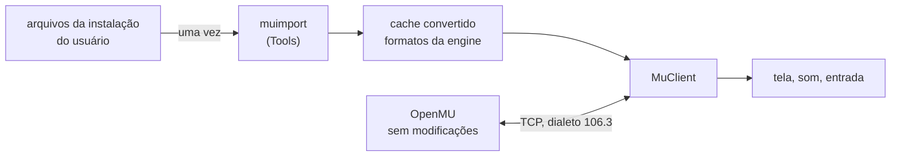
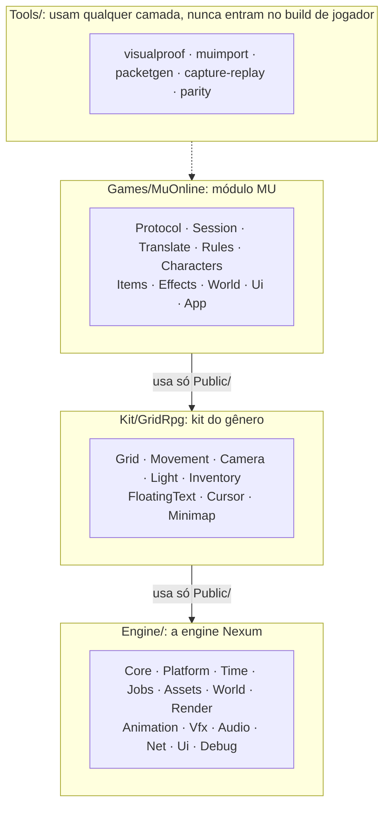
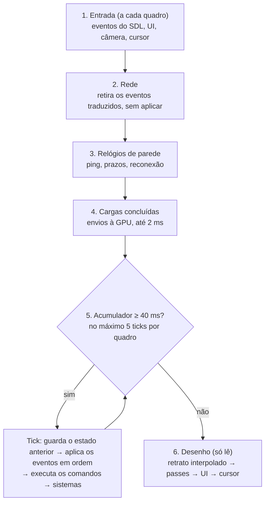

# Arquitetura

> Documento vivo: descreve como o Nexum é **agora** e para onde vai. É atualizado no mesmo PR do código que muda o que ele descreve. A fonte é a Parte III da [especificação de referência](referencia/especificacao-engine-propria-caminho-b.md#parte-iii--arquitetura).

**Como é agora (fatia 0, Fundação):** a engine tem a base (`nexum_core`), o tempo e o laço de ticks (`nexum_time`), o log e o profiler (`nexum_debug`), a plataforma com a janela (`nexum_platform`) e a placa de vídeo pelo SDL GPU (`nexum_render`). O kit (`nexum_gridrpg`) ainda é mínimo. O `MuClient` abre uma janela e desenha o cartão de teste num laço de ticks, e o build de desenvolvimento tem a prova visual (`--capture` e `visualproof`). Cada módulo que já existe tem a sua página em [docs/modules](modules/README.md). Todo o resto desta página é o destino.

## Visão geral

O jogador importa uma vez os arquivos que já tem, e o `MuClient` passa a ler só o cache convertido. O servidor é o OpenMU, sem nenhuma mudança.

## Camadas

O diagrama omite a seta direta do módulo MU para a engine, que também é permitida.

| Camada | Pasta | Sabe | Não sabe |
|---|---|---|---|
| **Engine (Nexum)** | `Engine/` | janela, GPU, recursos, entidades, animação, VFX, áudio, bytes de rede, host de UI, diagnóstico | grade, inventário, MU |
| **Kit do gênero** | `Kit/GridRpg/` | RPG de ação em grade: grade com camadas de atributos, coordenada dupla, A*, passos com predição e correção, câmera aérea, grade de luz, inventário em grade, texto flutuante, cursor contextual, minimapa | o que cada flag ou cursor **significa** no MU |
| **Módulo MU** | `Games/MuOnline/` | tudo do MU e do OpenMU | — |
| **Ferramentas** | `Tools/` | o que precisarem das três camadas, inclusive os formatos originais | — |

**Como o kit fica neutro:** os significados são **injetados**. O módulo MU registra, por exemplo, "o bit 0x04 bloqueia o andar" ou "este inventário tem 8×8 células". O kit executa essas regras sem saber de onde elas vêm ([ADR 0002](adr/0002-tres-camadas.md)).

### Regras de dependência

| De → Para | Engine | Kit | Games | Tools |
|---|---|---|---|---|
| **Engine** | sim | **não** | **não** | **não** |
| **Kit** | sim | sim | **não** | **não** |
| **Games** | sim | sim | sim | **não** |
| **Tools** | sim | sim | sim | sim |

São vigiadas de três formas:

1. cada módulo é um alvo do CMake, que só expõe a pasta `Public/`;
2. a checagem `architecture` recusa `#include` e ligações de alvo que cruzem a fronteira;
3. a checagem `terms` recusa nomes do MU dentro de `Engine/` e `Kit/`. É a regra da "linha vermelha".

## Estrutura do repositório

Cada módulo segue o mesmo formato:

- `Public/`: só os cabeçalhos que formam a API do módulo;
- `Private/`: a implementação e as dependências pesadas;
- `Tests/`: os testes;
- `CMakeLists.txt`.

| Pasta | O que guarda | Alvos do build | Camada |
|---|---|---|---|
| `Engine/Core` | tipos básicos, `Result`, versão, `NEXUM_ASSERT`, handles geracionais e pools, a arena do quadro e a imagem RGBA | `nexum_core` (`Nexum::Core`), `nexum_core_tests`, `nexum_core_assert_failure_tests` | Engine |
| `Engine/Time` | o relógio de ticks, os temporizadores de parede e de tick, o diagnóstico do laço e o relógio monotônico | `nexum_time` (`Nexum::Time`), `nexum_time_tests` | Engine |
| `Engine/Debug` | o log com categorias e níveis e as marcações do profiler (o Tracy, opcional) | `nexum_debug` (`Nexum::Debug`), `nexum_debug_tests` | Engine |
| `Engine/Platform` | a fronteira com o SDL3 e o sistema operacional: a entrada pelos *main callbacks*, o vídeo, a janela, o PNG e as falhas escritas como texto nos testes | `nexum_platform` (`Nexum::Platform`), `nexum_platform_tests` | Engine |
| `Engine/Render` | a placa de vídeo pelo SDL GPU: o dispositivo e a escolha do backend, o alvo da janela, o alvo sem janela com a leitura dos pixels, as texturas por handle, a lista de cópias e o cartão de teste | `nexum_render` (`Nexum::Render`), `nexum_render_tests` | Engine |
| `Kit/GridRpg` | o kit do gênero | `nexum_gridrpg` (`Nexum::GridRpg`), `nexum_gridrpg_tests` | Kit |
| `Games/MuOnline` | o módulo MU; hoje, a tela da fundação e a cena de prova | `MuOnline`, `muonline_tests`, `muonline_frame_allocation_tests` | Games |
| `Games/MuOnline/App` | o ponto de entrada do jogo | `MuClient` | Games |
| `Tools/VisualProof` | a comparação de imagens da prova visual; só no build de desenvolvimento | `visualproof_comparison`, `visualproof`, `visualproof_tests` | Tools |
| `tests/architecture` | provas de arquitetura: um "outro jogo" que usa só a Engine e o Kit, o contador de alocações do quadro e os canários dos sanitizers | `other_game`, `other_game_tests`, `nexum_test_allocation_counter`, `sanitizer_canary_*` | testes |
| `tests/support` | o `main` comum dos testes e o log em memória | `nexum_test_main`, `nexum_test_main_tests`, `nexum_test_log` | testes |
| `tests/visual` | os testes da prova visual e as imagens aprovadas pelo dono (`approved/`, uma trava) | `visual_proof_0000_test_card` | testes |
| `scripts/` | comando único (`dev.py`) e checagens em Python | — | infraestrutura |
| `cmake/` | as funções que declaram módulos, programas e testes | — | infraestrutura |
| `docs/`, `specs/`, `templates/` | documentação, fatias e modelos | — | — |

Pastas que ainda não existem e quando entram:

| Pasta | O que vai guardar | Marco |
|---|---|---|
| `Engine/Net`, `Tools/PacketGen`, `Tools/CaptureReplay` | transporte TCP; o gerador do codec; gravação `.mucap` | M2, parte 1 (antes do M1, [ADR 0032](adr/0032-rede-antes-do-importador.md)) |
| `third_party/openmu` | os XML de pacotes do OpenMU, com o aviso MIT | M2, parte 1 |
| `Engine/Jobs`, `Engine/Assets` | workers; VFS e cache | M1 |
| `Tools/MuImport` (programa `muimport`) | o conversor offline | M1 |
| `Engine/Animation`, `Engine/World` | esqueletos e clipes; a fachada sobre o EnTT | M1 (o `World` chega antes, na parte 1 do M2, se ela precisar dele) |
| `Tools/Parity`, `Content/` | cenas de referência; conteúdo próprio de teste, sem nada da Webzen | M3 |
| `Engine/Vfx`, `Engine/Ui`, `Engine/Audio` | partículas e rastros; host do RmlUi; miniaudio | M5 a M7 |

Uma pasta só nasce na fatia que precisa dela ([ADR 0022](adr/0022-organizacao-do-repositorio.md)). As pastas de `Tools/` também usam PascalCase, como os módulos; o programa pode ter um nome em minúsculas (`Tools/VisualProof` gera o `visualproof`).

## O quadro

- Tudo o que **muda o jogo** acontece dentro do laço de ticks. Fora dele, só entrada, rede (retirar, não aplicar), relógios de parede e desenho.
- Os eventos do servidor são aplicados **antes** dos comandos e dos sistemas, para o tick ver o mundo já corrigido.
- O desenho recebe um **retrato** interpolado com α e não tem como escrever no mundo.
- Comandos de jogo nunca são repetidos para "recuperar" ticks; o excesso de atraso é descartado ([ADR 0005](adr/0005-tick-fixo-de-25-hz.md)).
- Hoje, o laço do `MuClient` já segue essa ordem. Os passos que ainda não existem (rede e cargas) estão marcados no código, vazios.

## Threads e filas

| Thread | Faz | Não faz |
|---|---|---|
| Principal | eventos do SDL, ticks, desenho e envio à GPU, UI, comandos de áudio | bloquear em disco ou rede |
| Rede (uma por conexão) | ler e escrever no socket, enquadrar, cifrar e decifrar | tocar no estado do jogo |
| Workers (N = núcleos − 1, de 1 a 8), a partir do M1 | ler, descompactar, decodificar texturas, montar malhas | enviar dados para a GPU |
| Áudio (interna do miniaudio) | mixagem | — |

A rede entrega à principal uma fila de mensagens já decifradas. A principal entrega à rede **uma única fila de saída**: a cifra e o contador são aplicados só na thread de rede. Não existe thread de simulação até que uma medição mostre o tick passando de 8 ms com frequência ([ADR 0006](adr/0006-modelo-de-threads.md)).

## Memória e ciclo de vida

- **Por quadro** e **por tick:** arenas zeradas a cada ciclo. Nada de alocações soltas no caminho quente.
- **Pools** de tamanho fixo para partículas, efeitos e rastros. Quando um pool enche, o mais velho é descartado e uma métrica é registrada.
- **Grupos de vida** dos recursos: global, por mapa e por cena. Trocar de mapa libera o grupo do mapa anterior.
- **Handles geracionais** em vez de ponteiros para tudo o que pode morrer: entidades, recursos, vozes de áudio.

## Fronteiras entre camadas

Interfaces conceituais. Os nomes finais nascem nas fatias.

| Fronteira | O que a camada de baixo vê | Decisão |
|---|---|---|
| Rede | só bytes. O módulo MU implementa a transformação (tamanho da mensagem, abrir, fechar) | [ADR 0010](adr/0010-rede-adaptador-em-camadas.md) |
| Recursos | só formatos da engine, pelo VFS; carga assíncrona com handles | [ADR 0008](adr/0008-conversao-offline-de-assets.md) |
| Kit | regras injetadas: "andável", "zona segura", tamanho do inventário, tipos de texto flutuante | [ADR 0002](adr/0002-tres-camadas.md) |
| Desenho | o jogo descreve (malha, pilha de passes, pose, transformação, luz); o render decide | [ADR 0030](adr/0030-render-forward-classic-e-enhanced.md) |

## Modos de operação

| Recurso | Runtime (jogador) | Authoring (desenvolvimento) |
|---|---|---|
| Executável | `MuClient` (Release) | `MuClient` (Dev) com `--authoring` |
| Rede | conectada ao OpenMU | conectada, offline ou reproduzindo uma gravação |
| Escrita em disco | só configuração e logs | formatos da engine e o `.att` do servidor |
| Ferramentas | nenhuma (removidas na compilação) | ImGui: inspetores, editores, console, profiler |

A opção do CMake `NEXUM_AUTHORING` liga o modo de autoria no build de desenvolvimento e o desliga no build de jogador. Hoje o `MuClient --version` já diz qual dos dois é. A captura da prova visual (`--capture`) e o `Tools/VisualProof` só existem no build de desenvolvimento, e o build de jogador recusa a opção.

## Invariantes

Regras que nunca mudam sem um ADR. A coluna **Garantia** diz quem confere cada uma.

| ID | Invariante | Garantia |
|---|---|---|
| INV-01 | **O servidor manda.** O cliente pede e encena; prevê só a apresentação (começar a animação, começar a andar), nunca resultado (dano, HP, posição final, item), e aceita a correção | revisão; testes de lógica com eventos neutros (a partir do M2) |
| INV-02 | **Três camadas, dependência só desce:** Games → Kit → Engine. A Engine funciona sem o Kit, e o Kit sem o módulo MU. Tools usam as três e nunca entram no build de jogador | checagem `architecture` (includes e CMake) e o "outro jogo" de `tests/architecture/OtherGame` |
| INV-03 | **Linha vermelha:** Engine e Kit não sabem o que é MU (nomes, números, códigos de pacote, o namespace `mu`). Os significados são injetados | checagem `terms` e revisão |
| INV-04 | **O desenho só lê:** nada que acontece durante o desenho muda o estado do jogo | revisão; checagem de escrita no build Dev (M3) |
| INV-05 | **Tempo fixo:** a lógica anda em ticks de 40 ms, sem fator por quadro; o desenho interpola; relógios de parede são monotônicos e independentes de quadros e ticks | testes do laço (`Engine/Time/Tests/TickClockTest.cpp`); checagem `cpp-rules` (relógios só em Platform e Time) |
| INV-06 | **O quadro nunca espera** por rede ou disco | testes e revisão |
| INV-07 | **Aleatoriedade determinística:** gerador próprio, com fluxos separados para simulação, desenho e UI; o `rand()` do sistema é proibido | checagem `cpp-rules` e testes |
| INV-08 | **O jogo nunca abre um arquivo original:** só os formatos da engine, pelo VFS. Só o `muimport` lê os originais | checagem `terms` (nomes de formato só em `Tools/`) e revisão |
| INV-09 | **Rede em ordem:** os eventos recebidos são aplicados um a um, na ordem de chegada, com a época; toda saída passa por uma única fila, e a cifra e o contador só existem na thread de rede | testes e replay (M2) |
| INV-10 | **Cada biblioteca externa fica atrás de um único módulo** da engine (SDL em Platform e Render; Asio em Net; EnTT em World; RmlUi em Ui; ImGui e Tracy em Debug; miniaudio em Audio; GLM no Core), e os cabeçalhos públicos não a expõem | checagem `architecture` |
| INV-11 | **Memória com dono claro:** RAII; handles geracionais para tudo o que pode morrer; sem `new` e `delete` soltos | checagem `cpp-rules`, clang-tidy e sanitizers |
| INV-12 | **Dados de fora não são confiáveis:** todo dado de rede ou de arquivo é validado, com limites, antes do uso; leitores e decodificadores passam por fuzzing | testes com dados inválidos, sanitizers e fuzzing (M1 e M2) |
| INV-13 | **Caminho quente sem alocação solta:** arenas por quadro e por tick; pools com orçamento | teste de alocação do quadro (`Games/MuOnline/Tests/FrameAllocationTest.cpp`, com o contador de `tests/architecture/frame_allocations`) e revisão |
| INV-14 | **Erros esperados por valor** (`Result`); exceções só nas ferramentas offline, nunca atravessando um módulo do runtime | checagem `cpp-rules` (`throw` fora de `Tools/`) e revisão |
| INV-15 | **Três compiladores, três sistemas:** o código compila em MSVC, Clang e GCC, e os testes rodam em Windows, Linux e macOS | CI |
| INV-16 | **Sala limpa:** nada do código do MuMain; o comportamento vem de specs da central, com fontes; toda constante vem de uma spec que cita a origem | hook `guard-central`, seção "Fontes da central usadas" no plano, seção "Sala limpa" no relatório e revisão |
| INV-17 | **Nada da Webzen no repositório:** modelos, texturas, sons, tabelas e imagens de referência ficam na máquina do usuário | checagem `structure` (extensões e nomes dos arquivos originais) e revisão |
| INV-18 | **Nenhum segredo no repositório;** a senha nunca vai para o disco, e o log de pacotes mascara credenciais | hook de pre-commit, detecção do GitHub e revisão |
| INV-19 | **O build de jogador** não tem modo de autoria, socket de automação nem inspetor de pacotes | teste do `MuClient --version` no build Release; checagem de símbolos quando a autoria existir (M1) |
| INV-20 | **Paridade se mede, não se declara:** um nível P0–P3 só é atingido quando o teste dele passa | vetores do OpenMU (M2), replays e imagens de referência (M3) |
