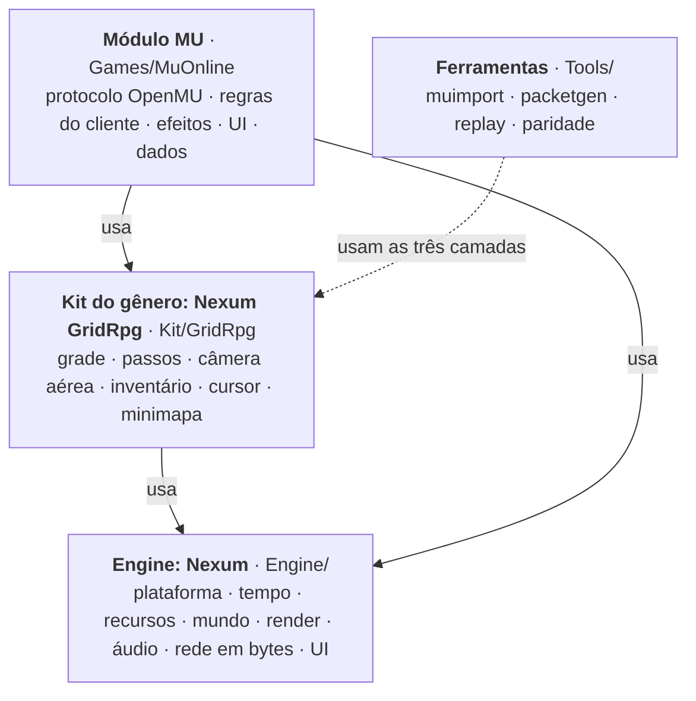

# Visão

> Documento vivo. Mudanças exigem a aprovação do dono. A fonte é a Parte 0 da [especificação de referência](referencia/especificacao-engine-propria-caminho-b.md#parte-0--visão-geral).

## O que é

O Nexum é uma engine própria, escrita do zero em C++20, para um **cliente de MU compatível com o OpenMU sem nenhuma modificação**. O nome vale para a engine e para o kit do gênero que vem com ela. O jogo que roda sobre o Nexum é o **módulo MU**, que gera o executável `MuClient`.

## Para quem

Primeiro, para o próprio dono: o objetivo é **dominar a construção de um cliente otimizado e de uma engine moderna**, controlando cada peça. Depois, para quem joga no OpenMU e quer um cliente aberto, moderno e sem código de origem duvidosa.

## Por que construir do zero (Caminho B)

Havia três caminhos: evoluir o MuMain por dentro (A), escrever uma engine própria (B) ou usar uma engine pronta (C). O Nexum é o **Caminho B** ([ADR 0001](adr/0001-caminho-b-sala-limpa.md)). Os motivos, em ordem de peso:

1. **Jurídico.** O MuMain não tem licença e deriva de fontes publicadas por terceiros. Uma engine escrita do zero, a partir de descrições de comportamento, não herda essa origem.
2. **Arquitetural.** Acoplar uma engine moderna aos poucos dentro do MuMain obrigaria a seguir as regras antigas dele enquanto se tenta trocá-las.
3. **Aprendizado e controle.** Uma engine pronta daria editor, render e interface, mas tiraria justamente a parte que se quer aprender.

**O custo é assumido:** é o caminho mais caro. Ele é contido com fatias verticais curtas, reaproveitando o **conhecimento** da central (nunca o código do MuMain), reaproveitando o OpenMU (MIT) e adiando tudo o que não é necessário para jogar.

## O que significam "compatível" e "fiel"

Em vez de prometer "100% de fidelidade", o Nexum mede **níveis de paridade**. Cada nível tem um teste que diz se foi atingido.

| Nível | Nome | O que exige |
|---|---|---|
| **P0** | Protocolo | cada pacote enviado é idêntico, byte a byte, ao que o OpenMU espera, e cada pacote recebido é entendido |
| **P1** | Comportamento | tempos e regras visíveis iguais: ritmo do andar, velocidade das animações, alcance dos cliques, ordem dos eventos |
| **P2** | Visual clássico | no modo **Classic**, a imagem fica próxima do original na mesma cena e câmera |
| **P3** | Visual aprimorado | no modo **Enhanced**, melhorias opcionais (sombras do sol, AO, bloom, LUT, áudio 3D), sem compromisso de paridade |

**Compatível** quer dizer P0 e P1 contra o OpenMU sem modificações. **Fiel** quer dizer de P0 a P2.

## Princípios

1. **O servidor manda.** O cliente pede e encena; o servidor decide e corrige.
2. **Sala limpa.** O código nasce das specs da central, nunca com o código do MuMain aberto ao lado.
3. **Três camadas, dependência só para baixo.**
4. **Tempo fixo.** A lógica anda em ticks de 40 ms, e a tela desenha no ritmo do monitor, interpolando.
5. **O desenho só lê.** Nada que acontece durante o desenho muda o estado do jogo.
6. **Dados onde há motivo para ajustar; código onde não há.**
7. **Medir antes de paralelizar ou otimizar.**
8. **Fatias verticais.** Cada marco termina em algo jogável ou mensurável.
9. **Tudo testável sem janela.**
10. **Paridade se mede, não se declara.**

As regras que nunca mudam estão em [ARCHITECTURE.md](ARCHITECTURE.md#invariantes).

## Piso de hardware

| | Mínimo |
|---|---|
| Sistema | Windows 10/11 64 bits, Linux 64 bits ou macOS (Apple Silicon) |
| GPU | com suporte a Direct3D 12, Vulkan ou Metal |
| Meta | Classic a 1080p numa GPU integrada recente, com folga para 144 Hz |

**Proposta, ainda não comprovada.** Máquinas que só têm OpenGL ficam de fora. A lista exata de requisitos do SDL GPU é conferida no M0 ([TD-0005](TECH_DEBT.md)).

## Não-objetivos

- **Servidor próprio.** O servidor é o OpenMU, sem modificações.
- **Anti-trapaça no cliente.** O servidor é a única defesa ([ADR 0017](adr/0017-seguranca-modelo-honesto.md)).
- **Navegador (WebAssembly).** O SDL GPU não tem um backend estável para o navegador.
- **Celular**, até o fim da Fase 1.
- **Editor externo em Qt e plugins em DLL**, adiados ([ADR 0013](adr/0013-ferramentas-de-autoria-em-imgui.md)).
- **Render graph e thread de simulação**, até que uma medição justifique.
- **Reproduzir a sequência exata dos sorteios do original.** A distribuição importa; a sequência, não.
- **Distribuir qualquer asset da Webzen.**

## Ainda não decidido

Depois do M7, um **ponto de decisão** responde por escrito, num ADR novo: se a arquitetura aguentou, qual é a velocidade real de entrega, se a paridade P0–P2 foi atingida e se o Nexum segue com o conteúdo do MU ou serve a outro jogo do mesmo gênero ([ROADMAP](ROADMAP.md)).
