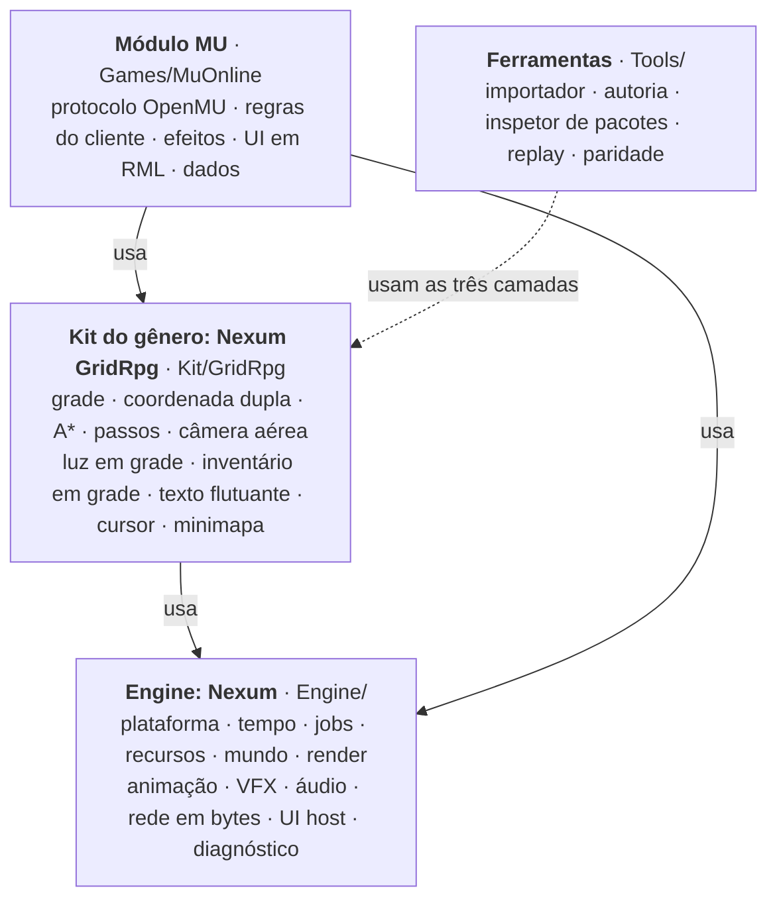
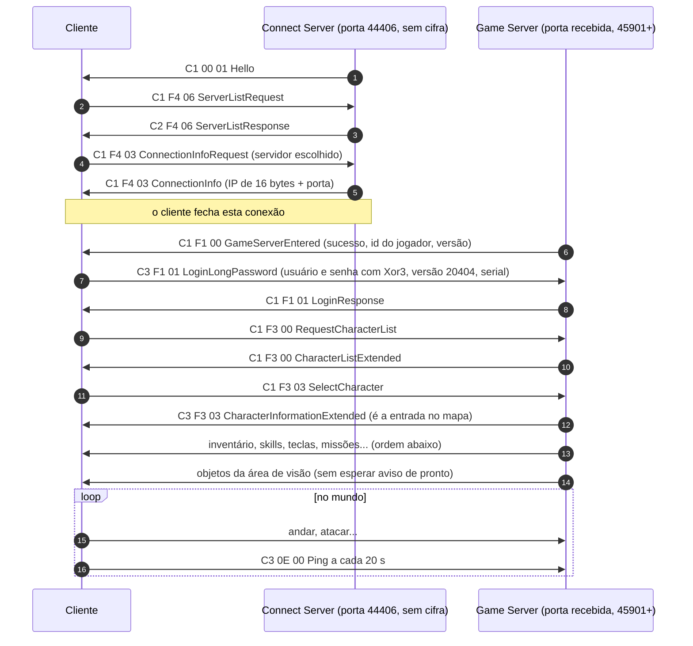
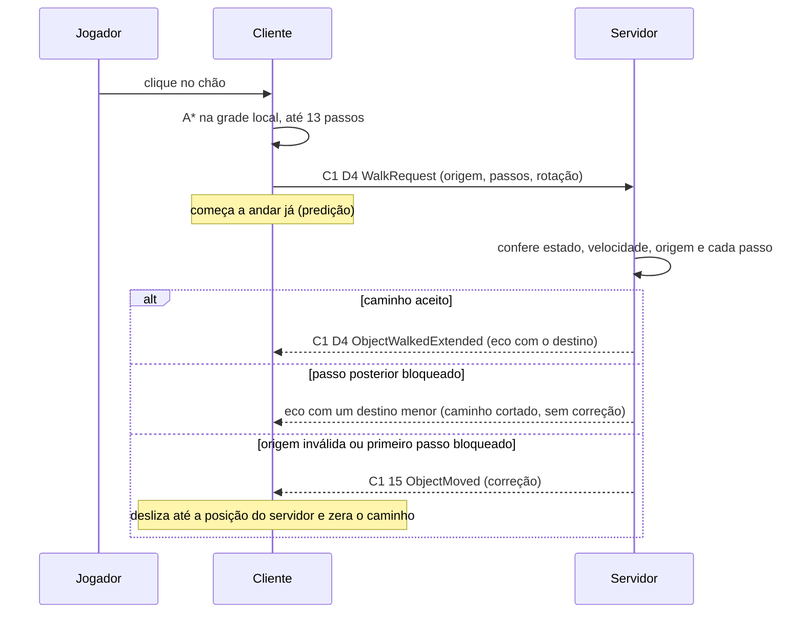
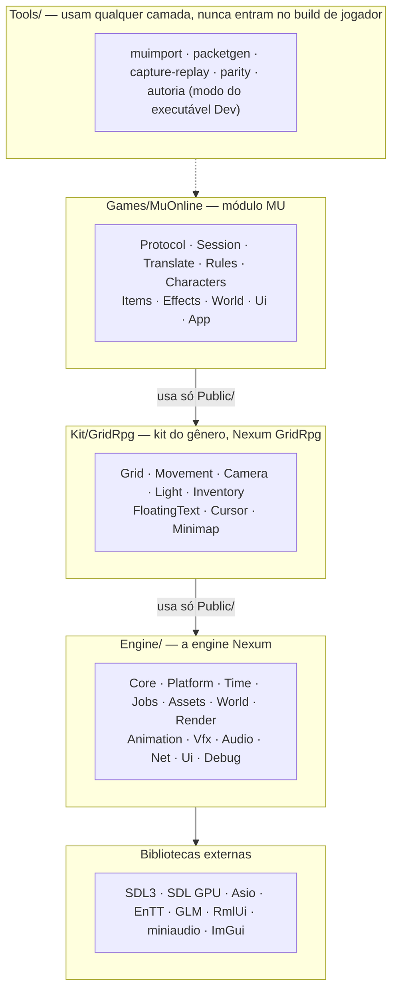
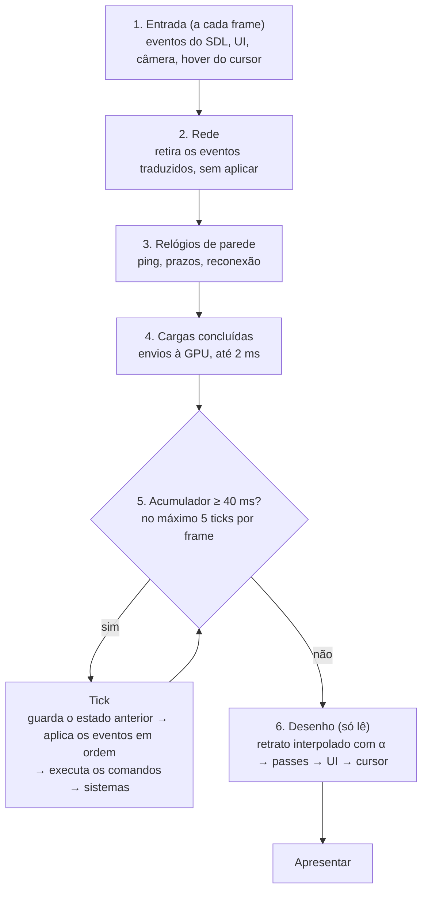
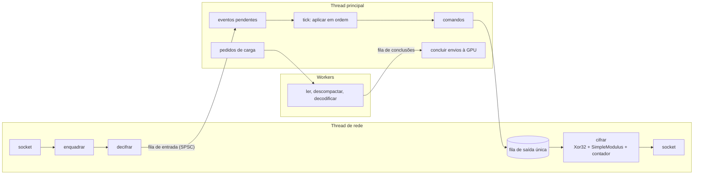
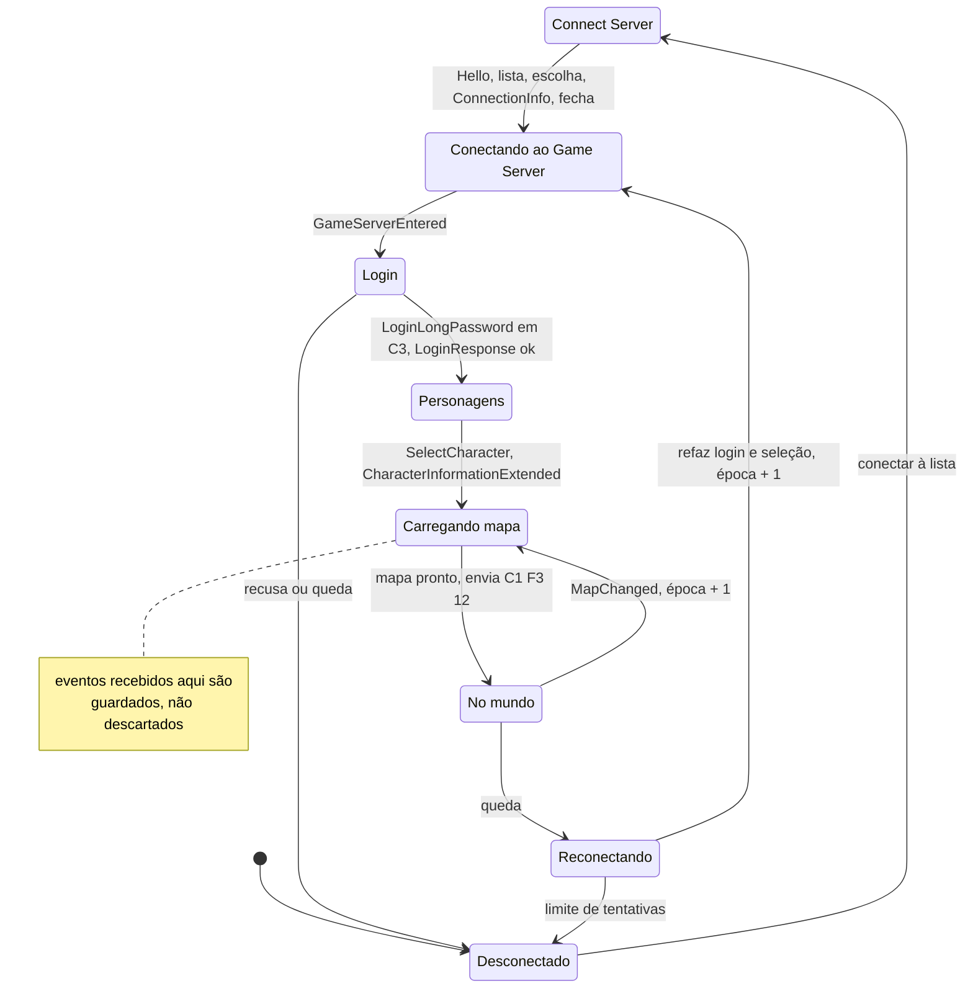
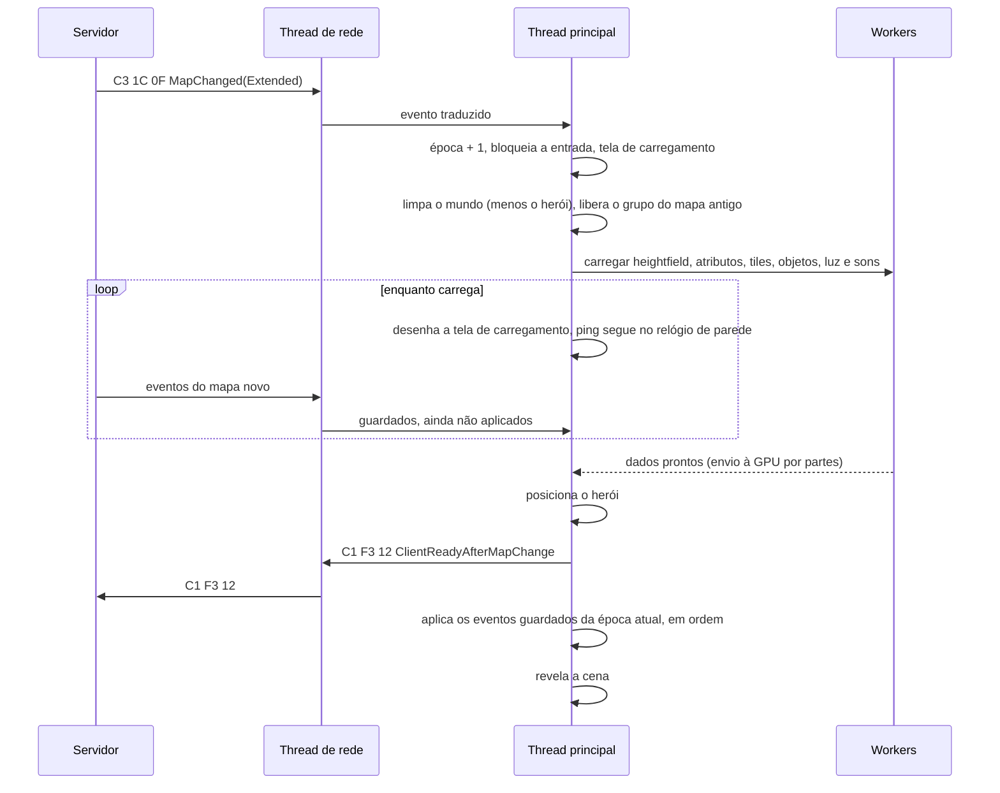
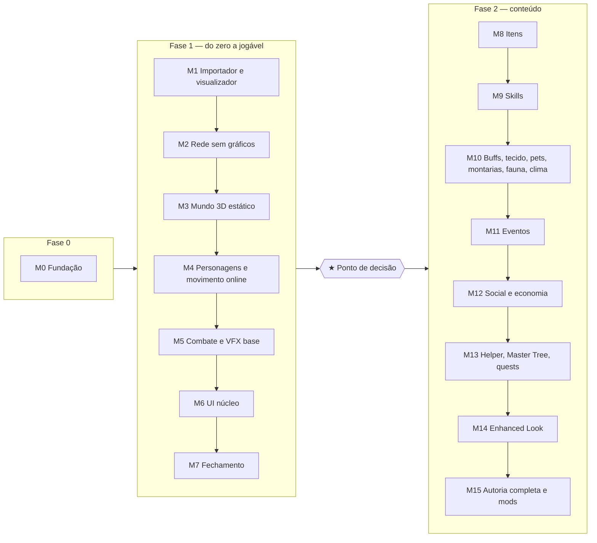

# Nexum — engine própria para um cliente de MU compatível com o OpenMU

**Especificação de arquitetura — Caminho B: a engine Nexum, escrita do zero em "sala limpa"**

> **Status: proposta para revisão.** Este documento é a versão revisada e ampliada da
> [especificação original](especificacao-engine-do-zero-mu-client.md), que continua no repositório
> como estava. Ele mantém o que a original tinha de bom (a regra da "linha vermelha", a convenção
> `Public/`/`Private/`, a coordenada dupla, o VFS insensível a maiúsculas, a análise do SDL GPU, os
> modos Runtime/Authoring, as fases da troca de mapa) e corrige os fatos que não conferiram com o
> código. Também acrescenta o que faltava: as decisões registradas, as convenções, a estratégia de
> paridade, a sala limpa e o contrato completo de rede. A auditoria que motivou a revisão está em
> [knowledge/arquitetura/2026-11-19-auditoria-spec-engine-propria.md](../../../knowledge/arquitetura/2026-11-19-auditoria-spec-engine-propria.md).

---

## Como ler este documento

**Rótulos.** Cada afirmação importante tem um dos rótulos abaixo, como pedem as regras da central
(`.claude/rules/evidencia.md`):

| Rótulo | Significa |
|---|---|
| **Fato** | O que o código do MuMain ou do OpenMU faz, verificado lendo o código, com `arquivo:linha` |
| **Interpretação** | Por que provavelmente é assim. É uma leitura do fato, não uma prova |
| **Decisão** | O que **esta engine** fará. Cada decisão tem um registro `D-xx` na Parte II, com as alternativas e as consequências |
| **Recomendação** | Opinião que ainda não virou decisão. Pode mudar na revisão |
| **Meta** | Um número-alvo para medir (desempenho, tempo de carga). Não é fato nem promessa |

**Abreviações de caminho**

| Abreviação | Caminho completo |
|---|---|
| `C/` | `Client/src/source/` (código do MuMain) |
| `CD/` | `Client/docs/` (docs oficiais do MuMain) |
| `S/` | `Server/src/` (código do OpenMU) |
| `P/` | `Server/docs/Packets/` (doc oficial de cada pacote do OpenMU) |
| `ME` | `Client/src/MuEditor/UI/MapEditor/MAP_EDITOR.md` (guia oficial do editor de mapa do MuMain, com os formatos dos arquivos de mapa) |
| `WS` | `C/Network/Server/WSclient.cpp` |
| `PM` | `S/GameLogic/PlayerMovement.cs` |
| `PMT` | `S/GameLogic/PlayerMapTransitions.cs` |

**Base analisada:** Client `c405ae907` (MuMain, main) e Server `b53c704c6` (OpenMU, master), como em
[knowledge/BASE.md](../../../knowledge/BASE.md). Quando um desses repositórios mudar, o `/atualizar`
avisa quais fatos precisam ser revistos.

**Termos técnicos** estão no [GLOSSARIO](../../GLOSSARIO.md). Os mais usados aqui: tick fixo,
interpolação de render, ECS, RHI, render graph, dialeto de pacotes, sala limpa, servidor autoritativo,
predição, rubberband, enquadramento, época.

**Diagramas.** Os diagramas estão em **Mermaid** (blocos ` ```mermaid `). Eles aparecem desenhados no
GitHub, no Obsidian e no VS Code com uma extensão de pré-visualização de Mermaid; em outros editores,
o código do diagrama continua legível como texto. A árvore de pastas (III.2) e os pseudo-códigos
(III.4, III.7) continuam em texto, porque são mais claros assim.

**Regra de cópia.** Este documento descreve comportamento com texto, tabelas e pseudo-código **nosso**.
Nenhum trecho de código do MuMain ou do OpenMU foi copiado (`.claude/rules/especificar-nao-copiar.md`).
Os números de formato (offsets, tamanhos, códigos de pacote) aparecem porque são o próprio objeto de
estudo.

**Mapa do documento**

| Parte | Conteúdo | Para quem |
|---|---|---|
| 0 | Visão geral, princípios, o que mudou | Todos; leia primeiro |
| I | O sistema de referência: o que o original faz (fatos) | Quem vai implementar um subsistema |
| II | Registro de decisões (D-01 a D-20) | Quem quer entender o "porquê" |
| III | Arquitetura: camadas, módulos, quadro, threads, fronteiras | Quem vai montar o esqueleto |
| IV | Subsistemas, um por um | Quem vai implementar |
| V | Qualidade e paridade: como provar que está certo | Todos |
| VI | Roteiro em fatias verticais | Planejamento |
| VII | Riscos | Planejamento |
| VIII | Lacunas: o que ainda não sabemos | Próximas investigações |
| Apêndices | Diferenças com a versão original, pacotes, formatos, licenças, checklist | Consulta |

---

# Parte 0 — Visão geral

## 0.1 O que vamos construir

A engine se chama **Nexum** (do latim *nexum*, "laço, vínculo"). O nome vale para a engine e para o
kit do gênero que vem com ela. O jogo que roda sobre o Nexum é o **módulo MU**, que gera o executável
`MuClient`.

Três coisas, em camadas, num mesmo repositório:

1. **A engine, Nexum:** um runtime em C++20 que não sabe o que é MU. Cuida de janela, entrada, GPU,
   recursos, entidades, animação, áudio, rede crua (bytes), interface e ferramentas de diagnóstico.
2. **O kit do gênero (Nexum GridRpg):** sistemas que todo **RPG de ação em grade com câmera aérea e servidor
   autoritativo** precisa (grade do mundo com atributos, coordenada dupla, pathfinding em grade,
   movimento por passos com predição e correção, câmera aérea, grade de luz, inventário em grade, texto
   flutuante, cursor contextual, minimapa). Também não sabe o que é MU: os significados vêm de quem o usa.
3. **O módulo MU:** tudo o que é específico do MU e do OpenMU. Inclui o importador dos arquivos
   originais, o protocolo, as regras do lado do cliente, o catálogo de efeitos, a interface e os eventos.



Ao lado delas fica a ferramenta **`muimport`**, que roda uma vez, fora do jogo. Ela lê os arquivos
originais do MU que o usuário já tem (`.bmd`, `.ozj`, `.ozt`, `.ozb`, `EncTerrain*`) e grava os
formatos **próprios** da engine. O jogo nunca abre um arquivo original (D-08).

O alvo de compatibilidade é o **OpenMU sem nenhuma modificação**, no "dialeto" de pacotes que o
OpenMU reserva para clientes open source (D-10).

## 0.2 Por que o Caminho B

**Decisão (D-01):** construir a engine do zero, em sala limpa, em vez de evoluir o MuMain por dentro
(Caminho A) ou usar uma engine pronta (Caminho C). A escolha é do usuário, e este documento a
registra com os motivos e o custo.

**Os motivos, em ordem de peso:**

1. **Jurídico.** O MuMain não tem arquivo de licença e é um fork das fontes do cliente Season 5.2
   publicadas por terceiros. O próprio README o descreve assim (`Client/README.md:5-6`), e não há
   `LICENSE` em `Client/`. Tudo o que for construído **dentro** dele herda essa origem. Uma engine
   escrita do zero, a partir de descrições de comportamento, não herda.
   - **Interpretação:** este é o argumento mais forte para o Caminho B, e a versão original da spec
     não o citava.
2. **Arquitetural.** O MuMain tem cerca de 450 mil linhas. Cerca de 17% delas estão nos arquivos
   `Zzz*` herdados do original: só o `WSclient.cpp` tem 15.750 linhas e 1.384 `case`. O fator de FPS
   aparece 3.043 vezes em 63 arquivos (contagens no código, `C/Engine/AI/ZzzAI.cpp:835`).
   - **Interpretação:** acoplar uma engine moderna aos poucos dentro do MuMain significaria seguir as
     regras dele (o fator por frame, as globais, a ordem do desenho) enquanto se tenta trocá-las. O
     próprio MuMain mostra o custo disso: separar o desenho do estado levou cinco etapas de trabalho,
     e a última ainda está planejada (`CD/adr/0003-draw-does-not-change-game-state.md:72-79`).
3. **Aprendizado e controle.** O objetivo do usuário é dominar a construção de um cliente otimizado
   ou de uma engine moderna. O Caminho C (por exemplo, Godot com extensão C++) daria editor, render e
   UI prontos, mas tiraria justamente a parte que se quer aprender e controlar.

**O custo (assumido):** é o caminho mais caro. Para conter o custo, o documento propõe:

- fatias verticais curtas, cada uma terminando em algo que roda e se mede (Parte VI);
- reaproveitar o **conhecimento** do MuMain (as specs e os achados desta central), nunca o código;
- reaproveitar o **OpenMU**, que é MIT: as definições de pacote em XML, os documentos de pacote e
  até um servidor local para testes;
- adiar tudo o que não é necessário para jogar: o editor em Qt, os plugins em DLL, o render graph e
  a thread de simulação.

## 0.3 O que significam "compatível" e "fiel"

A versão original prometia "100% de fidelidade". Este documento troca a promessa por **níveis de
paridade mensuráveis**. Cada nível tem um teste que diz se foi atingido (Parte V).

| Nível | Nome | O que exige | Como se mede |
|---|---|---|---|
| **P0** | Protocolo | Cada pacote enviado é idêntico, byte a byte, ao que o OpenMU espera, e cada pacote recebido é entendido | Vetores de teste gerados pelo próprio OpenMU; sessão real de 30 min sem queda nem aviso de violação |
| **P1** | Comportamento | Tempos e regras visíveis iguais: ritmo do andar, velocidade das animações, alcance dos cliques, ordem dos eventos | Replays de sessões gravadas; comparação de tempos com o servidor |
| **P2** | Visual clássico | No modo **Classic**, a imagem fica próxima do MuMain na mesma cena e câmera | Comparação de imagens com tolerância (Parte V.2) |
| **P3** | Visual aprimorado | Modo **Enhanced**: sombras do sol, AO, bloom, LUT, áudio 3D. Melhorias opcionais **sem** compromisso de paridade | Revisão visual |

**Compatível** quer dizer P0 e P1 contra o OpenMU sem modificações. **Fiel** quer dizer P0 a P2.

## 0.4 Princípios

1. **O servidor manda.** O cliente pede e encena; o servidor decide e corrige. O cliente prevê só o
   que é visual (começar a animação, começar a andar), nunca resultado (dano, HP, posição final,
   item). Fonte: [divisao-cliente-servidor](../../../knowledge/arquitetura/2026-11-17-divisao-cliente-servidor.md).
2. **Sala limpa.** Implementa-se a partir das specs desta central, que descrevem comportamento, e
   nunca com o código do MuMain aberto ao lado (D-01, Apêndice E).
3. **Três camadas, dependência só para baixo.** A engine não conhece o kit; o kit não conhece o MU (D-02).
4. **Tempo fixo.** A lógica anda em ticks de 40 ms, e a tela desenha no ritmo do monitor,
   interpolando (D-05).
5. **O desenho só lê.** Nada que acontece durante o desenho muda o estado do jogo. É a regra do
   ADR 0003 do MuMain, adotada desde o primeiro dia (D-05, D-09).
6. **Dados onde há motivo para ajustar; código onde não há.** Itens, monstros, efeitos e sons em
   dados. Comportamento que ninguém teria motivo para ajustar continua em código (D-16).
7. **Medir antes de paralelizar ou otimizar.** Thread nova, render graph e cache só entram com uma
   medição que justifique (D-06, D-09).
8. **Fatias verticais.** Cada marco termina em algo jogável ou mensurável, de ponta a ponta (Parte VI).
9. **Tudo testável sem janela.** Formatos, protocolo, lógica e até o desenho (captura sem janela)
   rodam em testes automáticos (D-14).
10. **Paridade se mede, não se declara.** Um nível de paridade só é atingido quando o teste dele passa (0.3).

## 0.5 O que mudou em relação à versão original

Resumo das mudanças grandes. A tabela completa, item a item, está no Apêndice A.

| Tema | Versão original | Esta versão | Por quê |
|---|---|---|---|
| Status do documento | "Aprovado / Especificação Mestre" | "Proposta para revisão" | Os fatos não tinham fonte e parte deles estava errada |
| Fronteira engine × jogo | Duas camadas, com sistemas de MU no núcleo | Três camadas (engine, kit do gênero, módulo MU) | Resolve a contradição entre "a engine não sabe o que é MU" e "sistemas de MU no núcleo" |
| Threads | Laço único (4.1) **e** simulação em thread própria (4.8.1) | Uma decisão: tick fixo na thread principal; rede e carregamento em threads auxiliares | Os dois modelos se contradiziam |
| Arquivos originais | Leitores de `.bmd`/`.ozj` dentro do runtime | Conversão offline (`muimport`) para formatos próprios | Engine neutra de verdade, carga mais rápida, separação jurídica |
| Rede | Portas, códigos e formato de item errados; anti-speedhack descrito errado | Contrato completo e conferido: dialeto 106.3, item estendido, ping, aviso de pronto, ordem, época | Auditoria (Parte I.13) |
| Editor | Qt 6 com plugins em DLL, desde o início | Modo de autoria em ImGui dentro da engine; Qt e plugins adiados | O MuMain prova que ImGui basta; DLL C++ tem ABI frágil |
| Render | GBuffer ou forward indefinido; render graph | Forward, pipeline fixa de passes, Classic em espaço gama | O conteúdo é aditivo e transparente; a paridade exige espaço gama |
| Áudio | 3D logarítmico com 4 barramentos | Paridade primeiro (2D, 2 volumes); 3D só no Enhanced | O original é 2D |
| UI | Base 1920×1080 | Base 640×480, com o mesmo ajuste do MuMain | Paridade de layout |
| Fidelidade | "100%" | Níveis P0–P3 com teste | Mensurável |
| Roteiro | 48 semanas; rede no marco 4 | Fatias verticais por tamanho; rede sem gráficos no marco 2 | A rede concentra os erros mais caros |
| Sala limpa, testes, orçamentos, convenções | Ausentes | Seções próprias | Lacunas da versão original |


---

# Parte I — O sistema de referência (o que o original faz)

Esta parte junta os **fatos** que a engine precisa reproduzir ou respeitar. Cada seção termina com
"Consequência", que liga o fato à decisão que o usa. Quando o fato vem de um achado desta central, o
link aponta para ele; os detalhes completos estão lá.

## I.1 Quem decide o quê: cliente e servidor

**Fato** (detalhes em [divisao-cliente-servidor](../../../knowledge/arquitetura/2026-11-17-divisao-cliente-servidor.md)
e [skills-em-area](../../../knowledge/gameplay/2026-11-17-skills-em-area-quem-escolhe-alvos.md)):

| Tarefa | Cliente | Servidor |
|---|---|---|
| Checar alcance antes de atacar | Sim, por conforto: anda até o alvo (`C/Engine/Object/ZzzInterface.cpp:1466-1470`) | Só confere se o alvo "enxerga" o atacante (raio de visão) |
| Animação do próprio ataque | Começa na hora (`ZzzInterface.cpp:1479-1483`) | Manda a animação só para os outros |
| Acerto, crítico, dano | — | **Decide** (`S/GameLogic/AttackableExtensions.cs:70` em diante) |
| HP do herói | Desconta ao receber o golpe, mas é sobrescrito pelo valor absoluto que chega | **Fonte da verdade** |
| Caminho (pathfinding) | **Calcula**, também para os outros personagens | Só valida passo a passo |
| Colisão do mapa | Cópia própria | Cópia própria, que **vence** |
| Alvos de skill em área (S6) | Não envia a lista | **Escolhe** os alvos |
| O que cai do monstro | — | **Decide** |
| Pegar item | Pré-checa distância (1,5 tile) e espaço (`ZzzInterface.cpp:1687-1713`) | **Decide**: até 3 tiles, espaço e dono (`S/GameLogic/PlayerActions/Items/PickupItemAction.cs:23`) |

- **Fato:** o pacote de ataque não tem campo de dano. Leva só o alvo, a animação e a direção
  (`S/Network/Packets/ClientToServer/ClientToServerPackets.cs:9189-9265`).

**Consequência:** o módulo MU só **prevê** a apresentação (I.13.8, IV.15). Nenhuma regra de resultado
mora no cliente, exceto fórmulas de exibição (a janela de atributos), que são cópia da regra do
servidor e devem ser tratadas como tal.

## I.2 Tempo: os 25 FPS de referência

- **Fato:** o cliente original rodava travado a 25 FPS (`Client/README.md:24`).
- **Fato:** o MuMain destravou o FPS e preserva a velocidade com um **fator por frame**, decidido no
  ADR 0001 (`CD/adr/0001-preserve-25-fps-reference-timing.md:16-33`):
  - o fator vale `clamp(25 / FPS, 0, 1)`;
  - somas por frame são multiplicadas pelo fator;
  - multiplicações repetidas usam a potência `base^fator`;
  - relógios e prazos usam milissegundos reais.
- **Fato:** abaixo de 25 FPS o fator fica em 1, e o jogo inteiro fica mais lento (mesmo ADR).
- **Fato:** contadores inteiros usam um acumulador de "frames de referência inteiros"
  (`C/Engine/AI/ZzzAI.cpp:843-849`). O fator aparece 3.043 vezes, e o sorteio ajustado por FPS
  (`rand_fps_check`) 646 vezes.
- **Fato:** o custo que o ADR documenta é de **disciplina** (cerca de 15 regras sobre o que leva o
  fator, `CD/adr/0001-preserve-25-fps-reference-timing.md:64-127`). O ADR não fala em erro acumulado.
- **Fato:** o sorteio "ajustado por FPS" é linear (fator/n). Ele preserva a média, mas não a
  distribuição exata (`C/Core/Utilities/Random.cpp:54-58`).
- **Fato:** o MuMain tem o próprio gerador de números aleatórios. Ele reproduz a sequência do
  `rand()` do Windows em todas as plataformas, e o desenho usa um sorteio separado, fixo por frame.
  Um teste falha se o `rand()` do sistema for usado (`CD/adr/0003-draw-does-not-change-game-state.md:55-61`).
- **Fato:** o MuMain já separou o update do desenho em quatro etapas (D0 a D4): spawns, animação e
  tecido foram para o update; cada objeto guarda a própria pose; câmera e culling rodam no fim do
  update. A etapa D5 (todo desenho só lê dados e os entrega a uma interface de "drawer") está
  planejada (`CD/adr/0003-draw-does-not-change-game-state.md:72-79`).

**Interpretação:** um tick fixo de 25 Hz é **mais fiel** ao original do que o fator, porque o
original era, na prática, um tick de 25 Hz acoplado ao desenho. Com tick fixo, as 15 regras do
ADR 0001 deixam de existir: cada lógica "por frame" do original vira "por tick", sem fator.

**Consequência:** D-05 (tick fixo de 25 Hz) e D-15 (aleatoriedade determinística).

## I.3 Mundo e terreno

### I.3.1 Grade, escala e altura

- **Fato:** o mapa tem 256×256 células, e cada célula mede 100 unidades de mundo
  (`C/Render/Terrain/TerrainHeightGrid.h:10-13`). Um mapa inteiro mede 25.600×25.600 unidades.
- **Fato:** a altura num ponto contínuo é a **interpolação bilinear** dos 4 cantos da célula:
  primeiro ao longo de Y, depois de X (`TerrainHeightGrid.h:37-46`). Coordenada negativa devolve 0;
  fora do mapa devolve a "altura especial" (`:24-35`).
- **Fato:** a altura vem do arquivo `TerrainHeight.OZB`. É um BMP comum com cabeçalho de 1080 bytes
  e 256×256 tons de cinza; a altura é o valor do pixel × 1,5 (ME:201).
- **Fato:** células com a flag `TW_HEIGHT` (0x0040) assumem a altura especial de 1200
  (`C/Render/Terrain/ZzzLodTerrain.cpp:108`). A câmera sobe para Z=1201 quando o herói pisa nelas
  (`C/Camera/DefaultCamera.cpp:605-608`). **Não** é uma flag de bloqueio.

### I.3.2 Atributos das células

- **Fato:** na memória do cliente, cada célula tem 16 bits de flags (`C/Core/Globals/_define.h:50-66`):

| Bit | Nome | Significado conhecido |
|---|---|---|
| 0x0001 | `TW_SAFEZONE` | Zona segura |
| 0x0002 | `TW_CHARACTER` | Há um personagem na célula (**calculado a cada frame**, ver abaixo) |
| 0x0004 | `TW_NOMOVE` | Não se pode andar |
| 0x0008 | `TW_NOGROUND` | Sem chão (abismo) |
| 0x0010 | `TW_WATER` | Água |
| 0x0020 | `TW_ACTION` | *Lacuna:* uso não investigado |
| 0x0040 | `TW_HEIGHT` | Altura especial (1200) |
| 0x0080 | `TW_CAMERA_UP` | *Lacuna:* a câmera sobe; uso exato não investigado |
| 0x0100 | `TW_NOATTACKZONE` | Zona sem ataque. Não cabe no arquivo (ver abaixo) |
| 0x0200–0x8000 | `TW_ATT1` a `TW_ATT7` | *Lacuna:* uso não investigado |

- **Fato:** o arquivo `EncTerrain{N}.att` guarda **1 byte por célula**. Flags acima de 0x80 não podem
  vir do arquivo (ME:127-131).
- **Fato:** o `TW_CHARACTER` é apagado e carimbado de novo **a cada frame** em toda célula ocupada
  por um personagem vivo. Por isso a grade da memória não é "dado do mapa": gravá-la como está grava
  também onde os NPCs estavam (ME:250-255).
- **Fato:** **cliente e servidor leem o mesmo byte de jeitos diferentes** (ME:256-262):
  - **servidor:** compara o valor exato. Só 0 e 1 são andáveis, e só 1 é zona segura. Água (16)
    bloqueia, e qualquer combinação (3, 5...) também bloqueia;
  - **cliente:** testa bits. Bloqueia com 4 ou 8; 1 é zona segura; 16 não bloqueia, e 3 é andável.
- **Fato:** o servidor tem a **própria cópia** da grade, no banco (`GameMapDefinition.TerrainData`).
  São 65.539 bytes sem cifra (3 bytes de cabeçalho + 65.536), semeados de `Resources/Terrain{N}.att`
  (ME:199).
- **Fato:** a grade muda em jogo por um pacote próprio (`ChangeTerrainAttributes`, C1 46),
  por exemplo em eventos (`S/GameServer/RemoteView/MiniGames/ChangeTerrainAttributesViewPlugIn.cs:31-64`,
  `WS:8889-8935`).
- **Fato:** o carregador do `.att` tem **sentinelas anti-adulteração**. Ele confere uma célula mágica
  em alguns mapas e fecha o jogo se ela não bater; também recusa bytes ≥ 128 (ME:266-270).

### I.3.3 Arquivos do mapa

**Fato** (ME:190-205): os arquivos ficam em `Data\World{N}\`, onde **N = número do mapa no servidor + 1**.
Exemplo: Lorencia é 0 no servidor e `World1` no cliente; alguns mapas especiais são remapeados (ME:233-238).

| Dado | Arquivo | Como é |
|---|---|---|
| Texturas do chão | `EncTerrain{N}.map` | Cifrado com `MapFileDecrypt`. Contém versão, número do mapa, camada 1 (256²), camada 2 (256²) e alfa (256²). Cada célula guarda um índice de 0 a 29: de 0 a 13 são os tiles fixos, de 14 a 29 os extras |
| Atributos | `EncTerrain{N}.att` | Para ler: primeiro `MapFileDecrypt`, depois `BuxConvert` (para gravar, o inverso). Cabeçalho `[versão, mapa, 255, 255]` + 256² bytes, índice `y*256+x` |
| Objetos | `EncTerrain{N}.obj` | Cifrado. Contém versão, mapa, quantidade e, por objeto: tipo (int16), posição (3 floats), ângulos (3 floats) e escala (float). É uma lista plana |
| Altura | `TerrainHeight.OZB` | BMP comum (I.3.1) |
| Luz estática | `TerrainLight.jpg` (no disco como `.OZJ`) | Ver I.5 |
| Minimapa | `mini_map.OZT` | Ver I.11 |

- **Fato:** a cifra `MapFileDecrypt` faz XOR com uma chave fixa de 16 bytes e subtrai uma chave
  móvel que depende do byte cifrado anterior. O tamanho não muda. Detalhes em
  [leitura-modelo-bmd](../../../knowledge/formatos/2026-11-17-leitura-modelo-bmd.md) (`C/Render/Terrain/ZzzLodTerrain.h:191-208`).
- **Fato:** os modelos dos objetos ficam em `Data\Object{N}\`. Mapas genéricos usam `Object{i}.bmd`;
  alguns (Lorencia) usam uma tabela de nomes no código (ME, seção de modelos de objeto).

**Consequência:** o kit tem uma grade com **três camadas** separadas: a estática do mapa, a dinâmica
vinda de pacotes e a de ocupação, calculada e nunca gravada (IV.7). O `muimport` valida o `.att`
contra a regra do servidor e avisa quando uma célula será lida de forma diferente pelos dois lados
(IV.5).

## I.4 Câmera

| Parâmetro | Valor | Fonte |
|---|---|---|
| Pitch da cena principal | -48,5° | `C/Camera/DefaultCamera.cpp:667` |
| Yaw padrão | -45°, ajustável pelo jogador em ±15° | `DefaultCamera.cpp:277`, `:340`, `:794-798` |
| FOV horizontal de referência | 40° nas câmeras principal, orbital e de seleção de personagem; 90° no login e na câmera livre | `C/Camera/CameraConfig.h:74`, `:158`, `:187`, `:236` |
| FOV vertical | Calculado com a proporção travada em 4:3. O aspect real é ignorado; 40° horizontais dão cerca de 30,5° verticais. Em telas largas aparece **mais terreno nas laterais**, sem esticar | `CameraConfig.h:6-18` |
| Plano distante | Multiplicado por 1,4 (3000 → 4200 no terreno), também na projeção | `CameraConfig.h:44`, `:163-165`; `C/Camera/CameraProjection.cpp:58-59` |
| Raio do mouse | **Não** aplica o 1,4, ao contrário do que diz o comentário | `CameraProjection.cpp:100`, `CameraConfig.h:39` |

- **Fato:** **picking** (descobrir o que está sob o mouse). O raio sai de um ponto no plano distante
  calculado com a perspectiva, com o Y negado, e é girado de volta pela transposta da matriz de view
  (`CameraProjection.cpp:90-112`).
- **Fato:** o chão é testado com o raio contra **os 2 triângulos de cada tile dentro do frustum**,
  ficando com o acerto mais próximo (`ZzzLodTerrain.cpp:1923-1937`,
  `C/Render/Textures/ZzzOpenglUtil.cpp:1445-1500`). Os objetos são testados com raio contra caixas
  orientadas (OBB) (`C/Input/Selection.cpp:82`).

**Consequência:** IV.8 (câmera) e IV.7.5 (picking).

## I.5 Luz

- **Fato:** a luz estática do chão vem de `TerrainLight.jpg`. Crywolf e o Battle Castle têm as
  variantes 1 e 2 (`C/World/MapInfra/MapManager.cpp:1060-1090`).
- **Fato:** essa imagem é multiplicada por `clamp(N·Sol + 0,5)` e pelo fator do "light mood" (o perfil
  de luz do mapa), virando a luz de base de cada vértice (`ZzzLodTerrain.cpp:623-660`).
- **Fato:** no modo Classic, a cada frame, a luz estática é copiada **só na região do frustum**
  (`ZzzLodTerrain.cpp:2922-2931`). As luzes dinâmicas (magias, tochas) são somadas com queda linear
  `(alcance − d) / alcance`, medida em células e aplicada só quando positiva. Cada soma termina com um
  clamp ≥ 0, e luzes negativas **escurecem** (`C/Render/Terrain/TerrainLightGrid.cpp:28-37`, `:105-130`).
- **Fato:** os modelos amostram essa grade em bilinear na posição do objeto e somam uma luz
  direcional `max(0,8·N·L + 0,4; 0,2)` (`ZzzLodTerrain.cpp:1167-1206`, `C/Render/Lighting/ModelLight.h:10-13`).
- **Fato:** no modo Enhanced, as chamadas de luz são **gravadas** durante o update e **reaplicadas**
  uma vez por frame, antes do terreno (`TerrainLightGrid.cpp:191-223`). O `DynamicLightHistory`
  (`C/Render/Lighting/DynamicLightHistory.h:3-19`, `:57-140`):
  - suaviza no tempo as luzes de mapa e de personagem (o fogo "respira" em vez de piscar);
  - deixa as luzes de efeito sumirem com fade;
  - trata como continuação uma luz do mesmo tipo a até 24 unidades;
  - não guarda histórico das luzes que escurecem;
  - tem capacidade de 1024 e volta à ordem Classic quando estoura;
  - adia para o frame seguinte as chamadas feitas durante o desenho.
- **Fato:** a iluminação é feita em **espaço gama**, não linear (`CD/enhanced-look.md:344-345`).

**Interpretação:** o histórico de luzes é um bom modelo de **buffer entre simulação e render**: a
simulação emite luzes; o render consome uma versão suavizada e estável.

**Consequência:** IV.7.6 (luz em grade, no kit) e D-09 (Classic em espaço gama).

## I.6 Modelos e animação

- **Fato:** o `.bmd` guarda malhas, nomes de textura, animações ("actions") e o esqueleto com a pose
  de cada osso em cada quadro, em três versões de cifra (0x0A sem cifra, 0x0C com `MapFileDecrypt`,
  0x0E com duas cifras de bloco). Formato completo em
  [leitura-modelo-bmd](../../../knowledge/formatos/2026-11-17-leitura-modelo-bmd.md).
- **Fato:** os keyframes **não têm tempo**. Cada action tem uma velocidade `PlaySpeed`, em "keys por
  tick de referência" (`C/Render/Models/ZzzBMD.h:159-162`), e o quadro avança
  `PlaySpeed × fator` a cada frame (`ZzzBMD.cpp:1162`).
  - Os valores de `PlaySpeed` estão no código (cerca de 222 atribuições, por exemplo
    `C/Engine/Object/ZzzCharacter.cpp:555-600`) e nos dados de monstro.
- **Fato:** as rotações vêm em ângulos de Euler, convertidas para quaternions ao carregar, e a
  interpolação entre keys é **NLERP** (interpolação linear normalizada), não slerp
  (`ZzzBMD.cpp:573-591`, `:4027`).
- **Fato:** armadilha de nome: na action, `Loop == true` significa **parar no fim** da animação
  (`ZzzBMD.cpp:1175-1181`).
- **Fato:** uma action com `LockPositions` guarda o deslocamento do modelo a cada quadro, ou seja,
  *root motion*.
- **Fato:** o skinning na GPU é obrigatório no MuMain (`ZzzBMD.cpp:151-157`,
  `CD/build/rendering-parity.md:22-23`).
- **Fato:** existe crossfade (mistura) entre actions (`ZzzBMD.cpp:1163-1165`).

### I.6.1 Personagens montados por partes

- **Fato:** cabeça, elmo, armadura, calça, luvas e botas são **BMDs separados**
  (`_define.h:113-119`), transformados com a pose do personagem, ou seja, compartilham o esqueleto
  (`C/Engine/Object/ZzzObject.cpp:7953-7958`).
- **Fato:** armas, asas e itens nas costas são **anexos** presos a ossos do esqueleto do jogador
  (`ZzzCharacter.cpp:12869-12870`, `:14100`):

| Anexo | Osso |
|---|---|
| Mão direita | 33 |
| Mão esquerda / escudo | 42 |
| Asas | 47 |
| Capa | 19 |

- **Fato:** as asas são modelos separados, com animação própria (`ZzzCharacter.cpp:14101`).
- **Fato:** o `CharacterAttachments` do MuMain é o **plano por frame** dos anexos, como pede o ADR 0003:
  cada slot guarda o modelo, o osso, a velocidade e a pose, e o desenho só consulta
  (`C/Engine/Object/CharacterAttachments.h:11-78`).
- **Fato:** o tecido (capas) é um `CPhysicsCloth`: partículas ligadas por distância mínima e máxima,
  com vento, esferas de colisão e fixação num osso (`C/Engine/Physics/PhysicsManager.h:170-215`).
  A capa do Dark Lord nasce com 4 panos, ou 6 com a Cape of Emperor (`ZzzCharacter.cpp:9150-9170`).
- **Fato:** com 20 personagens ou mais, a animação pode rodar num pool de threads, que vem desligado
  por padrão (`ZzzCharacter.cpp:6590-6596`).

**Consequência:** IV.10 (animação com tempo fracionário avaliado no desenho; sockets por índice de
osso, vindos de dados).

## I.7 Materiais e aparência de itens

### I.7.1 Modos de mistura

- **Fato:** o "brilho" é mistura aditiva `ONE, ONE` (`C/Render/Textures/ZzzOpenglUtil.cpp:323-331`).
  Também existem os modos Subtract, LightMap, Luminance e Mixed (`C/Render/Renderer/MuRenderer.h:43-53`).
- **Fato:** a rolagem de UV de asas e armaduras vem de dados (`blendMeshU/V`, `scrollU/V`, em
  `Client/src/bin/Data/Effects/RenderStyles.json`).
- **Fato:** `RENDER_WAVE` ondula os vértices ao longo da normal (`ZzzBMD.cpp:2424-2431`).

### I.7.2 Reflexo metálico ("chrome")

- **Fato:** há 9 modos: CHROME, CHROME2 a CHROME7, METAL e OIL (`ZzzBMD.cpp:128-149`, `:1849-1862`).
- **Fato:** o UV do reflexo usa a **normal já transformada pelos ossos, em espaço de modelo** (e não
  de câmera), mais um termo de tempo (`ZzzBMD.cpp:2161-2214`). Em palavras:
  - **CHROME:** u = metade do componente Z da normal + onda; v = metade do componente Y + 2 × onda.
    A onda vem do relógio do jogo;
  - **METAL** (o caso padrão): u = metade de Z + 0,2; v = metade de Y + 0,5;
  - os outros modos têm variações próprias. O shader da GPU repete as mesmas fórmulas
    (`Client/src/shaders/skinned_vertex.hlsli:200-249`).
- **Fato:** cada modo usa uma textura de reflexo (CHROME, CHROME2, CHROME6 ou SHINY), e
  CHROME3/4/5/7 desenham em modo aditivo (`ZzzBMD.cpp:2000-2008`, `:2028-2055`).

### I.7.3 O nível do item escolhe uma pilha de passes

**Fato** (`ZzzObject.cpp:7553-7652`): o nível não muda uma "intensidade". Ele escolhe **quantos passes
extras** o modelo recebe:

| Nível | Passes desenhados |
|---|---|
| +3 a +6 | Só tinge a luz do corpo |
| +7 e +8 | 1 passe CHROME |
| +9 e +10 | CHROME + METAL |
| +11 e +12 | CHROME2 + METAL + CHROME |
| +13 a +15 | CHROME4 + METAL + CHROME |

### I.7.4 Outros efeitos de modelo

- **Fato:** a **sombra planar** clássica achata os vértices no chão e os pinta de preto
  (`ZzzBMD.cpp:2414-2422`). Também existem uma versão na GPU que segue o relevo
  (`TerrainHeightGrid.h:49-65`), shadow volumes (`C/Render/Models/ShadowVolume.h`) e a sombra do sol
  no Enhanced (`C/Render/Renderer/SdlGpuSunShadowMap.cpp`).
- **Fato:** o **contorno de seleção** desenha o modelo inflado (×1,2) duas vezes, em modo aditivo, com
  a cor conforme o tipo de alvo (`ZzzObject.cpp:7734-7749`, `:7903-7944`).
- **Fato:** há **LOD** com histerese pela altura do modelo na tela (`C/Render/Models/ModelLod.h:7-18`)
  e **MSAA** com 2, 4 ou 8 amostras (`C/Render/Renderer/Antialiasing.h:6-13`).
- **Fato:** a **ordem de desenho** agrupa os opacos por pipeline e textura e mantém os transparentes
  na ordem em que foram enviados (`C/Render/Renderer/ReorderableDrawRuns.h:6-18`). As partículas só são
  agrupadas por textura onde a ordem não muda o resultado (`C/Render/Effects/ParticleDrawOrder.h:5-15`).

**Consequência:** IV.9.3 (modelo de material clássico: o motor oferece "pilhas de passes"; o módulo
MU decide qual pilha cada nível usa).

## I.8 Água

São dois sistemas diferentes. A versão original da spec os misturava.

- **Fato:** em Atlans, os tiles da **camada 5** do chão trocam entre **32 texturas** no ritmo de 25 por
  segundo (a troca é feita a cada 40 ms). Não há passe de refração (`ZzzLodTerrain.cpp:1734-1738`,
  `C/Scenes/SceneManager.cpp:590-603`).
- **Fato:** o `CSWaterTerrain` existe só nos mapas Hellas/Kalima (`C/Render/Terrain/CSWaterTerrain.cpp:62`,
  `C/World/GameMaps/GMHellas.cpp:46-70`). É uma **malha deformável**:
  - ondulação simulada em 2 buffers, com amortecimento de 1/16 (`CSWaterTerrain.cpp:303-322`);
  - ondas senoidais de base (`:293-298`);
  - "pingos" perto do herói a cada 1600 ms (`:35`, `:103-114`);
  - 2 passes: um com alpha-test e UV pela normal, outro aditivo (`:60-101`).

  Nesses mapas o terreno comum não é desenhado (`C/Scenes/MainScene.cpp:600`, `:711-721`).

**Consequência:** o kit oferece "camada de tile animada" e "superfície ondulante" como recursos
genéricos; o módulo MU decide onde usá-los (IV.7.4).

## I.9 Efeitos, partículas e limites

- **Fato:** o código tem 464 tipos de efeito, 98 de partícula e 31 de "joint" (raios e rastros), e o
  `switch` de criação de monstros tem 269 `case`
  (`CD/superpowers/specs/2026-09-29-data-driven-content-roadmap-design.md:29-35`).
- **Fato:** o catálogo de efeitos em dados dá só **nomes e valores de criação**. O comportamento
  continua no código (`CD/effect-data.md:3-8`).
- **Fato:** os limites fixos (`_define.h:436-484`):

| Recurso | Limite |
|---|---|
| Efeitos | 200 |
| Efeitos de skill | 100 |
| Sprites | 1000 |
| Partículas | 3000 |
| Folhas (clima) | 200 |
| Joints | 500 |
| Rastros (tails) | 200 |

**Consequência:** a engine oferece as **primitivas** (partículas, sprites, rastros, raios, efeitos de
malha) com orçamentos configuráveis. O módulo MU implementa o **catálogo** de comportamentos em C++
nosso, guiado por specs (IV.11). Os limites do original servem de orçamento inicial.

## I.10 Buffs (o lado visual)

- **Fato:** o `Client/src/bin/Data/Buffs/Buffs.json` tem 158 entradas (116 buffs e 42 debuffs), e o
  cliente aceita IDs de 1 a 205 (`CD/buff-data.md:31`). O arquivo cuida de ícone, tooltip e efeitos de
  chegada, não do render.
- **Fato:** as "cores" de estado **multiplicam a luz do corpo**, sem translucidez
  (`ZzzObject.cpp:7493-7525`):

| Estado | Multiplicador (R; G; B) |
|---|---|
| Veneno | 0,3; 1; 0,5 |
| Gelo | 0,3; 0,5; 1 |
| Stun | 0; 0; 1 |

- **Fato:** o gelo reduz pela metade só a velocidade de **andar e correr**
  (`ZzzCharacter.cpp:561-600`). Stun e sono **param** a animação (`ZzzCharacter.cpp:2543`).
- **Fato:** o Greater Defense cria 5 joints na posição do personagem (`ZzzCharacter.cpp:11139-11148`).
  O Swell Life é um efeito mantido enquanto o buff dura (`C/Render/Effects/ZzzEffect.cpp:6153-6157`).
  *Lacuna:* o visual do Soul Barrier e se os efeitos ficam presos a ossos.

## I.11 Interface e entrada

| Tema | Fato | Fonte |
|---|---|---|
| Base do layout | **640×480** | `C/App/stdafx.h:210-211`, `C/UI/Scaling/UITransform.cpp:11-12` |
| Escala | `clamp(min(L/640, A/480), 1, teto × escala do SO)`; teto de 2,0 para o HUD e 2,25 para dock e tipografia; multiplicada pela preferência do jogador (75–150%) | `UITransform.cpp:15-21`, `:65-69`, `:133-152`; `C/Data/GameConfig/GameConfigConstants.h:139-140` |
| Biblioteca | RmlUi 6.3 + PR #989, de um fork | `CD/rmlui-ui-system/engine-findings.md:270-271` |
| Migração | A doc declara a migração completa: 66 janelas feitas, 3 nativas (cursor e overlays) e 3 apagadas | `CD/rmlui-ui-system/README.md:8`, `:42`; `migration-ledger.md` |
| Escala no RmlUi | Pela razão `dp` do contexto e por containers de 640×480 | `C/Render/RmlUi/RmlUiRuntime.cpp:44`; `CD/rmlui-ui-system/layout-and-scaling.md:15-17`, `:122-129` |
| Temas | Por pasta (legacy, modern), com `tokens.ini`; troca sem reiniciar e recarga manual que preserva os dados | `CD/rmlui-ui-system/README.md:169-180`; `C/UI/RmlBridge/RmlTheme.cpp:468-499` |
| Hot-reload por arquivo | **Não existe** | busca por monitores de arquivo sem resultado |
| Texto | Duas rotas: SDL_ttf com o motor de texto da GPU, para o texto desenhado pelo C++; FreeType do RmlUi, para as janelas | `C/Render/Text/CUIRenderText.cpp:22`; `C/Render/RmlUi/RmlUiRuntime.cpp:87`, `:103-105` |
| Fontes | Cadeia de reserva: DejaVu Sans → Noto Sans TC → Nanum Gothic → Noto Sans SC. A Cousine é a fonte **monoespaçada**, não reserva | `CD/build/rendering-parity.md:72-87`; `C/Core/Platform/BundledFonts.h:34-51` |
| Glifos | Envio em lote **por texto** (um patch no SDL_ttf 3.2.2) e aquecimento na partida | `rendering-parity.md:117-122`; `C/Render/Renderer/MuRendererSDLGpu.cpp:1431` |
| IME | `SDL_StartTextInput` ao focar um campo; `TEXT_EDITING` vai para o IME do RmlUi | `C/Render/RmlUi/RmlUiSystemInterface.cpp:52-67`; `C/App/Platform/Windows/Winmain.cpp:1549-1562` |
| Cursor | 10 estados: normal, apertar, atacar, pegar, falar, reparar, encostar, sentar, não-pode-andar, selecionar ID; mais um segundo cursor de ataque em Kanturu 2 e Battle Castle. O de NPC anima 6 passos sobre 4 células de um atlas, a cada 100 ms. **Não há bigorna.** É desenhado de forma nativa, depois do RmlUi | `C/Core/Globals/_enum.h:3969-3981`; `C/Engine/Object/ZzzInterface.cpp:3964-4078`; `CD/rmlui-ui-system/README.md:34-38` |
| Minimapa | **Tela cheia**, aberto com TAB. Textura `mini_map.OZT` de 1024×1024, girada 45° e centrada no herói. Marca herói, NPC e portal, com nome no tooltip; os dados vêm de `Minimap_<Mundo>_<idioma>.bmd`. **Sem party** | `C/UI/HUD/MiniMap.h:21`; `C/UI/HUD/MiniMap.cpp:197`, `:211`, `:397-408`, `:416-420` |
| Inventário | 8×8, mais até 4 extensões de 8×4. Baú 8×15, com uma versão estendida. Loja pessoal, troca e mix: 8×4. Posicionamento na primeira célula livre; sem auto-organização | `_define.h:149-161`, `:214-216`; `C/UI/Inventory/StorageInventoryExt.cpp:57`; `C/UI/Inventory/InventoryCtrl.cpp:846-858` |
| Tamanho dos itens | De 1×1 a **5×3** (asas) | `Client/src/bin/Data/Items/Group12_Wing.json:68-69` |
| UI × mundo | Uma regra única decide se o clique é da UI ou do mundo (`IsMouseOverUI`) e qual janela fica com o teclado | `C/Render/RmlUi/RmlUiRuntime.h:75-123` |
| Tradução | Arquivos `.resx` geram código C++, com reserva em inglês | `CD/translation-system.md:1-30` |
| Teste de layout | Acusa texto cortado ou sobreposto por idioma e escala | `CD/rmlui-ui-system/layout-and-scaling.md:206-231` |
| Gamepad e acessibilidade | Não existem | busca por eventos de gamepad sem resultado |

## I.12 Áudio

- **Fato:** os efeitos sonoros tocam sempre em **2D**. A função de posição 3D existe, mas é vazia de
  propósito (`C/Core/Platform/Audio/MiniAudioBackend.cpp:27-30`, `:563-568`).
- **Fato:** o jogador tem **2 volumes**: música e efeitos (`MiniAudioBackend.h:67-77`).
- **Fato:** só os sons de objetos do mapa caem com a distância, e a queda é **linear**: volume 1,0 até
  300 unidades e 0,25 a partir de 1500 (`C/World/MapInfra/MapObjectSounds.cpp:26-28`, `:241-253`).
- **Fato:** os passos existem só para o herói. A regra está em dados e usa o mundo e o índice de
  textura da camada 1 do chão, **não o atributo** da célula (`Client/src/bin/Data/Audio/SoundEvents.json:5-14`,
  `ZzzCharacter.cpp:5339-5356`).

**Consequência:** D-12. A paridade começa 2D; o áudio 3D fica para o modo Enhanced.

## I.13 Rede: o contrato com o OpenMU

Esta é a seção mais importante para a compatibilidade (P0). Ela junta o achado de
[fluxo de sessão](../../../knowledge/protocolo/2026-11-18-fluxo-de-sessao-cliente-servidor.md) com a
auditoria. A tabela compacta de pacotes está no Apêndice B.

### I.13.1 Conexões e portas

- **Fato:** são duas conexões TCP **em sequência**: primeiro o Connect Server (lista de servidores),
  depois o Game Server. O cliente fecha a primeira antes de abrir a segunda (`WS:617-626`). O chat é
  uma terceira conexão, opcional.
- **Fato:** o Connect Server do OpenMU tem uma porta por tipo de cliente. A **44406** é a do cliente
  open source, e é a que o MuMain usa (`C/Scenes/SceneCore.cpp:54`,
  `S/Persistence/Initialization/DataInitializationBase.cs:285-299`).
- **Fato:** os Game Servers usam a faixa **45901 em diante**. A faixa 55901 foi abandonada, porque
  fica no intervalo de portas dinâmicas do sistema operacional (`Server/docs-website/docs/reference/ports.md:32-39`).
  O endereço e a porta reais chegam pelo pacote `ConnectionInfo` (`P/C1-F4-03-ConnectionInfo_by-server.md`).
- **Fato:** o Connect Server **não usa cifra**. Ele desconecta quem fica 60 s sem enviar ou manda
  mensagem acima de 6 bytes (`S/ConnectServer/ClientListener.cs:67`;
  `S/DataModel/Configuration/ConnectServerDefinition.cs:121-123`; `S/ConnectServer/Client.cs:112-131`).

### I.13.2 Enquadramento

- **Fato:** o 1º byte dá o tipo. `C1` e `C3` têm tamanho de 1 byte; `C2` e `C4`, de 2 bytes. O
  tamanho **inclui** o cabeçalho (`S/Network/ArrayExtensions.cs:128-141`, `:176-189`).
- **Fato:** o leitor junta mensagens partidas e separa mensagens coladas no mesmo laço
  (`S/Network/PacketPipeReaderBase.cs:98-155`).
- **Fato:** um cabeçalho inválido (1º byte desconhecido ou tamanho 0) **fecha a conexão** (`:111-120`).

### I.13.3 Cifra (na verdade, ofuscação)

- **Fato:** não há negociação. As chaves são fixas e valem desde o primeiro byte
  (`Client/ClientLibrary/ConnectionManager.cs:157-158`, `S/Network/Readme.md:145-153`).
- **Fato:** **C1/C2 passam sem cifra; C3/C4 são cifrados** com SimpleModulus nas duas direções. A cifra
  trabalha em blocos de 8 bytes que viram 11 (`S/Network/SimpleModulus/PipelinedSimpleModulusDecryptor.cs:91-109`, `:99-105`).
- **Fato:** do **cliente para o servidor**, todo pacote recebe antes uma camada **Xor32**, com uma chave
  de 32 bytes encadeada dentro do pacote e sem estado entre pacotes. Do servidor para o cliente, só a
  cifra de bloco (`S/Network/Xor/PipelinedXor32Encryptor.cs:68-81`).
- **Fato:** cada direção tem um **contador de 1 byte**, que começa do zero a cada conexão. Um contador
  errado lança exceção e **fecha a conexão**, sem ressincronizar
  (`PipelinedSimpleModulusDecryptor.cs:139-142`, `S/Network/PacketPipeReaderBase.cs:69-73`,
  `S/Network/Connection.cs:135-138`).
- **Fato:** no login, usuário e senha vão também com **Xor3**, por dentro do C3
  (`S/GameServer/MessageHandler/Login/LogInHandlerPlugIn.cs:27`, `:62-66`).

**Interpretação:** com chaves fixas e públicas, isso é **ofuscação**, não segurança. A senha trafega
sem TLS (D-17).

### I.13.4 Versão do cliente e "dialeto" de pacotes

- **Fato:** o login leva uma versão de 5 bytes. O MuMain manda `20404` (`WS:170`). O servidor resolve
  essa versão para o "cliente 106.3" (`LogInHandlerPlugIn.cs:76-80`) e, para cada mensagem, escolhe o
  plugin de versão mais alta compatível (`S/GameServer/RemoteView/ViewPlugInContainer.cs:89-92`).
- **Fato:** 29 plugins de visão são marcados para o cliente 106.3 ou mais novo, ou seja, são
  **exclusivos do cliente open source**. Entre eles estão `AddCharacterToScopeExtended`,
  `ObjectWalkedExtended`, `ObjectHitExtended`, `CharacterInformationExtended` e o item estendido.
- **Fato:** uma versão desconhecida cai **em silêncio** no padrão, sem erro
  (`S/GameServer/ClientVersionResolver.cs:59-68`). O serial não é conferido (nenhuma referência em
  `S/GameServer` ou `S/GameLogic`).
- **Fato:** alguns códigos mudam com o **idioma** do cliente. O código de "andar" é um exemplo
  (`S/GameServer/RemoteView/World/ObjectMovedPlugIn.cs:123-143`).

**Consequência:** D-10. A engine escolhe **explicitamente** o dialeto 106.3 (Extended) e implementa os
formatos estendidos. Esse dialeto só existe no OpenMU, o que é aceitável, porque o alvo é o OpenMU.

### I.13.5 Sequência da sessão

**Fato** (nomes reais dos pacotes; docs em `P/`):



- **Fato:** **"JoinMapServer" não é um pacote**: é só o nome de um handler do MuMain (`WS:1210`).
- **Fato:** o login **precisa** chegar como C3, ou é descartado
  (`LogInHandlerPlugIn.cs:33`, `S/GameServer/MessageHandler/PacketHandlerPlugInContainer.cs:120-124`).
- **Fato:** no primeiro ingresso, o servidor envia, em sequência e na mesma tarefa: atributos,
  inventário, skills, teclas de atalho, missões, entrada no mapa com os objetos da visão e, por fim, a
  configuração do ajudante e os extras (`S/GameLogic/Player.cs:2232-2275`). Ele põe o jogador no mapa
  **sem esperar** o cliente (`Player.cs:2252`).

### I.13.6 Presença (ping)

- **Fato:** o cliente envia `C3 0E 00 Ping` a cada 20 s, com a contagem do relógio do sistema, a
  velocidade de ataque e a de magia (`P/C3-0E-00-Ping_by-client.md`, `C/App/Platform/Windows/Winmain.cpp:195-214`).
- **Fato:** o servidor não responde. **Só o ping renova o prazo**: sem ping por 2 min, o jogador é
  desconectado, com checagem a cada 10 s
  (`S/GameLogic/PlugIns/LostConnectionDetectionPlugIn.cs:32`, `:53-61`). Quem nunca enviou ping desde
  que entrou no mundo não é afetado (`:20-21`).
- **Fato:** no MuMain, o temporizador do ping roda **por frames**, então um carregamento síncrono longo
  também o trava (`Winmain.cpp:2403-2404`).
- **Fato:** não há sincronização de relógio. Diferenças de tempo no ping só são registradas em log
  (`S/GameLogic/PlugIns/PingCheck.cs:62-96`).

### I.13.7 Troca de mapa

- **Fato:** numa troca por warp, o servidor tira o jogador do mapa, avisa o cliente
  (`MapChanged(Extended)`, C3 1C 0F) e **espera** o aviso de pronto `C1 F3 12 ClientReadyAfterMapChange`
  (`PMT:163-179`). Um aviso repetido é ignorado (`PMT:241-252`).
- **Fato:** não há prazo para esse aviso. Enquanto ele não chega, pedidos de andar são ignorados
  (`PM:126-130`).
- **Fato:** o primeiro ingresso, o renascimento e o teleporte por skill no mesmo mapa **não** esperam
  o aviso (`Player.cs:2252`; `PMT:209-218`, `:50-95`).
- **Fato:** o MuMain limpa os objetos, carrega o mapa **de forma síncrona dentro do handler do pacote**
  e só então envia o aviso (`WS:2319-2331`, `:2388`).
- **Fato:** nem o aviso nem as mensagens do mundo dizem a qual troca de mapa pertencem
  (`Server/docs/Packets/C1-F3-12-ClientReadyAfterMapChange_by-client.md`).

### I.13.8 Andar

- **Fato:** o cliente envia `C1 D4 WalkRequest` com a origem (X, Y), o número de passos e a rotação
  final (4 bits cada) e as direções, 4 bits por passo (`P/C1-D4-WalkRequest_by-client.md`,
  `ZzzInterface.cpp:1035-1078`). Zero passos quer dizer "parei aqui, virado para lá".
- **Fato:** os limites de passos são diferentes nos três lugares (`S/GameLogic/Walker.cs:94-97`,
  `ZzzInterface.cpp:1040-1043`):

| Onde | Máximo de passos |
|---|---|
| MuMain | 13 |
| Formato do pacote | 15 |
| `Walker` do servidor | 16 |

- **Fato:** o cliente calcula o caminho com A* sobre a própria cópia da grade e **começa a andar antes
  da resposta** (`C/Engine/AI/ZzzAI.cpp:768-800`, `ZzzInterface.cpp:1924-1926`).
- **Fato:** o servidor executa **um passo por vez**, com temporizador, e um pedido novo substitui o
  anterior (`Walker.cs:112-123`). O tempo de cada passo é (`PM:610-642`, constante em `PM:24`):
  - tempo do passo = 100 × max(1, distância em tiles) ÷ velocidade × 40 ms;
  - velocidade = max(12, atributo de velocidade) × fator de velocidade; na zona segura, 12 × fator;
  - com velocidade 12, isso dá cerca de **333 ms em linha reta** e **471 ms na diagonal**.
- **Fato:** **a velocidade de andar não é enviada ao cliente** em nenhum pacote. Só as velocidades de
  ataque e magia são enviadas (por exemplo em `CharacterInformationExtended` e `CurrentStatsExtended`).
- **Fato:** não há confirmação de passo. O movimento volta ao próprio jogador como **eco**
  (`PM:184`, `:202`), e o MuMain só muda o tile lógico pelo eco se estiver parado (`WS:2186-2200`).
- **Fato:** como o servidor reage a cada situação (`PM:126-179`, `:511-548`):

| Situação | Resposta |
|---|---|
| Sem mapa, congelado, atordoado ou dormindo | Nada |
| Reprovado na checagem de velocidade | Correção de posição |
| Primeiro passo bloqueado | Correção de posição |
| Passo posterior bloqueado | **Sem correção**: o caminho é cortado e o eco traz um destino menor |
| Origem a mais de 5 tiles ou em tile bloqueado | Correção de posição |
| Origem diferente, dentro da tolerância | O servidor **adota** a posição do cliente |

O mesmo ciclo, em diagrama (o caso de sucesso não tem confirmação própria; só o eco):



- **Fato:** a correção é um `C1 15 ObjectMoved`, um movimento **instantâneo** enviado só ao próprio
  jogador (`ObjectMovedPlugIn.cs:56-57`). O MuMain a aplica sempre: sobrescreve a posição, zera o
  caminho e faz o boneco deslizar até o tile (`WS:2244-2256`).
- **Fato:** o andar **dos outros** chega uma vez por caminhada, como `C1 D4 ObjectWalkedExtended`, com
  origem e destino (`P/C1-D4-ObjectWalkedExtended_by-server.md`,
  `S/GameServer/RemoteView/World/ObjectMovedPlugInExtended.cs:39-63`). O formato tem campo para as
  direções, mas por padrão o servidor **não as manda** (a opção `SendWalkDirections` vem desligada),
  porque "o cliente calcula o próprio caminho" (`ObjectMovedPlugIn.cs:39-43`). O cliente recalcula o
  caminho dos outros localmente (`ZzzCharacter.cpp:6440-6460`).

### I.13.9 Área de visão e identificadores

- **Fato:** entrar e sair da visão são **eventos**:
  - `C2 12 AddCharacterToScopeExtended` (só OpenMU);
  - `C2 13 AddNpcsToScope`;
  - `C2 20 ItemsDropped`;
  - `C1 14 MapObjectOutOfScope`.
- **Fato:** a área é um conjunto de **baldes** de 8×8 tiles, e o recálculo só acontece ao trocar de
  balde (`S/GameLogic/BucketAreaOfInterestManager.cs:126-167`). Numa caminhada, o balde salta para o
  destino logo no início.
- **Fato:** aparecer na visão traz o estado junto: posição, **destino, se estiver andando**, aparência
  e efeitos (`S/GameServer/RemoteView/World/NewPlayersInScopeExtendedPlugIn.cs:65-91`). O bit alto do
  id marca "acabou de surgir" (`WS:2703-2705`).
- **Fato:** um objeto morto **não** gera saída de visão. Numa troca de mapa, o servidor não envia
  saídas; o cliente limpa sozinho (`S/GameLogic/ObserverToWorldViewAdapter.cs:127-163`).
- **Fato:** o identificador vale por instância de mapa e é **reaproveitado na hora**
  (`S/Persistence/IdGenerator.cs:61-92`). O próprio jogador se vê sempre com um id constante, enquanto o
  id real muda a cada mapa (`S/GameLogic/Views/ViewExtensions.cs:14-43`).

### I.13.10 Combate

- **Fato:** o cliente envia `C1 11 HitRequest` (alvo, animação, direção) e já toca a animação.
- **Fato:** o servidor valida estado, zona segura, velocidade de ataque e visão; calcula o dano; e
  devolve `C1 11 ObjectHitExtended` (16 bytes, dano de 32 bits, % de HP e escudo do alvo), só para quem
  atacou (`S/GameServer/RemoteView/World/ShowHitExtendedPlugIn.cs:23-69`).
- **Fato:** o HP do herói é sempre sobrescrito pelo valor absoluto do pacote de stats
  (`CurrentStatsExtended`, C1 26 FF).
- **Fato:** nas skills em área do S6, **o servidor escolhe os alvos**, e o MuMain nem envia mais a
  lista ([skills-em-area](../../../knowledge/gameplay/2026-11-17-skills-em-area-quem-escolhe-alvos.md)).

### I.13.11 Itens no protocolo

**Formato clássico, 12 bytes** (`S/GameServer/RemoteView/ItemSerializer.cs:46-118`). É o que a versão
original da spec descrevia, mas com os bytes 5 a 11 errados.

| Byte | Conteúdo |
|---|---|
| 0 | Número do item (8 bits baixos) |
| 1 | Skill (1 bit), nível (4 bits), luck (1 bit), option baixa (2 bits) |
| 2 | Durabilidade |
| 3 | Bit 7: bit 8 do número. Bit 6: option alta. Bits 0–5: excelentes (nas asas e no Fenrir, alguns bits têm outro uso) |
| 4 | Bits 0–1: conjunto ancient; bits 2–3: nível do bônus |
| 5 | **Nibble alto: grupo (categoria) do item. Bit 3 (0x08): opção 380** |
| 6 | Harmony (tipo e nível) ou bônus de socket |
| 7–11 | Os 5 sockets: **0xFE = vazio, 0xFF = slot não existe** (`S/GameServer/RemoteView/ItemSerializerHelper.cs:18-25`) |

**Formato estendido, de 5 a 15 bytes.** É **o que o MuMain recebe**, escolhido pela versão 106.3
(`S/GameServer/RemoteView/ItemSerializerExtended.cs:27`, layout em `:220-330`).

| Posição | Conteúdo |
|---|---|
| B0, nibble alto | Grupo (4 bits) |
| B0, nibble baixo + B1 | Número do item (12 bits: os 4 altos em B0, os 8 baixos em B1) |
| B2 | Nível |
| B3 | Durabilidade |
| B4 | Flags que dizem quais campos opcionais vêm a seguir: 0x01 option, 0x02 luck, 0x04 skill, 0x08 excelente, 0x10 ancient, 0x20 harmony, 0x40 opção 380, 0x80 sockets |
| Opcionais, nesta ordem | Option (nível e tipo, 4 bits cada) · excelentes (8 bits) · ancient (conjunto e bônus, 4 bits cada) · harmony (8 bits) · sockets (bônus e quantidade, 4 bits cada, seguidos de 1 byte por socket) |

- **Fato:** luck, skill e opção 380 são **só flags**, sem byte próprio.
- **Fato:** no MuMain, o tamanho de cada item é calculado a partir das flags (`WS:1755-1798`) e o
  parse fica em `C/UI/Inventory/ItemMng.cpp:41-97`. O formato de 12 bytes só aparece em missões
  (`C/GameLogic/Quests/QuestMng.cpp:186`).
- **Fato:** o desserializador clássico do servidor lê o bit alto do número num byte diferente do que
  o serializador escreve (`ItemSerializer.cs:123` × `:77-81`), e não foi encontrado quem o chame.
  **Não use como referência.**

### I.13.12 Anti-speedhack e limites

- **Fato:** o `SpeedHackDetectPlugIn` vem **ativo** em instalação nova (`S/GameLogic/PlugIns/SpeedHackDetectPlugIn.cs:22`,
  `DataInitializationBase.cs:146`). Mas **banir, desconectar e impor a velocidade de andar vêm
  desligados** (`S/GameLogic/PlugIns/SpeedHackDetectConfiguration.cs:24`, `:36`, `:82`;
  `S/GameLogic/PlugIns/ViolationPolicy.cs:108-123`).
- **Fato:** o andar é medido numa **janela deslizante de 15 s**, só com os passos que o próprio
  servidor executou e com **2000 ms de tolerância**; o tempo entre dois pacotes não importa
  (`S/GameLogic/PlugIns/WalkSpeedCheck.cs:89-96`). Com a configuração padrão, o excesso só gera log
  (`:129-142`).
- **Fato:** uma origem a mais de 5 tiles soma pontos. Com 6 pontos, o andar é rejeitado e aparece um
  aviso (`WalkSpeedCheck.cs:164-191`, `ViolationPolicy.cs:19`).
- **Fato:** o ataque usa um **balde de 5 fichas** (token bucket). Sem ficha, o ataque é **descartado
  em silêncio**, com aviso a no máximo cada 5 s (`S/GameLogic/PlugIns/AttackSpeedCheck.cs:49-88`).
- **Fato:** o terreno é checado pelo `PlayerMovement`, com a grade do servidor (`PM:313`, `:532`).
  O anti-speedhack não olha o terreno.
- **Fato:** não foi encontrado um limite geral de mensagens por segundo no Game Server, nem
  desconexão por fila de envio cheia (achado de fluxo de sessão).
- **Fato:** o checksum de arquivos (`C1 03`) e a `MapMoveChecksumKey` (`C1 8E 01`) estão definidos,
  mas o OpenMU **não os usa**.

### I.13.13 De onde vêm as definições de pacote

- **Fato:** o OpenMU define os pacotes em XML: `S/Network/Packets/{ClientToServer,ServerToClient,ConnectServer,ChatServer}/*.xml`,
  com `CommonEnums.xml` e o esquema `PacketDefinitions.xsd`. São 391 pacotes do servidor para o
  cliente e 204 no sentido inverso. A licença é **MIT** (`Server/LICENSE`).
- **Fato:** o MuMain gera, a partir desses XML, só as funções de **envio**. A recepção é decodificada à
  mão no `WSclient.cpp` (`Client/ClientLibrary/MUnique.Client.Library.csproj:21`, `:36`).
- **Fato:** a rede do MuMain roda numa biblioteca .NET compilada com NativeAOT. O laço de recepção
  roda num `Task.Run` e põe os pacotes numa fila com mutex, que a thread principal esvazia **inteira**
  a cada frame, sem limite (`Client/ClientLibrary/ConnectionWrapper.cs:97-98`,
  `C/Network/IncomingPacketQueue.h:26-33`).

**Consequência:** D-10. Um gerador **nosso** lê os XML (MIT) e produz o codec C++ das duas direções.
Os campos binários de tamanho variável (item, aparência) e os códigos que dependem do idioma são
escritos à mão.

## I.14 O que o MuMain já resolveu (referência de qualidade)

O Caminho B não copia o MuMain, mas usa o que ele **provou** como referência do que é possível e útil.

| Prática | O que existe | Fonte |
|---|---|---|
| Portabilidade | Windows, Linux e macOS, com D3D12, Vulkan e Metal pelo SDL GPU; presets de CMake; CI publicando os três; Android e iOS planejados | `Client/CMakePresets.json`; `Client/README.md:47-49`, `:125`; `CD/build/README.md:6-9` |
| Entrada do programa | "Main callbacks" do SDL: o SDL chama o jogo a cada frame | `C/App/Platform/AppMain.cpp:1-3`, `:22-25` |
| Shaders | HLSL compilado para SPIR-V, DXIL e MSL | `C/Render/Renderer/GpuShaderFormats.h:22-25` |
| Testes | Cerca de 410 arquivos com doctest (dados, render, UI, core, rede, lógica) e checagens estáticas | `Client/tests/` |
| Automação | Socket de controle em JSON, uma mensagem por linha: login, andar, lutar, consultar estado, screenshot, input sintético. Só em builds de desenvolvimento | `CD/control-socket.md:1-60` |
| Testes no jogo | Um testador joga contra um OpenMU de teste | `CD/in-game-tests.md` |
| Editor | ImGui com janelas acopláveis, desfazer/refazer e editores de mapa, item, monstro, efeito e som. Só em builds `_EDITOR` | `CD/dev-editor.md:39-60`, `:390-399` |
| Pureza do desenho | Checagens automáticas de que o desenho não cria nada | `CD/adr/0003-draw-does-not-change-game-state.md:174-216` |
| Camada de conteúdo | Todo arquivo passa por `Core/Content`, e um teste falha se aparecer leitura direta | `Client/AGENTS.md:41-45` |
| Dados × código | Conteúdo movido para dados é comparado com o código antigo, entrada por entrada; lógica que ninguém ajustaria continua em código | `Client/docs/CODING_RULES.md:11-48` |
| Configurações | `config.ini` na pasta de `SDL_GetPrefPath` (o Registro do Windows foi abandonado) | `C/Core/Platform/Adapters/UserFolderSdl.cpp:11-23`; `C/Data/GameConfig/GameConfig.cpp:58-64` |
| Diagnóstico | Painel de diagnóstico, perfilador de frame, captura de frame sem janela, comando `$bench` | `Client/README.md:160-169`; `CD/benchmark.md:1-10` |

**Interpretação:** o padrão de qualidade a superar é alto. A engine nova precisa nascer com testes,
automação e captura sem janela, ou ficará atrás do MuMain justamente no que dá segurança para mudar.

---

# Parte II — Registro de decisões

Cada decisão segue o formato de um ADR (*Architecture Decision Record*): contexto, decisão,
alternativas e consequências. Todas estão com status **Proposta** até a revisão. Mudar uma decisão
depois é permitido, desde que se escreva um novo registro dizendo qual ele substitui; a versão antiga
não se apaga.

| ID | Tema | Decisão em uma linha |
|---|---|---|
| D-01 | Caminho | Engine do zero, em sala limpa |
| D-02 | Camadas | Engine, kit do gênero e módulo MU; dependência só para baixo |
| D-03 | Linguagem e build | C++20 (com partes do C++23), CMake com presets, vcpkg em modo manifesto |
| D-04 | Plataforma e GPU | SDL3 + SDL GPU (D3D12, Vulkan, Metal); shaders HLSL compilados offline |
| D-05 | Tempo | Tick fixo de 25 Hz, desenho interpolado, input a cada frame |
| D-06 | Threads | Jogo e desenho na principal; rede e carregamento em auxiliares; sem thread de simulação |
| D-07 | Mundo | Entidades com handle geracional, componentes simples, EnTT atrás de uma fachada |
| D-08 | Assets | Conversão offline (`muimport`) para formatos próprios; o jogo nunca lê arquivo original |
| D-09 | Render | Forward, lista fixa de passes, Classic em espaço gama, materiais como pilhas de passes |
| D-10 | Rede | Adaptador em camadas, codec gerado dos XML do OpenMU, dialeto 106.3, ordem e época |
| D-11 | Interface | RmlUi com base 640×480; cursor nativo; texto e IME pelo SDL |
| D-12 | Áudio | miniaudio; paridade 2D primeiro; 3D no Enhanced |
| D-13 | Ferramentas | Modo de autoria em ImGui dentro da engine; Qt e plugins adiados |
| D-14 | Qualidade | Testes, fuzzing, CI em 3 sistemas, paridade medida, gravação e replay de sessões |
| D-15 | Aleatoriedade | Gerador próprio, determinístico, com fluxos separados para simulação e desenho |
| D-16 | Dados | Dados onde há motivo para ajustar; conferência contra as definições do OpenMU |
| D-17 | Segurança | Modelo honesto: o servidor é a única defesa; nada de falsas garantias no cliente |
| D-18 | Configuração e diagnóstico | Pasta do usuário via SDL, JSON versionado, logs por categoria, profiler |
| D-19 | Convenções | Z para cima, unidades do MU, graus em dados, radianos no código, UTF-8 |
| D-20 | Conteúdo original | Nada da Webzen no repositório; o usuário aponta a própria instalação |

## D-01 — Caminho B: engine do zero, em sala limpa

**Contexto.** Há três caminhos (0.2):

| Caminho | O que é |
|---|---|
| **A** | Evoluir o MuMain por dentro |
| **B** | Engine própria |
| **C** | Engine pronta (Godot, Unreal, O3DE...) mais um módulo MU |

O MuMain não tem licença e deriva de fontes publicadas por terceiros (`Client/README.md:5-6`). O usuário
considera o Caminho A inviável ("acoplar uma engine aos poucos dentro do MuMain seria terrível") e
aceita o custo do B.

**Decisão.** Caminho B. A implementação segue o **processo de sala limpa**:

1. o conhecimento sobre o original é escrito em specs desta central, com texto, tabelas e
   pseudo-código nosso;
2. o código da engine é escrito **a partir das specs**, sem o código do MuMain aberto ao lado;
3. quando a spec não basta, volta-se ao passo 1: investiga-se, registra-se o achado e atualiza-se a
   spec. Só então se implementa;
4. o código do **OpenMU** (MIT) pode ser lido e até reaproveitado, com o aviso de licença MIT, porque a
   licença permite.

**Alternativas consideradas**

| Caminho | Por que não |
|---|---|
| **A**, evoluir o MuMain | Herda a origem sem licença; obriga a seguir o fator por frame, as globais e a ordem de desenho enquanto se tenta trocá-los |
| **C**, Godot com GDExtension em C++ | Ganharia editor, UI e render prontos, mas perderia o controle e o aprendizado que são o objetivo; e o visual clássico exigiria lutar contra o pipeline da engine |
| **Híbrido**, aproveitar partes do MuMain (o renderer, por exemplo) | Mesmo problema jurídico do A |

**Consequências**

- Custo alto, contido pelas fatias verticais (Parte VI).
- A central de conhecimento vira **pré-requisito** da implementação: cada subsistema precisa de uma
  spec antes do código. O roteiro reserva tempo para investigar.
- O OpenMU (MIT) vira a principal fonte reaproveitável: pacotes em XML, documentos de pacote e um
  servidor local para testes.

## D-02 — Três camadas: engine, kit do gênero, módulo MU

**Contexto.** A versão original queria uma engine "que nunca sabe o que é MU", mas punha no núcleo:

- o inventário com tamanhos de baú;
- um cursor com "balão de NPC";
- texto de "dano excelente";
- passos em "grama e neve";
- as flags `TW_SAFEZONE`;
- as constantes 256×256 e 25 Hz.

Isso é uma contradição. Ao mesmo tempo, ela estava certa em não querer uma engine "folha em branco".

**Decisão.** Três camadas, e a dependência só aponta para baixo:

| Camada | Pasta | Sabe | Não sabe |
|---|---|---|---|
| **Engine (Nexum)** | `Engine/` | Janela, GPU, recursos, entidades, animação, VFX, áudio, bytes de rede, UI host, diagnóstico | Grade, inventário, MU |
| **Kit do gênero** | `Kit/GridRpg/` | RPG de ação em grade: grade com camadas de atributos, coordenada dupla, A*, movimento por passos com predição e correção, câmera aérea, grade de luz, inventário em grade, texto flutuante, cursor contextual, minimapa | O que cada flag ou cursor **significa** no MU |
| **Módulo MU** | `Games/MuOnline/` | Tudo do MU e do OpenMU | — |

**Como o kit fica neutro:** os significados são **injetados**. O módulo MU registra, por exemplo:

- "o bit 0x04 bloqueia o andar";
- "este inventário tem 8×8 células";
- "o estado de cursor 4 usa a animação X";
- "este tipo de texto flutuante é amarelo e sobe 30 unidades".

O kit sabe executar essas regras sem saber de onde elas vêm.

**Regra de dependência (vigiada):**

- `Engine` não inclui nada de `Kit` ou de `Games`;
- `Kit` não inclui nada de `Games`;
- `Tools` pode usar as três.

O CMake só expõe as pastas `Public/` de cada alvo para quem o consome, e um teste no CI procura
`#include` proibidos (III.3).

**Alternativas.** Duas camadas (a versão original), que obriga a escolher entre engine "vazia" e
engine com MU dentro; ou um monólito, que é o que o MuMain herdou e o que se quer evitar.

**Consequências.** O kit pode servir a outro jogo do mesmo gênero. Isso tem um custo: cada sistema do
kit precisa de uma interface de configuração.

## D-03 — Linguagem, build e dependências

**Decisão.**

- **Linguagem:** C++20 como base. Do C++23, só o que os três compiladores suportam bem, como
  `std::expected` para erros recuperáveis. Compiladores: MSVC (Windows), Clang (Linux e macOS) e GCC
  no CI.
- **Build:** CMake ≥ 3.28 com `CMakePresets.json` (Debug, Release, RelWithDebInfo, e um "Dev" com
  ferramentas e checagens). Geração com Ninja, mais o gerador do Visual Studio para quem preferir.
- **Nomes dos alvos:** cada módulo da engine é um alvo `Nexum::<Módulo>` (`Nexum::Core`,
  `Nexum::Render`, `Nexum::Net`...); o kit é `Nexum::GridRpg`; o módulo MU é `MuOnline`, e o
  executável do jogo é `MuClient`.
- **Dependências:** vcpkg em **modo manifesto**, com a linha de base fixada, para que todos compilem
  com as mesmas versões. Bibliotecas que precisarem de patch (o RmlUi, se precisar) entram como
  submódulo git, fixado num commit.
- **Estilo:** clang-format e clang-tidy no CI. Nomes de tipos em `PascalCase`, de funções em
  `PascalCase`, de variáveis em `camelCase`; prefixo `m_` só se o time quiser. O importante é
  ter **uma** regra, escrita num `CODING_RULES.md` nosso.
- **Erros:**
  - `std::expected<T, Erro>` onde a falha é esperada (arquivo ausente, pacote inválido);
  - `assert` e logs para bugs;
  - exceções só nas ferramentas offline, nunca atravessando a fronteira de um módulo do runtime.

**Alternativas.** `FetchContent` do CMake (mais simples, mas recompila tudo e não fixa versões tão
bem) ou Conan (bom, mas é mais uma ferramenta para aprender).

**Consequências.** O primeiro marco (M0) inclui montar isso e o CI antes de qualquer gráfico.

## D-04 — Plataforma e GPU: SDL3 + SDL GPU

**Contexto.** O MuMain usa SDL3 e SDL GPU com D3D12, Vulkan e Metal, e shaders HLSL compilados para
SPIR-V, DXIL e MSL (I.14). A versão original da spec fez uma boa análise do SDL GPU (sem ray tracing,
sem mesh shaders, sem bindless irrestrito, sincronização automática), e essa análise continua valendo.

**Decisão.**

- SDL3 para janela, eventos, entrada, texto, pastas do usuário e áudio de baixo nível.
- SDL GPU como RHI (*Render Hardware Interface*: a camada que esconde as diferenças entre as APIs
  gráficas). A engine **não** cria uma RHI própria por cima: ela usa o SDL GPU diretamente, atrás do
  módulo `Engine/Render`.
- Shaders em HLSL, compilados **offline**, no build, com o `SDL_shadercross` para SPIR-V, DXIL e MSL.
  Em builds de desenvolvimento a compilação também pode ser feita em tempo de execução, para o
  hot-reload (IV.18).

**Consequências e limites (honestos)**

- **Hardware mínimo:** exige GPU e sistema com D3D12, Vulkan ou Metal. Isso exclui máquinas que só
  têm OpenGL e o Windows antigo sem D3D12.
  - **Interpretação:** é um preço aceitável em 2026.
  - **Meta:** documentar no M0 a lista exata de requisitos que o SDL GPU impõe na versão escolhida.
- **Navegador:** até onde sei, o SDL GPU não tem backend estável para o navegador (WebGPU).
  WebAssembly fica **fora do escopo**, ao contrário do que a versão original sugeria. Confiança média:
  conferir na documentação do SDL na época do M0.
- **Celular:** Android (Vulkan) e iOS (Metal) são possíveis em tese, mas exigem UI de toque e outro
  orçamento de desempenho. Ficam fora do escopo até o fim da Fase 1.

**Alternativas.** Uma RHI própria sobre Vulkan e D3D12 diretamente: meses de trabalho de baixo nível,
sem ganho para este jogo. O bgfx: maduro, mas com o próprio modelo de shaders e menos alinhado com o
que o MuMain prova.

## D-05 — Modelo de tempo: tick fixo de 25 Hz com interpolação

**Contexto.** I.2: o original era um tick de 25 Hz acoplado ao desenho. O MuMain o destravou com um
fator por frame, que exige cerca de 15 regras de disciplina.

**Decisão.**

1. **A simulação anda em ticks fixos de 40 ms (25 Hz).** Toda lógica que o original fazia "por frame"
   é feita "por tick", **sem fator**: animação, movimento, partículas lógicas, temporizadores de
   efeito, sorteios por tick.
2. **O desenho roda no ritmo do monitor** e mostra o estado **interpolado** entre o tick anterior e o
   atual, com um α (alfa) de 0 a 1. Interpolam-se:
   - **transformações** (posição; rotação com nlerp/slerp; escala);
   - **o tempo das animações:** o esqueleto é avaliado no desenho, com o quadro fracionário
     interpolado. Interpolar vértices, como sugeria a versão original, não é a técnica certa;
   - **posições de partículas e rastros:** cada um guarda a posição anterior.
3. **Entrada e câmera são processadas a cada frame**, não a cada tick:
   - mover o mouse, girar ou aproximar a câmera, passar o cursor por cima e clicar na UI respondem
     no mesmo frame;
   - **comandos de jogo** (andar, atacar, usar skill) viram pedidos numa fila, que o próximo tick
     executa. O atraso máximo é de 1 tick, mais 1 frame;
   - para não parecer lento, o clique ganha **retorno visual no mesmo frame** (marcador no chão,
     cursor de ataque).
4. **Rede:** os pacotes recebidos são retirados da fila **a cada frame** e guardados numa lista de
   eventos pendentes, que é aplicada **no início do próximo tick, em ordem** (D-10).
5. **Recuperação de atraso:**
   - no máximo **5 ticks por frame** (200 ms);
   - se o atraso for maior (o jogo travou), o excesso é **descartado**: o tempo da simulação "escorrega",
     e as posições se acertam pelas correções do servidor;
   - **comandos nunca são repetidos** para "recuperar" ticks. Eles nascem de eventos de entrada, não
     de ticks, e isso evita mandar mais de 5 ataques de uma vez (I.13.12).
6. **Relógios de parede** (ping, prazos, reconexão) usam o relógio monotônico, **independente de frames
   e ticks**. Eles continuam rodando durante carregamentos (lição de I.13.6).
7. **Pausa:** a simulação pode ser pausada (no editor, nos testes). O desenho continua, com α fixo.

**Por que 25 Hz e não 50 Hz:** toda a lógica de referência do MU (velocidades de animação, rotações,
contadores) foi calibrada para 25 por segundo. Com 50 Hz, seria preciso reescalar tudo, que é o mesmo
problema do fator, só que menor.

**Alternativas**

| Alternativa | Por que não |
|---|---|
| Fator por frame (MuMain) | Mais regras e erros sutis de distribuição (I.2) |
| Passo variável (dt) | Não reproduz contadores inteiros nem sorteios por tick |
| 50 Hz | Exige reescalar a lógica |

**Consequências**

- Cada componente que se move guarda o estado anterior e o atual.
- O desenho precisa de α.
- Todo "por frame" do original vira "por tick" na spec do subsistema. Cada spec de efeito ou de
  animação tem de dizer isso explicitamente.

## D-06 — Modelo de threads

**Contexto.** A versão original tinha dois modelos que se contradiziam (4.1 e 4.8.1). O MuMain roda o
jogo inteiro na thread principal, com rede, decodificação de texturas e, opcionalmente, animação fora
dela (I.14). A separação entre desenho e estado ainda não está completa nele.

**Decisão.**

| Thread | Faz | Não faz |
|---|---|---|
| **Principal** | Eventos do SDL, ticks, construção do desenho e envio para a GPU, UI, comandos de áudio | Bloquear em disco ou rede |
| **Rede** (1 por conexão, Asio) | Ler e escrever no socket, enquadrar, cifrar e decifrar, contar bytes | Tocar no estado do jogo |
| **Workers** (pool, N = núcleos − 1, entre 1 e 8) | Ler arquivos, descompactar, decodificar texturas, montar malhas; avaliar poses em paralelo quando houver muitos personagens | Enviar dados para a GPU (isso volta à principal) |
| **Áudio** (interna do miniaudio) | Mixagem | — |

**Comunicação**

- **Rede → principal:** uma fila de um produtor e um consumidor (SPSC), com quadros já decifrados.
- **Principal → rede:** uma fila **única** de saída. A cifra e o contador são aplicados **só na thread
  de rede**, no momento de escrever (D-10).
- **Workers:** uma fila de tarefas e uma de conclusões, que a principal confere a cada frame.

Uma fila simples com mutex é aceitável, porque a trava só protege a troca de listas (é assim no MuMain).
Uma fila sem trava (*lockless*) só se uma medição mostrar disputa.

**Sem thread de simulação.** Ela só será criada se uma medição mostrar que o tick passa de **8 ms**
(20% do orçamento de 40 ms) de forma recorrente. Se for criada, o desenho passa a ler um retrato
imutável, copiado no fim do tick.

**Consequências.** Simples de depurar e de reproduzir. Um carregamento nunca trava a janela.

## D-07 — Mundo: entidades, componentes e handles

**Contexto.** O MuMain usa arrays fixos e globais (`CharactersClient`, 400+1+128 posições,
`_define.h:451`). Um objeto desconhecido cai numa **posição reserva** do array
(`C/Engine/Object/ZzzCharacter.cpp:12568-12579`). Os ids do servidor são reaproveitados na hora (I.13.9).

**Decisão.**

- **Entidade** = handle geracional: índice + geração. Um handle velho nunca aponta para um objeto novo
  que reaproveitou a mesma posição.
- **Componentes** são structs simples, sem herança. **Sistemas** são funções chamadas numa **ordem
  fixa** dentro do tick.
- **Armazenamento:** EnTT (MIT), escondido atrás de uma fachada `World` da engine, para que possa ser
  trocado. ECS é a ferramenta, não o objetivo: não se cria um sistema genérico onde uma função direta
  resolve.
- **Mapa de ids da rede:** um dicionário de `(época, id do servidor)` para a entidade, no módulo MU.
  Um id desconhecido gera um log e é **ignorado**; nada de posição reserva.
- **Estado para interpolar:** os componentes que se movem têm "anterior" e "atual" (D-05).

**Alternativas.** Um registro próprio com *sparse sets* (mais didático, mais trabalho) ou uma
hierarquia de classes, que é o modelo do original e o que se quer evitar.

## D-08 — Assets: conversão offline para formatos próprios

**Contexto.** A versão original punha leitores de `.bmd`/`.ozj` dentro do runtime, registrados pelo
módulo MU. Isso deixa a lógica de decifrar os arquivos de outra empresa dentro do jogo, obriga a
engine a carregar formatos ineficientes e amarra as ferramentas a eles.

**Decisão.**

- A ferramenta **`muimport`** (em `Tools/`) lê a pasta `Data/` da instalação do usuário e grava um
  **cache convertido** em formatos da engine:

| Original | Formato da engine |
|---|---|
| `.bmd` | Modelo: malhas, esqueleto, clipes de animação e referências de material, num binário próprio, versionado e em blocos (*chunks*) |
| `.ozj`, `.ozt`, `.ozb`, `.jpg` | Textura em **KTX2**, com compressão BCn no desktop e mipmaps |
| `EncTerrain*.map`, `.att`, `.obj`, `TerrainHeight.OZB`, `TerrainLight.jpg` | Mapa: heightfield, camadas de tiles, atributos, objetos, luz base |
| Tabelas de dados (itens, monstros, minimapa, textos) | JSON da engine |
| Sons e músicas | Arquivos de áudio (formato de entrada a confirmar no M1) |

- O runtime lê **só** os formatos da engine, por um **VFS** com montagens (cache convertido, conteúdo
  próprio, mods) e resolução de nomes **insensível a maiúsculas**. A ideia é da versão original e
  continua.
- O cache é indexado pelo hash do arquivo de entrada mais a versão do importador. Reimportar só refaz
  o que mudou.
- O `muimport` também **exporta glTF** de qualquer modelo convertido, para inspeção no Blender. O
  caminho inverso (do glTF para um modelo da engine) é a porta para conteúdo novo e mods.

**Alternativas.** Leitores em runtime (a versão original) ou híbrido (leitores em runtime só em
desenvolvimento).

**Consequências**

- **Dois passos** para o usuário: importar uma vez e depois jogar.
- O importador vira uma peça crítica, com testes contra arquivos reais (locais, fora do repositório) e
  fuzzing.
- A engine fica neutra de verdade.
- A versão original propunha um plugin "glTF → `.bmd`". Aqui a direção é a contrária: o `.bmd` é só
  **entrada**.

## D-09 — Render: forward, passes fixos, Classic em espaço gama

**Contexto.** O conteúdo do MU é cheio de aditivos e transparências; a iluminação é por vértice, a
partir de uma grade, e em espaço gama (I.5, I.7). A versão original deixava "GBuffer ou forward"
indefinido e propunha um render graph.

**Decisão.**

- **Forward rendering**, com uma **lista fixa de passes** por frame (IV.9.1). Sem render graph até que
  exista um motivo medido, por exemplo mais de 10 passes com dependências dinâmicas.
- **Dois modos de aparência:**
  - **Classic:** espaço gama, iluminação por vértice e grade de luz, materiais clássicos. É o modo da
    paridade P2;
  - **Enhanced:** acrescenta sombra do sol, AO, bloom e LUT de cor, sem compromisso de paridade (P3).
- **Materiais** = **pilhas de passes**. A engine oferece o mecanismo (IV.9.3); o módulo MU decide qual
  pilha cada item ou nível usa (I.7.3).
- **Ordem de desenho:** opacos agrupados por pipeline e textura; transparentes **na ordem em que foram
  enviados**, como no MuMain (I.7.4).
- **Skinning na GPU**, com uma paleta de ossos por personagem compartilhada por todas as partes.
- **Instancing** para objetos estáticos repetidos (árvores, pedras).
- **MSAA** de 2, 4 ou 8 amostras.
- **A regra do desenho:** o desenho **só lê** o estado do mundo e escreve apenas em estruturas próprias
  do frame (listas de draw, buffers temporários). Uma checagem em builds de desenvolvimento acusa
  qualquer escrita (IV.9.8).

**Alternativas.** Deferred (GBuffer): ruim para aditivos e transparências, e pesado para o visual
clássico. Forward+ ou clustered: desnecessário com a grade de luz.

## D-10 — Rede: adaptador em camadas, codec gerado, dialeto 106.3

**Contexto.** I.13.

**Decisão.**

1. **Camadas do adaptador de protocolo:**

| Camada | Onde fica | Faz |
|---|---|---|
| Transporte | Engine (thread de rede) | Socket TCP (Asio standalone), filas, métricas, keep-alive do TCP |
| Transformação de bytes | Interface na engine; implementação no módulo MU | Enquadramento C1–C4, Xor32 na saída, SimpleModulus em C3/C4 com o contador, tudo na thread de rede |
| Sessão | Módulo MU | Máquina de estados (lista de servidores, login, personagem, no mundo, trocando de mapa, reconectando) |
| Tradução | Módulo MU | Pacote ↔ **evento neutro** do jogo ("objeto X entrou na visão em P", "minha posição foi corrigida para Q") |

2. **Codec gerado** por uma ferramenta nossa, a partir dos XML do OpenMU (MIT), para as duas direções.
   Ficam à mão: o item estendido, os campos binários de aparência e os códigos que mudam com o idioma.
3. **Dialeto explícito:** a engine se apresenta como **cliente 106.3** (a versão "20404") e implementa os
   formatos Extended. A versão fica numa configuração, não espalhada pelo código.
4. **Ordem:** os eventos recebidos são aplicados **um a um, na ordem de chegada**, nunca agrupados por
   tipo ou por sistema. Os ids são reaproveitados na hora (I.13.9).
5. **Época:** um contador local aumenta a cada conexão e a cada troca de mapa. Todo evento traduzido
   leva a época, e os de época velha são descartados.
6. **Saída única:** todos os pacotes de saída, inclusive o ping, passam pela mesma fila, porque o
   contador da cifra exige uma ordem única.
7. **Ping** a cada 20 s pelo relógio de parede, com as velocidades de ataque e magia lidas do último
   estado conhecido.
8. **Aviso de pronto (`C1 F3 12`)** enviado **depois de toda troca de mapa**, quando o mapa novo
   estiver pronto. O servidor ignora repetições (I.13.7), então mandar sempre é seguro e simples.
9. **Ritmo de ataque:** o cliente nunca envia ataques mais rápido do que a velocidade de ataque
   permite, para não esbarrar no balde de 5 fichas do servidor (I.13.12).

**Alternativas.** Reusar a biblioteca .NET de pacotes do OpenMU por NativeAOT, como faz o MuMain. É
juridicamente possível (MIT), mas traz o runtime .NET para dentro de um projeto C++. Fica como plano
de reserva se o gerador atrasar.

**Consequências.** O gerador de código vira uma peça do M2. Os vetores de teste do OpenMU validam o
codec (D-14).

## D-11 — Interface: RmlUi com base 640×480

**Decisão.**

- **RmlUi** (MIT) para toda a UI 2D, com a versão fixada. Se precisar de patch, fica num submódulo.
- **Layout de referência 640×480** e a regra de escala de I.11 (clamp com teto, multiplicada pela
  preferência de 75–150%), para a paridade de layout. Um "layout moderno" com outra base pode vir
  depois, como **tema**, sem mudar a regra.
- **Temas por pasta**, com tokens; *data binding* do RmlUi para ligar janelas e estado.
- **Uma regra única** decide se o input vai para a UI ou para o mundo, e qual janela fica com o
  teclado (o padrão `IsMouseOverUI` do MuMain, adotado como comportamento).
- **Cursor nativo**, desenhado **depois** da UI, com os estados de I.11 vindos de dados.
- **Texto:** um único conjunto de fontes (a cadeia de reserva de I.11), servindo ao RmlUi e ao texto
  desenhado no mundo (nomes, números de dano). O texto do mundo sai em lote pela engine.
- **IME** pelo SDL (`SDL_StartTextInput` ao focar um campo).
- **Hot-reload** de `.rml` e `.rcss` em builds de desenvolvimento, com um monitor de arquivos. O MuMain
  não tem isso.
- **Tradução:** tabelas de textos por idioma, com reserva em inglês.

**Alternativas.** Base 1920×1080, como na versão original: quebra a paridade de layout. Dear ImGui
para o jogo: não serve para UI temática. UI própria: trabalho demais.

## D-12 — Áudio: paridade primeiro

**Decisão.**

- **miniaudio** (domínio público ou MIT-0).
- **Modo Classic (paridade):**
  - efeitos em 2D;
  - 2 volumes, música e efeitos;
  - sons de objetos do mapa com queda linear (1,0 até 300 unidades, 0,25 a partir de 1500);
  - passos só do herói, escolhidos pelo mundo e pela textura da camada 1 do chão (I.12).
- **Modo Enhanced:** som posicional 3D e barramentos extras (ambiente, UI), configuráveis.
- **Eventos de som em dados** (qual som toca em qual momento), como já faz o MuMain.

**Alternativa.** O áudio 3D com 4 barramentos já na base, como na versão original. Ele muda a
experiência original e não é paridade.

## D-13 — Ferramentas: autoria em ImGui dentro da engine

**Contexto.** A versão original queria um editor em Qt 6 (`MuStudio`) com plugins em DLL desde o
início. O MuMain prova que um editor em **ImGui**, dentro do jogo, dá conta de janelas acopláveis,
desfazer/refazer e editores de mapa, item, monstro, efeito e som (I.14). Plugins C++ em DLL têm um ABI
frágil (exigem o mesmo compilador e não podem passar STL entre módulos), e o Qt traz obrigações de
licença (LGPL) e de integração com o SDL GPU, com código diferente por sistema operacional.

**Decisão.**

- **Modo de autoria (Authoring)** dentro do próprio executável de desenvolvimento, com Dear ImGui
  (ramo *docking*). A ideia dos dois modos da versão original continua (IV.18).
- **Ferramentas, em ordem de prioridade:**
  1. inspetor de entidades e componentes;
  2. visualizador de modelos e animações;
  3. visualizador de mapa com a sobreposição de atributos;
  4. inspetor de pacotes, ao vivo e a partir de gravações;
  5. console de comandos;
  6. editor de mapa (altura, atributos, objetos, luz), que grava os **formatos da engine** e também
     exporta a grade de atributos no formato do **servidor** OpenMU (65.539 bytes, I.3.2);
  7. editores de dados (itens, efeitos, sons).
- **Qt 6 e plugins em DLL: adiados.** Só voltam à mesa se duas condições forem verdadeiras ao mesmo
  tempo: a ferramenta ultrapassou o ImGui e a API pública da engine já está estável. Se voltarem,
  plugins usam uma **API em C**, não classes C++.

**Consequência.** O jogador nunca recebe o modo de autoria: ele é removido na compilação do build de
jogador, junto com o socket de automação e o inspetor de pacotes.

## D-14 — Qualidade: testes, paridade medida e CI

**Decisão.** Detalhes na Parte V. Em resumo:

- testes de unidade com doctest;
- fuzzing dos leitores de arquivo e dos decodificadores de pacote;
- sanitizers (ASan/UBSan) no Linux;
- CI em Windows, Linux e macOS;
- **vetores de protocolo** gerados pelo próprio OpenMU;
- **gravação e replay** de sessões reais;
- **comparação de imagens** contra o MuMain, usado como referência de "caixa preta": roda-se o programa
  para tirar as fotos, sem olhar o código dele;
- testes de integração contra um OpenMU local (o repositório do OpenMU traz um docker-compose "all-in-one",
  `Server/deploy/all-in-one/docker-compose.yml`);
- **socket de automação** próprio, só em builds de desenvolvimento.

## D-15 — Aleatoriedade determinística

**Contexto.** O MuMain reproduz a sequência do `rand()` do Windows e separa o sorteio do desenho
(I.2).

**Decisão.**

- Um gerador próprio, rápido e determinístico (da família PCG ou xoshiro), com **fluxos separados**:
  - **simulação:** usado nos ticks;
  - **desenho:** semeado a cada frame a partir do número do tick, para que o mesmo tick desenhado
    duas vezes saia igual;
  - **UI e ferramentas.**
- Proibido usar o `rand()` do sistema; um teste procura chamadas a ele.
- Os testes de paridade podem **fixar a semente**.

**Não reproduzir a sequência exata do original.** A distribuição importa; a sequência exata só
importaria para comparar quadro a quadro com o MuMain, e os testes de imagem usam cenas estáticas, com
os efeitos aleatórios desligados ou congelados. Se um dia for necessário, o `rand()` do Windows é um
gerador congruencial linear de constantes publicamente conhecidas, fácil de reproduzir sem olhar o
MuMain.

## D-16 — Dados do jogo

**Decisão.**

- **De onde vêm:**
  - os dados **visuais e de interface** (modelos, nomes, tamanhos no inventário, ícones, textos,
    minimapa) vêm dos arquivos originais do usuário, pelo `muimport`;
  - as **regras** (dano, drop, requisitos) são do servidor;
  - os dados de que o cliente precisa para **exibir** regras (por exemplo a janela de atributos) são
    conferidos contra as definições do OpenMU (MIT), e qualquer divergência vira aviso no importador.
- **Formato:** JSON legível no repositório de conteúdo e no cache. Um binário compacto só se a
  medição de carga pedir.
- **Regra de ouro** (o comportamento já adotado pelo MuMain, I.14): vai para dados o que alguém teria
  motivo para ajustar; o resto fica em código. Cada conteúdo movido para dados é **comparado**, entrada
  por entrada, com a fonte original.
- O comportamento dos **efeitos** é código do módulo MU, escrito a partir de specs. O catálogo em dados
  só guarda parâmetros (I.9).

## D-17 — Segurança: um modelo honesto

**Decisão.** A spec não promete o que o cliente não pode garantir.

- **O servidor é a única defesa.** Ele já valida dano, posição, drop e alvos (I.1, I.13). Mexer nos
  arquivos locais não dá vantagem que o servidor aceite.
- **Hash de assets no cliente não é segurança.** Um cliente modificado pula a verificação. Pode existir
  para **detectar arquivo corrompido**, não para impedir trapaça. A versão original o apresentava como
  proteção.
- **O protocolo não tem TLS.** A cifra é ofuscação, com chaves públicas (I.13.3). A documentação para o
  usuário deve dizer isso.
- **Senha:** nunca gravada em disco. Para a reconexão automática, fica em memória só se o usuário
  aceitar, e é apagada ao sair. O MuMain a mantém em memória (achado de fluxo de sessão).
- **Dados do servidor são entradas não confiáveis.** Todo decodificador confere limites, e os
  decodificadores passam por fuzzing. Um servidor com bug ou malicioso não pode derrubar o cliente.
- **Build de jogador:** sem modo de autoria, sem socket de automação, sem carregamento de DLL de
  terceiros.

## D-18 — Configuração, logs e diagnóstico

**Decisão.**

- **Pasta do usuário** via `SDL_GetPrefPath`, com nomes **nossos** de organização e aplicativo, por
  exemplo `SDL_GetPrefPath("Nexum", "MuClient")` (não "Webzen" nem "OpenMU", para não confundir com
  produtos de terceiros).
  - **Fato:** no Linux essa pasta fica em `~/.local/share/...` (`C/Core/Platform/Adapters/UserFolderSdl.cpp:11-12`).
    A versão original dizia `~/.config`.
- **Configuração** em JSON com `"schema_version"` e migrações automáticas entre versões. Vídeo, áudio,
  UI, controles e opções do ajudante ficam em seções separadas.
- **Logs** por categoria (render, rede, recursos, jogo), com níveis. O log de pacotes **mascara
  credenciais**.
- **Profiler** Tracy (BSD) nos builds de desenvolvimento, com zonas nos ticks, no desenho e nos jobs.
- **Relatório de falha:** minidump no Windows e pilha de chamadas nos outros sistemas, gravados na
  pasta do usuário.

## D-19 — Convenções

**Decisão.**

| Tema | Convenção | Observação |
|---|---|---|
| Eixos do mundo | X e Y no chão, **Z para cima** | Fato: alturas e câmera em Z (I.3.1) |
| Lateralidade (mão direita ou esquerda) | *Lacuna:* confirmar no M1 com uma cena de teste importada | Não chutar; errar espelha o mundo |
| Unidades | As do MU: **100 unidades = 1 célula** | Evita conversões e erros de escala |
| Ângulos | Graus nos dados e nas ferramentas; radianos no código | A ordem dos eixos de Euler do `.bmd` é *Lacuna*; o importador converte para quaternions uma vez |
| Espaço de recorte e texturas | As convenções do SDL GPU; textura com origem no canto superior esquerdo | O OZT guarda de baixo para cima (ME:202); o importador inverte |
| Tempo | Simulação em ticks inteiros; relógio de parede em segundos (double) | — |
| Namespaces | `nexum::` na engine (`nexum::render`, `nexum::net`...); `nexum::gridrpg::` no kit; `mu::` no módulo MU | O teste da "linha vermelha" (III.3) também procura `mu::` dentro de `Engine/` e `Kit/` |
| Identificadores | Tipos fortes (`EntityId`, `ServerObjectId`, `MapEpoch`), nunca `int` cru | — |
| Texto | UTF-8 em tudo; conversão só na borda com o sistema operacional | — |
| Caminhos | Sempre pelo VFS, com barra normal | — |

## D-20 — Conteúdo original e distribuição

**Decisão.**

- **Nada da Webzen no repositório:** nem modelos, nem texturas, nem sons, nem tabelas de dados, nem
  imagens de referência com a arte do jogo.
- O usuário aponta o `muimport` para a **própria instalação**. O cache convertido fica na máquina dele.
- O repositório tem **conteúdo de teste próprio** (malhas simples, texturas geradas, um mapa pequeno),
  para que o CI rode sem os arquivos originais.
- As imagens de referência dos testes de paridade (que contêm a arte do jogo) ficam **fora** do
  repositório público. No repositório ficam só os parâmetros das cenas e as métricas.
- Avisos de licença: OpenMU (MIT) quando o código ou os XML dele forem usados; dependências conforme o
  Apêndice D.

---

# Parte III — Arquitetura

## III.1 Visão em camadas



> Por clareza o diagrama omite a seta direta do módulo MU para a engine, que também é permitida (III.3).

## III.2 Repositório e módulos

A convenção **`Public/` e `Private/`** da versão original continua, porque é boa:

- `Public/` tem só os cabeçalhos que formam a API do módulo;
- `Private/` tem a implementação e as dependências pesadas;
- o CMake só expõe `Public/` para quem consome o módulo.

```
Nexum/                         (raiz do repositório)
├── CMakeLists.txt, CMakePresets.json, vcpkg.json
├── docs/                      (ADRs, CODING_RULES, specs de implementação)
├── Engine/
│   ├── Core/        Public/ Private/   tipos, memória, handles, log, asserts, Result, hashing,
│   │                                    matemática (GLM por trás), serialização binária
│   ├── Platform/    ...                janela SDL3, eventos, input, texto/IME, pastas do usuário
│   ├── Time/        ...                relógio monotônico, laço de ticks, α de interpolação
│   ├── Jobs/        ...                pool de workers, tarefas, fila de conclusões
│   ├── Assets/      ...                VFS, formatos da engine, cache, carga assíncrona, grupos de vida
│   ├── World/       ...                fachada World (EnTT), handles, componentes base, culling, picking
│   ├── Render/      ...                SDL GPU, pipelines, passes, materiais (pilhas), skinning, debug draw
│   ├── Animation/   ...                esqueleto, clipes, amostragem, crossfade, root motion, sockets, tecido
│   ├── Vfx/         ...                partículas, sprites, rastros, raios, efeitos de malha, orçamentos
│   ├── Audio/       ...                miniaudio, vozes, barramentos, streaming
│   ├── Net/         ...                transporte TCP (Asio), filas, interface IByteTransform
│   ├── Ui/          ...                host RmlUi (render, input, fontes), texto do mundo em lote
│   └── Debug/       ...                ImGui, inspetor, console, profiler, captura de frame
├── Kit/
│   └── GridRpg/
│       ├── Grid/         grade, camadas de atributos, altura, chunks
│       ├── Movement/     coordenada dupla, A*, passos, predição e correção
│       ├── Camera/       câmera aérea parametrizada
│       ├── Light/        grade de luz por vértice, histórico de luzes
│       ├── Inventory/    matemática de inventário em grade
│       ├── FloatingText/ texto flutuante tipado
│       ├── Cursor/       máquina de estados de cursor
│       └── Minimap/      projeção, marcadores
├── Games/
│   └── MuOnline/
│       ├── Protocol/     codec gerado + itens estendidos + transformação de bytes (C1–C4, Xor32, SimpleModulus)
│       ├── Session/      máquina de estados, reconexão, época
│       ├── Translate/    pacote ↔ evento neutro
│       ├── Rules/        predição, animações por ação, velocidades, regras de exibição
│       ├── Characters/   classes, partes do corpo, anexos, asas, montarias, pets
│       ├── Items/        aparência (pilhas de chrome por nível), conjuntos, sockets
│       ├── Effects/      catálogo de efeitos (comportamento em C++), buffs visuais
│       ├── World/        mapas, água especial, clima, objetos animados, eventos
│       ├── Ui/           documentos RML, tema, ligação de dados
│       └── App/          ponto de entrada do jogo
├── Tools/
│   ├── muimport/         conversor offline
│   ├── packetgen/        gerador do codec a partir dos XML do OpenMU
│   ├── capture-replay/   gravação e reprodução de sessões (.mucap)
│   └── parity/           cenas de referência e comparação de imagens
├── Content/              conteúdo próprio de teste (sem nada da Webzen)
└── tests/                testes por módulo + fuzzers
```

## III.3 Regras de dependência e como são vigiadas

| De → Para | Engine | Kit | Games | Tools |
|---|---|---|---|---|
| **Engine** | sim | **não** | **não** | **não** |
| **Kit** | sim | sim | **não** | **não** |
| **Games** | sim | sim | sim | **não** |
| **Tools** | sim | sim | sim | sim |

**Como é vigiado**

1. Cada módulo é um alvo do CMake, e só os alvos permitidos aparecem em `target_link_libraries`.
2. Um script no CI procura `#include` que cruzem a fronteira, por exemplo `Engine/` incluindo algo de
   `Games/`.
3. Um teste procura **palavras proibidas** dentro de `Engine/` e `Kit/`: nomes de mapas, classes,
   itens e códigos de pacote do MU. Esta é a regra da "linha vermelha" da versão original, agora
   automatizada.

## III.4 Anatomia de um frame

Primeiro o fluxo, depois o detalhe em pseudo-código:



Pseudo-código **nosso**, para mostrar a ordem (não é código de nenhum dos repositórios):

```
a cada callback de iteração do SDL:
    agora = relogio_monotonico()

    # 1. entrada: a cada frame
    processar_eventos_do_sdl()            # teclado, mouse, janela, texto/IME
    ui.processar_entrada()                # a UI decide primeiro o que é dela
    camera.atualizar_controles(frame_dt)  # girar e aproximar respondem já
    cursor.hover = picking(cena_interpolada_do_frame_anterior)
    fila_de_comandos += comandos_de_jogo_gerados_pela_entrada   # andar, atacar...

    # 2. rede: retirar tudo o que chegou, sem aplicar ainda
    eventos_pendentes += rede.retirar_eventos_traduzidos()

    # 3. relógios de parede (independentes de tick)
    temporizadores.processar(agora)       # ping a cada 20 s, prazos, reconexão

    # 4. carregamentos concluídos pelos workers
    assets.concluir_envios_para_gpu(orcamento_ms = 2)

    # 5. ticks fixos
    acumulador += min(agora - anterior, 5 * TICK)   # no máximo 5 ticks por frame
    enquanto acumulador >= TICK:
        mundo.guardar_estado_anterior()
        aplicar_em_ordem(eventos_pendentes, epoca_atual)   # D-10
        executar_comandos(fila_de_comandos)                # cada comando, uma vez
        sistemas.tick()                    # animação, movimento, efeitos, luzes, timers
        acumulador -= TICK
        numero_do_tick += 1

    # 6. desenho: só lê
    alfa = acumulador / TICK
    retrato = mundo.montar_vista_interpolada(alfa)   # transformações, poses, partículas
    render.desenhar(retrato)              # passes fixos (IV.9.1)
    ui.desenhar()
    cursor.desenhar()
    debug.desenhar()                      # só em Dev
    render.apresentar()
```

**Regras que o pseudo-código expressa**

- Tudo o que **muda o jogo** acontece dentro do laço de ticks. Fora dele, só entrada, rede (retirar,
  não aplicar), relógios de parede e desenho.
- `aplicar_em_ordem` vem **antes** dos comandos e dos sistemas no tick. Assim o tick vê o mundo já
  atualizado pelo servidor.
- O desenho recebe um **retrato** e não tem como escrever no mundo.

## III.5 Threads e filas



## III.6 Memória e ciclo de vida

- **Por frame:** uma *arena* que é zerada a cada frame, para listas de draw e dados temporários. Nada
  de alocações soltas no caminho quente.
- **Por tick:** uma arena para eventos e comandos do tick.
- **Pools** de tamanho fixo para partículas, efeitos e rastros, com os orçamentos de I.9 como valores
  iniciais. Quando um pool enche, a política é **descartar o mais velho** e registrar uma métrica,
  nunca travar.
- **Recursos (assets)** têm **grupos de vida**:
  - **global:** UI, personagens e itens comuns;
  - **por mapa:** tiles, objetos, luz e sons do mapa;
  - **por cena:** login e seleção de personagem.

  Trocar de mapa libera o grupo do mapa anterior (IV.16).
- **Handles** em vez de ponteiros para tudo o que pode morrer: entidades, recursos e vozes de áudio.
  Um handle velho é detectado, nunca acessa memória inválida.

## III.7 Fronteiras entre camadas

Interfaces **conceituais**, em pseudo-código nosso. Os nomes finais podem mudar na implementação.

**Rede: a engine só vê bytes**

```
interface IByteTransform          # implementada pelo módulo MU
    tamanho_da_mensagem(bytes_recebidos) -> tamanho ou "incompleto" ou "inválido"
    abrir(mensagem)  -> mensagem_clara ou erro        # decifra; erro = fechar conexão
    fechar(mensagem_clara) -> bytes_para_o_socket     # cifra com o contador; só na thread de rede
```

**Recursos: o runtime não conhece formatos originais**

```
Assets.carregar<Modelo>("chars/knight_body")  -> Handle<Modelo>   # assíncrono
Assets.pronto(handle) -> bool
Assets.grupo_de_vida("mapa:atual").liberar()
```

**Kit: significados injetados**

```
Grid.registrar_regra("andavel",      celula -> nao (bits & BLOQUEIO_ESTATICO) e nao ocupada)
Grid.registrar_regra("zona_segura",  celula -> bits & ZONA_SEGURA)
Inventory.criar(largura=8, altura=8) -> InventarioEmGrade
FloatingText.registrar_tipo("critico", cor=..., subida=..., duracao=...)
```

**Desenho: o jogo descreve, o render decide**

```
para cada entidade visível no retrato:
    render.enviar(Malha, Material(pilha_de_passes), Pose(paleta_de_ossos), Transformacao, Luz)
```

## III.8 Modos de operação: Runtime e Authoring

Ideia mantida da versão original, com ajustes:

| Recurso | Runtime (jogador) | Authoring (desenvolvimento) |
|---|---|---|
| Executável | `MuClient` (Release) | `MuClient` (build Dev) com `--authoring` |
| Rede | Conectada ao OpenMU | Conectada, offline ou reproduzindo uma gravação (`.mucap`) |
| Câmera | A do jogo (I.4) | A do jogo, livre ou orbital |
| Terreno na GPU | Buffers imutáveis | Buffers dinâmicos (edição) |
| Escrita em disco | Só configuração e logs | Formatos da engine + exportação do `.att` do servidor |
| Ferramentas | Nenhuma (removidas na compilação) | ImGui: inspetores, editores, console, profiler |
| Socket de automação | Não existe | Opcional |

---

# Parte IV — Subsistemas

Cada subsistema diz em qual camada fica, o que faz, como chega à paridade e qual é o seu **critério de
pronto**.

## IV.1 Plataforma e entrada (Engine/Platform)

- Janela com o SDL3: tela cheia sem borda, janela e redimensionamento; troca de monitor; DPI do
  sistema repassado à UI.
- Ponto de entrada pelos *main callbacks* do SDL, como no MuMain (I.14). Isso funciona em todas as
  plataformas e deixa o SDL controlar o ritmo.
- Entrada:
  - teclado (teclas físicas e texto separados);
  - mouse com captura e roda;
  - gamepad: **fora do escopo** da Fase 1. Nem o MuMain tem;
  - texto e IME com `SDL_StartTextInput` e o retângulo do campo.
- Uma camada de **ações** traduz teclas em ações do jogo ("abrir inventário"), com o mapeamento em
  configuração.

**Pronto quando:** janela, entrada e IME funcionam nos 3 sistemas, com testes de ações sem janela
(eventos sintéticos).

## IV.2 Tempo e laço (Engine/Time)

Implementa D-05: relógio monotônico, acumulador, no máximo 5 ticks por frame, α, pausa e passo a passo.

- **Temporizadores de parede**, desacoplados dos ticks: usados pelo ping, pelos prazos e pela reconexão.
- **Temporizadores de tick:** contam ticks, para a lógica do jogo.
- **Diagnóstico:** ticks por segundo, ticks descartados, maior frame, histograma do tempo do tick.

**Pronto quando:** um teste roda 10 min simulados com frames irregulares (de 5 a 200 ms) e confere
que o número de ticks e a posição de um objeto em movimento são exatamente os esperados.

## IV.3 Jobs (Engine/Jobs)

- Pool com N = núcleos − 1 workers, entre 1 e 8.
- Tarefas com prioridade (carregamento do mapa atual > pré-carga > miniaturas).
- `parallel_for` para avaliar poses quando houver mais de 20 personagens, um limiar a medir. O MuMain
  usa 20 como gatilho (I.6.1).
- Os workers **nunca** chamam a GPU nem tocam no mundo: devolvem o resultado por uma fila de conclusões.

## IV.4 Recursos (Engine/Assets)

- **VFS** com montagens em ordem de prioridade (mods > cache convertido > conteúdo próprio),
  resolução de nomes insensível a maiúsculas e cache de diretórios.
- **Formatos da engine** versionados. Cada arquivo tem um cabeçalho com tipo, versão e hash da fonte.
- **Carga em duas fases:**
  1. num worker: ler, descompactar e montar os dados na CPU;
  2. na principal: criar os recursos na GPU, com um **orçamento por frame** (por exemplo 2 ms) para não
     travar a tela.
- **Grupos de vida** (III.6) e contagem de referências por handle.
- **Pré-carga:** ao entrar em um portal, os recursos do mapa de destino podem começar a carregar antes.

**Pronto quando:** carregar um mapa inteiro não produz nenhum frame acima de 33 ms na tela de
carregamento (**Meta**).

## IV.5 Importador `muimport` (Tools)

O importador converte a instalação do usuário no cache da engine (D-08). Ele é a única peça que
conhece os formatos originais, e por isso concentra o conhecimento de `formatos`.

| Entrada | Saída | Pontos de atenção |
|---|---|---|
| `.bmd` (versões 0x0A, 0x0C, 0x0E) | Modelo da engine | Cifras por versão; Euler → quaternions, com a ordem de eixos a confirmar; `Loop` com sentido invertido → enum explícito (`Repetir` ou `ParaNoFim`); `LockPositions` → trilha de *root motion*; nome de textura com "script" embutido (*Lacuna*, PERGUNTAS) |
| `.ozj` | KTX2 | Prefixo de **24 bytes** antes do JPEG (`C/Render/Textures/ZzzTexture.cpp:200-203`) |
| `.ozt` | KTX2 | Prefixo de **4 bytes** + cabeçalho TGA de 18 bytes; só 32 bits sem compressão; linhas de baixo para cima (`C/Render/Textures/OztFile.h:6-14`) → inverter |
| `TerrainHeight.OZB` | Heightfield em float | BMP com cabeçalho de 1080 bytes; altura = byte × 1,5 |
| `EncTerrain{N}.map` | Camadas de tiles + alfa | `MapFileDecrypt`; índices de 0 a 29 |
| `EncTerrain{N}.att` | Atributos estáticos | `MapFileDecrypt` + `BuxConvert`; **validar** as sentinelas e bytes < 128; **avisar** de cada célula que cliente e servidor leem diferente (I.3.2); exportar também no formato do servidor |
| `EncTerrain{N}.obj` | Lista de objetos | Lista plana; separar em chunks na carga |
| `TerrainLight.jpg` (OZJ) | Luz base por vértice | Pré-multiplicar `clamp(N·Sol + 0,5)` × perfil do mapa, ou guardar separado para o modo Enhanced |
| `mini_map.OZT` | Textura do minimapa | 1024² (a confirmar por mapa) |
| Tabelas de dados (itens, monstros, minimapa, textos) | JSON da engine | Conferir com as definições do OpenMU (D-16) |
| Sons e músicas | Áudio | Formatos de entrada a confirmar (*Lacuna*) |

**Requisitos**

- Determinístico: a mesma entrada gera a mesma saída, byte a byte.
- Incremental, por hash.
- **Relatório** ao final: o que foi convertido, avisos e falhas.
- Nunca altera a instalação original.
- Os leitores passam por **fuzzing** antes do M1 terminar.

**Pronto quando:** a instalação completa importa sem falha; os modelos abrem no visualizador com as
animações certas; um teste compara as alturas e os atributos importados com amostras conhecidas.

## IV.6 Mundo, entidades e coordenada dupla (Engine/World + Kit/Movement)

- **Componentes de base (engine):** `Transform` (anterior e atual), `Renderable`, `SkinnedPose`,
  `Attachments`, `Bounds` (AABB/OBB), `LightReceiver`.
- **Coordenada dupla (kit), ideia da versão original:** cada entidade de jogo tem a **célula lógica**
  (inteiros X, Y), usada para colisão, caminho e rede, e a **posição contínua** (X, Y, Z), usada no
  desenho. O sistema de movimento leva a contínua até a lógica a cada passo; o desenho interpola a
  contínua.
- **Ordem fixa dos sistemas no tick** (exemplo, a refinar):
  1. aplicar os eventos da rede;
  2. executar os comandos do jogador;
  3. IA de apresentação (outros personagens andando);
  4. movimento;
  5. animação;
  6. anexos e tecido;
  7. efeitos e partículas;
  8. luzes;
  9. ocupação da grade;
  10. temporizadores de jogo;
  11. limpeza (entidades mortas).
- **Mapa de ids** `(época, id) → entidade` no módulo MU (D-07).

## IV.7 Terreno (Kit/Grid + Engine/Render)

### IV.7.1 Altura

- Heightfield em float, de (W+1)×(H+1) vértices. No MU, 256×256, com escala de 100 por célula.
- Amostragem **bilinear**, primeiro em Y e depois em X, como em I.3.1. As bordas devolvem o valor
  configurado: 0 para coordenada negativa e a "altura especial" fora do mapa.
- Flag de **altura especial**, que o módulo MU liga a `TW_HEIGHT` com o valor 1200.

### IV.7.2 Atributos em três camadas

A lição de I.3.2: a grade de atributos não pode misturar dado do mapa com estado do jogo.

| Camada | Origem | Gravada? | Exemplo no MU |
|---|---|---|---|
| **Estática** | Arquivo do mapa (importado) | Sim | Zona segura, sem andar, sem chão, água, altura especial |
| **Dinâmica** | Pacotes do servidor | Não | `ChangeTerrainAttributes` em eventos (portões, pontes) |
| **Ocupação** | Calculada a cada tick | **Nunca** | Onde há personagens (o antigo `TW_CHARACTER`) |

- A regra "andável" é a combinação das três, definida pelo módulo MU.
- O módulo MU guarda também a **regra do servidor** (só os valores 0 e 1 são andáveis), para avisar no
  importador e no editor quando o cliente aceitaria um caminho que o servidor recusa.

### IV.7.3 Desenho, chunks e culling

- **Chunks de 16×16 células.** Num mapa de 256×256 isso dá 16×16 = 256 chunks, cada um com uma AABB
  calculada a partir das alturas mínima e máxima. A ideia é da versão original e continua. O MuMain
  separa os objetos numa grade de 16×16 blocos (`C/Engine/Object/ZzzObject.cpp:87`).
- Frustum culling por chunk; objetos estáticos agrupados por chunk e desenhados com instancing.
- **Tiles:** duas camadas de textura com alfa entre elas, a partir de um array de texturas com os 30
  tiles do mapa.
- **LOD do terreno:** *Recomendação* começar sem LOD (um mapa de 256² tem cerca de 131 mil triângulos,
  pouco para uma GPU atual) e medir antes de criar.

### IV.7.4 Camada de tile animada e superfície ondulante

Dois recursos genéricos do kit, que o módulo MU liga onde precisar (I.8):

- **Camada de tile animada:** um índice de tile troca entre N texturas a cada M ticks. No MU: a camada
  5 de Atlans, com 32 texturas, uma por tick.
- **Superfície ondulante:** uma malha com simulação de ondulação em dois buffers, amortecimento,
  ondas senoidais de base e perturbações pontuais. No MU: Hellas e Kalima.

### IV.7.5 Picking

- Raio a partir da câmera e do mouse. Pode ser pela inversa de view-projection: o resultado é o mesmo,
  e o método é livre.
- **Chão:** teste do raio contra os triângulos das células, mas percorrendo **só as células que o raio
  cruza** em 2D (um percurso tipo DDA na grade), em vez de todas as células do frustum como faz o
  MuMain (I.4). Mesmo resultado, muito menos trabalho.
- **Objetos e personagens:** raio contra OBB, com prioridade por tipo, que o módulo MU define
  (monstro > NPC > item no chão > chão).
- *Interpretação:* o resultado precisa ser o mesmo do original (o triângulo mais próximo), não o
  método.

### IV.7.6 Luz em grade (Kit/Light)

- **Luz base por vértice:** a importada (I.5).
- **Luzes dinâmicas, a cada tick:** somadas às células com queda linear `(alcance − d) / alcance` em
  células, só nas que estão dentro da região visível, com clamp ≥ 0. Luzes negativas escurecem.
- **Histórico de luzes** (comportamento descrito em I.5): suavização por tipo, fade das luzes de
  efeito, continuidade a até 24 unidades, capacidade de 1024. No modo Classic, pode ser desligado para
  a paridade estrita.
- **Modelos:** amostram a grade em bilinear na posição e somam a luz direcional
  `max(0,8·N·L + 0,4; 0,2)`.
- A grade de luz é enviada à GPU como textura, e os shaders do terreno e dos modelos a leem.

**Pronto quando:** a cena de referência de Lorencia (V.2) passa na comparação de imagens no modo Classic.

## IV.8 Câmera (Kit/Camera)

- **Câmera aérea parametrizada:** pitch, yaw, distância, FOV horizontal de referência, proporção de
  referência, multiplicador do plano distante e limites de yaw ajustável.
- **Valores do MU (módulo MU):**
  - pitch -48,5°;
  - yaw -45°, com ajuste de ±15°;
  - FOV horizontal de 40°, com a proporção travada em 4:3;
  - plano distante × 1,4.

  O login e a câmera livre usam FOV de 90° (I.4).
- **FOV vertical travado:** o FOV vertical é calculado a partir do horizontal e da proporção de
  referência, não da tela. Telas largas mostram mais nas laterais.
- **Câmeras extras:**
  - **orbital**, só para inspeção (editor e modo espectador);
  - **livre**, só no modo de autoria;
  - **seleção de personagem.**
- Em células com altura especial, a câmera sobe (Z = altura especial + 1), como em I.3.1.
- O movimento da câmera é **interpolado** a cada frame, e os controles do jogador respondem no mesmo
  frame (D-05).

## IV.9 Render (Engine/Render)

### IV.9.1 Lista fixa de passes

| # | Passe | Classic | Enhanced | Observação |
|---|---|---|---|---|
| 1 | Sombra do sol | — | sim | Mapa de sombra |
| 2 | Opacos: terreno | sim | sim | Camadas de tile, luz em grade |
| 3 | Opacos: objetos e personagens | sim | sim | Agrupados por pipeline e textura; skinning na GPU |
| 4 | Sombras clássicas | sim | opcional | Planar achatada ou a versão na GPU que segue o relevo |
| 5 | Água especial | sim | sim | Superfície ondulante (Hellas/Kalima) |
| 6 | Transparentes e aditivos | sim | sim | **Na ordem de envio**; pilhas de passes dos itens |
| 7 | VFX | sim | sim | Partículas, sprites, rastros, raios; agrupamento por textura só onde a ordem não importa |
| 8 | Contorno de seleção | sim | sim | Modelo inflado ×1,2, aditivo, 2 vezes |
| 9 | Pós-processamento | — | sim | AO, bloom só nos aditivos, LUT de cor por mapa (opcional) |
| 10 | Texto do mundo | sim | sim | Nomes, números de dano (em lote) |
| 11 | UI (RmlUi) | sim | sim | — |
| 12 | Cursor | sim | sim | Nativo, sempre por último |
| 13 | Debug e ImGui | Dev | Dev | — |

### IV.9.2 Espaços de cor

- **Classic:** os cálculos de luz e as misturas acontecem em **espaço gama**, como no original
  (`CD/enhanced-look.md:344-345`). As texturas são tratadas como estão, sem conversão sRGB→linear.
- **Enhanced:** *Recomendação* manter o espaço gama no início (como o MuMain), para que as melhorias
  sejam **aditivas** ao visual clássico. Um caminho linear completo é um projeto separado, e mudaria a
  cara do jogo.

### IV.9.3 Materiais clássicos como pilhas de passes

Um **material** é uma lista de passes. Cada passe tem:

| Campo | Valores |
|---|---|
| Mistura | Opaco, alpha-test, alpha-blend, aditivo (glow), subtrativo, lightmap, luminância, misto |
| Textura | A base da malha ou uma textura de reflexo nomeada |
| Gerador de UV | Estático; rolagem (velocidade em U e V); **reflexo por normal**, que escolhe dois componentes da normal em espaço de modelo, escala, deslocamentos e um termo de onda no tempo |
| Modificador de vértice | Nenhum; onda pela normal; inflar (escala) |
| Cor | Multiplicador RGB(A), com a luz do corpo opcional |
| Profundidade | Escreve ou não; testa ou não |

- O **módulo MU** define os 9 modos de reflexo (CHROME a CHROME7, METAL, OIL) como parâmetros desse
  gerador, a partir das fórmulas descritas em I.7.2.
- Também é o módulo MU que liga o **nível do item** a uma pilha (I.7.3). Isso cumpre a "linha vermelha":
  a engine conhece "reflexo por normal com parâmetros", não "CHROME3".
- A **cor de estado** (veneno, gelo, stun) é um multiplicador da luz do corpo (I.10), aplicado pelo
  módulo MU.
- Os shaders são poucos e parametrizados, sem uma variação de shader para cada efeito. Cada combinação
  usada gera um pipeline, guardado num cache.

### IV.9.4 Skinning, partes e anexos

- Uma **paleta de ossos** por personagem, por frame, calculada a partir da pose interpolada. Todas as
  partes do corpo (elmo, armadura, calça, luvas, botas) usam a mesma paleta (I.6.1).
- **Anexos** (armas, asas, capa) são modelos com a própria pose, posicionados pela matriz de um osso do
  personagem, mais um deslocamento. A tabela "anexo → osso" vem de dados do módulo MU (por exemplo,
  33/42/47/19 no esqueleto do jogador).

### IV.9.5 Sombras, contorno e LOD

- **Sombra planar clássica:** os vértices são achatados no plano do chão e desenhados em preto
  translúcido.
- **Versão que segue o relevo:** a sombra é projetada sobre o heightfield na GPU.
- **Contorno de seleção:** I.7.4.
- **LOD de modelos** com histerese pela altura na tela, só se a medição pedir.

### IV.9.6 Orçamentos e medição

Métricas por passe sempre ligadas no build Dev: draw calls, triângulos, trocas de pipeline, tempo de
GPU por passe e memória de GPU.

- **Fato:** não há números publicados de draw calls nem de polígonos do MuMain (`CD/benchmark.md:145-151`).
- **Meta:** medir a cena de Lorencia **antes** de otimizar qualquer coisa (Parte V.5).

### IV.9.7 Enhanced Look

Opcional e depois da paridade (marco 14). Itens:

- sombra do sol com mapa de sombra;
- AO em espaço de tela;
- bloom só nos draws aditivos;
- LUT de cor 1024×32 (um cubo 32³) por mapa, opcional;
- luz dinâmica por pixel a partir do histórico de luzes.

Todos existem no MuMain, o que prova a viabilidade (I.5, I.7.4, `CD/post-processing.md:13-16`).

### IV.9.8 A regra do desenho, vigiada

- O desenho recebe um **retrato somente leitura** do mundo.
- Em builds Dev, uma checagem conta as entidades, os efeitos e as luzes antes e depois do desenho.
  Qualquer diferença é erro (a ideia vem do `DrawSpawnCheck` do MuMain, descrita no ADR 0003).
- O sorteio do desenho usa o fluxo de desenho, semeado pelo número do tick (D-15).

## IV.10 Animação e personagens (Engine/Animation)

- **Clipe:** sequência de keys sem tempo próprio, mais uma **velocidade em keys por tick**, vinda de
  dados. É o `PlaySpeed` do original, por action (I.6).
- **No tick:** o quadro avança `velocidade` keys. É a paridade exata com o original, sem fator.
- **No desenho:** a pose é avaliada no quadro **interpolado** entre o do tick anterior e o do atual,
  com cuidado na volta do loop (do último quadro para o primeiro).
- **Interpolação entre keys:** NLERP para as rotações, que é o que o original usa; uma opção de slerp
  fica para comparar visualmente.
- **Modos de fim:** `Repetir` ou `ParaNoFim`, já corrigidos pelo importador. Não existe flag com o
  sentido invertido.
- **Crossfade** entre clipes, com duração configurável.
- **Root motion:** trilha de deslocamento das actions que a têm.
- **Velocidade modificada por estado:** o gelo multiplica por 0,5 só os clipes de andar e correr; stun
  e sono param a animação (I.10). Essas regras são do módulo MU.
- **Tecido (Verlet):** partículas com restrições de distância mínima e máxima, vento, esferas de
  colisão e fixação num osso, simuladas **no tick**. No MU: capas (4 panos, ou 6 com a Cape of
  Emperor) e cabelos especiais.
- **Avaliação paralela** de poses nos workers, quando houver muitos personagens (IV.3).

**Pronto quando:** os clipes de andar, correr e atacar de cada classe tocam na mesma velocidade do
MuMain, conferida por contagem de keys em 10 s de animação, e o personagem montado por partes não tem
costuras visíveis.

## IV.11 Efeitos visuais (Engine/Vfx + Games/MuOnline/Effects)

- **Primitivas da engine:**
  - **partículas:** billboards com posição anterior e atual, interpoladas;
  - **sprites;**
  - **rastros** (*ribbons*, presos a ossos de armas);
  - **raios** (*beams*, entre dois pontos);
  - **efeitos de malha:** modelos animados com material próprio;
  - **luzes de efeito:** emitidas para a grade de luz.
- **Orçamentos:** os do original (I.9) como valores iniciais. Ao estourar, descarta o mais velho e
  conta numa métrica.
- **Catálogo do módulo MU:** cada tipo de efeito tem uma **spec** (o que nasce, como se move, quanto
  dura, que luz emite) e um comportamento em C++ **nosso**, escrito a partir da spec. Os parâmetros
  ajustáveis (cores, tamanhos, durações) ficam em dados.
- **Prioridade de implementação:**
  1. golpe básico;
  2. números de dano;
  3. skills de cada classe no nível inicial;
  4. buffs comuns;
  5. o resto, por demanda.

  O original tem 464 tipos de efeito (I.9). Fazer todos é trabalho da Fase 2.
- **Tudo roda no tick** (D-05). O desenho só lê.

## IV.12 Interface (Engine/Ui + Kit + Games/MuOnline/Ui)

- **Host RmlUi (engine):** render pelo SDL GPU, entrada, IME, fontes e texto do mundo em lote.
- **Regra de escala (módulo MU, paridade):**
  - escala = clamp(min(L/640, A/480), 1, teto) × preferência (75–150%);
  - teto de 2,0 para o HUD e 2,25 para dock e tipografia, respeitando a escala do sistema operacional
    (I.11).
- **Temas** por pasta, com tokens; troca sem reiniciar; hot-reload em Dev.
- **Cursor contextual (kit):** máquina de estados com prioridades, e os estados e animações vêm do
  módulo MU. No MU são os 10 estados de I.11, mais o segundo cursor de ataque; o de NPC tem 6 passos a
  cada 100 ms.
- **Texto flutuante (kit):** tipos registrados pelo módulo MU (normal, crítico, excelente, cura, EXP,
  miss), com subida, duração e fade. É desenhado em lote no passe 10 (IV.9.1).
- **Minimapa (kit + módulo MU):** projeção da célula para a tela com rotação e centro configuráveis, e
  marcadores tipados. No MU: **tela cheia** (TAB), textura de 1024², girada 45° e centrada no herói,
  com marcadores de NPC e portal com nome no tooltip (I.11).
  - *Recomendação:* um radar de canto pode vir depois, como opção do modo Enhanced.
- **Inventário em grade (kit):** colisão de retângulos, primeira célula livre, arrastar e soltar,
  troca. No MU:
  - inventário 8×8, mais até 4 extensões de 8×4;
  - baú 8×15, mais um estendido;
  - loja pessoal, troca e mix 8×4;
  - itens de 1×1 a 5×3 (I.11).

  A auto-organização não existe no original. Pode vir como recurso novo, marcado como tal.
- **Janelas do MU** (HUD, inventário, personagem, skills, chat, loja, baú, troca, party, guild, mix,
  opções, helper...) em RML, ligadas ao estado por *data binding*. A **ordem de implementação** está no
  roteiro (Parte VI).
- **Teste de layout** por idioma e escala, para acusar texto cortado ou sobreposto, como faz o MuMain
  (I.11).

## IV.13 Áudio (Engine/Audio)

- miniaudio, com vozes por handle, limite de vozes simultâneas por som e streaming para a música.
- **Classic (paridade):** I.12.
- **Enhanced:** posição 3D, barramentos extras e efeitos (reverberação por mapa, se fizer sentido).
- **Eventos de som** em dados: um evento tem lista de arquivos, volume, variação e regra de escolha.

## IV.14 Rede (Engine/Net + Games/MuOnline/Protocol, Session, Translate)

### IV.14.1 Máquina de estados da sessão



> A reconexão automática só parte de "No mundo". Uma queda na seleção de personagem volta a
> "Desconectado" com mensagem, como no MuMain (achado de fluxo de sessão).

- **Guardar, não descartar:** no primeiro ingresso, o servidor manda os objetos da visão sem esperar o
  cliente (I.13.5). Eventos que chegam durante o carregamento ficam guardados e são aplicados quando o
  mapa estiver pronto.
- **Reconexão:** igual ao comportamento do MuMain no mundo (sondagem a cada 5 s; 2 s para abrir; 10 s
  para o cumprimento; 10 s para o login; `C/Network/Reconnect/ReconnectManager.cpp:22-26`), com
  **limite de tentativas** configurável, que o MuMain não tem, e mensagem clara ao desistir. Ao
  reconectar, a época aumenta.
- **Login duplicado:** depois de uma queda, o servidor pode ainda considerar a sessão antiga como
  logada e responder "conta já conectada". O cliente repete a tentativa dentro do limite, como faz o
  MuMain (`ReconnectManager.cpp:305-312`).

### IV.14.2 Transformação de bytes (thread de rede)

- **Entrada:** enquadrar (C1–C4); decifrar C3/C4 com SimpleModulus e o contador de entrada. Um
  contador errado **fecha a conexão**, que é o mesmo comportamento do servidor.
- **Saída:** primeiro o Xor32 em **todo** pacote; depois, nos C3/C4, o SimpleModulus com o contador de
  saída. É a ordem descrita no achado de fluxo de sessão (`Client/ClientLibrary/ConnectionManager.cs:157-158`).
  Os vetores de teste (V.2) a confirmam antes da implementação.
- **Connect Server:** sem cifra.
- Os algoritmos são descritos numa spec de protocolo desta central antes da implementação, e validados
  contra os vetores de teste gerados pelo OpenMU.

### IV.14.3 Codec gerado (`Tools/packetgen`)

- **Entrada:** os XML do OpenMU (MIT) e o esquema `.xsd`.
- **Saída:** para cada pacote, uma *view* C++ sobre os bytes (ler e escrever campos sem cópia), as
  constantes de código e subcódigo e o tamanho.
- **À mão:** item estendido (I.13.11), aparência dos personagens e códigos que mudam com o idioma.
- **Teste:** para cada pacote, os vetores do OpenMU são decodificados e codificados de novo, e o
  resultado precisa ser **idêntico** ao original.

### IV.14.4 Tradução para eventos neutros

Exemplos:

| Pacote recebido | Evento neutro |
|---|---|
| `AddCharacterToScopeExtended` | `ObjetoEntrou{id, tipo, posição, destino?, aparência, efeitos}` |
| `MapObjectOutOfScope` | `ObjetoSaiu{id}` |
| `ObjectWalkedExtended` | `ObjetoComecouAAndar{id, origem, destino}` |
| `ObjectMoved` (C1 15) | `PosiçãoCorrigida{id, posição}` |
| `ObjectHitExtended` | `DanoRecebido{alvo, valor, tipo, %HP, %escudo}` |
| `CurrentStatsExtended` | `StatsDoHeroi{HP, mana, escudo, AG, velocidades}` |
| `ItemsDropped` | `ItemNoChão{id, posição, item}` |
| `ChangeTerrainAttributes` | `AtributosMudaram{área, valor, ligar/desligar}` |

Os sistemas do jogo só conhecem eventos. Isso permite testar a lógica sem rede e reproduzir gravações.

### IV.14.5 Itens

Um decodificador do **formato estendido** (I.13.11), com:

- fuzzing;
- testes com os vetores do OpenMU;
- conversão para um **componente de item neutro** (grupo, número, nível, durabilidade, opções, luck,
  skill, excelentes, ancient, harmony, 380, sockets).

O formato clássico de 12 bytes só aparece em missões e é implementado quando elas chegarem.

### IV.14.6 Limites e reações

| Situação | Reação do cliente |
|---|---|
| Código desconhecido | Ignorar e registrar em log (como o servidor faz) |
| Erro ao tratar um pacote | Registrar e seguir; o pacote é descartado |
| Contador da cifra fora de sincronia | Fechar a conexão e reconectar |
| Id desconhecido | Ignorar e registrar (nada de posição reserva) |
| Fila de entrada muito grande | Métrica e aviso. Não descartar: a ordem importa |
| Muitos eventos num frame | Aplicar todos no tick. *Meta:* medir; se passar do orçamento, distribuir por ticks seguintes, sempre em ordem |

## IV.15 Lógica do cliente MU (Games/MuOnline/Rules)

### IV.15.1 Movimento do herói

1. O clique no chão vira um comando de "andar até P".
2. No tick, roda o A* na grade do cliente, com 8 direções e as regras de I.3.2.
3. O caminho é cortado em no máximo **13 passos** por pacote (o que o MuMain faz; o formato aceita 15,
   e o servidor, 16). Caminhos maiores vão em pedidos seguidos, conforme o herói avança.
4. Envia `C1 D4` com a origem, os passos e a rotação, e **começa a andar já** (predição).
5. **Ritmo:** cada passo leva o tempo do servidor (I.13.8). Com velocidade 12, isso dá 333 ms em
   linha reta e 471 ms na diagonal, com o fator de velocidade dos itens. Como o servidor não envia a
   velocidade de andar, o cliente a **calcula** a partir dos mesmos atributos visíveis. Um desvio só
   gera rubberband ocasional.
6. **Eco** (`ObjectWalkedExtended` do próprio herói): confirma o destino. Se for **menor** que o
   pedido (caminho cortado), o cliente ajusta o destino sem saltar.
7. **Correção** (`ObjectMoved`): desliza até a posição do servidor e zera o caminho. Ela invalida
   qualquer eco mais antigo, pela ordem de chegada; *Lacuna:* o caso de um eco antigo chegar depois da
   correção (PERGUNTAS).
8. **Zona segura:** a velocidade 12 é fixa ali.

### IV.15.2 Outros personagens

- Recebem origem e destino. O cliente calcula o caminho localmente com o mesmo A* (I.13.8) e anda no
  mesmo ritmo.
- Ao entrar na visão **andando**, já nascem com o destino (I.13.9).

### IV.15.3 Combate

- **Ataque básico:**
  1. se o alvo estiver fora de alcance, anda até ele;
  2. toca a animação na hora;
  3. envia `HitRequest`;
  4. **respeita a velocidade de ataque** antes do próximo, para não perder pacotes no balde do servidor.
- **Dano recebido:** número flutuante, cor por tipo e barra de HP do alvo. **O HP do herói vem sempre
  do servidor** (valor absoluto).
- **Skills:** no S6, o servidor escolhe os alvos das skills em área. O cliente envia o pedido e encena
  ([skills-em-area](../../../knowledge/gameplay/2026-11-17-skills-em-area-quem-escolhe-alvos.md)).

### IV.15.4 Itens e inventário

- Pegar item: pré-checa a distância (1,5 tile) e o espaço; trava novos pedidos até a resposta; só
  insere o que o servidor descreveu (I.1).
- Arrastar e soltar entre janelas: o cliente pede, o servidor confirma.

### IV.15.5 MU Helper

- **Fato:** no MuMain, o helper online **roda no cliente** (`CD/mu-helper.md:34-35`). O servidor guarda
  a configuração e cobra zen; só no modo offline o servidor joga sozinho
  (`S/GameLogic/MuHelper/MuHelper.cs:73-82`, `S/GameLogic/Offline/OfflinePlayerMuHelper.cs:9-22`).
- **Decisão:** implementar no módulo MU como um "jogador automático" que gera os **mesmos comandos**
  que o jogador geraria, com as mesmas regras de ritmo. Fase 2.

## IV.16 Troca de mapa

As fases da versão original continuam, corrigidas e com o que faltava:

1. **Recebe `MapChanged(Extended)`** (ou, no primeiro ingresso, `CharacterInformationExtended`):
   - a época aumenta;
   - a entrada do jogador é bloqueada;
   - a tela de carregamento entra com fade.
2. **Limpa o mundo:** remove todas as entidades, menos o herói, e todos os efeitos e luzes. O MuMain já
   faz isso, preservando o herói (`ZzzCharacter.cpp:12513-12531`).
3. **Libera** o grupo de vida do mapa anterior; os grupos globais continuam.
4. **Carrega o mapa novo nos workers:** heightfield, atributos, tiles, objetos, luz e sons. A
   principal segue desenhando a tela de carregamento e **os relógios de parede continuam** (o ping não
   para). Os eventos da rede que chegam são **guardados**. Esta é a melhoria real sobre o MuMain, que
   carrega de forma síncrona dentro do handler do pacote (I.13.7).
5. **Mapa pronto:**
   - posiciona o herói nas coordenadas recebidas;
   - **envia `C1 F3 12`**;
   - aplica os eventos guardados, da época atual e em ordem;
   - revela a cena.

As mesmas fases, mostrando quem faz o quê:



- **Teleporte no mesmo mapa:** não recarrega nada; só reposiciona.
- **Portal recusado pelo servidor:** a tela de carregamento precisa de um **prazo** para não ficar
  presa. *Lacuna:* o comportamento exato do servidor nesse caso está em aberto (PERGUNTAS).

**Pronto quando:** trocar de mapa 50 vezes seguidas não deixa vazamento de memória (contadores de
recursos voltam ao mesmo valor), não produz frame acima de 33 ms e não perde nenhum objeto da visão.

## IV.17 Configuração e persistência

D-18. Arquivo JSON na pasta do usuário, com estas seções:

| Seção | Conteúdo |
|---|---|
| `video` | Resolução, modo da janela, VSync, limite de FPS, MSAA, modo Classic ou Enhanced |
| `audio` | Volume de música e de efeitos (e os barramentos extras no Enhanced) |
| `ui` | Escala de 75 a 150%, tema, idioma |
| `controls` | Mapeamento de teclas |
| `network` | Servidor e porta do Connect Server, reconexão automática |
| `helper` | Configuração do MU Helper local; a do servidor fica no servidor |

Com `schema_version` e migrações. As **credenciais nunca** vão para esse arquivo (D-17).

## IV.18 Diagnóstico e ferramentas de desenvolvimento

- **Overlay de métricas:** FPS, tempo do tick, ticks descartados, draw calls, memória, fila de rede e
  época.
- **Inspetor de pacotes:** lista ao vivo, decodificada pelo codec, com filtros, e a exportação para
  `.mucap`.
- **Gravação e replay (`.mucap`):**
  - grava cada pacote recebido com o tempo e cada comando do jogador;
  - o replay alimenta o cliente **sem servidor**, para depurar e para testes de regressão.
- **Captura de frame sem janela:** desenha uma cena para uma imagem, para os testes de paridade.
- **Socket de automação (Dev):** JSON por linha, com login, andar, atacar, consultar estado, fotografar
  e injetar entrada. A ideia vem do MuMain, que provou o valor disso; a implementação é nossa.
- **Hot-reload:** shaders (recompilados em segundo plano e trocados no próximo frame), `.rml`/`.rcss` e
  dados JSON de efeitos e sons.
- **Console de comandos:** teletransporte local de depuração, ligar e desligar passes, congelar a
  simulação, avançar tick a tick.

---

# Parte V — Qualidade e paridade

## V.1 Pirâmide de testes

| Nível | O que testa | Ferramenta | Quando roda |
|---|---|---|---|
| Unidade | Funções puras: matemática, A*, inventário, decodificadores, amostragem de altura, interpolação | doctest | Todo commit, nos 3 sistemas |
| Formato | O `muimport` contra amostras reais da instalação do usuário | doctest + amostras locais | Na máquina do desenvolvedor; no CI, só com o conteúdo próprio de teste |
| Fuzzing | Leitores de `.bmd`, `.oz*`, `EncTerrain*`; decodificadores de pacote e de item | libFuzzer (Clang) | Toda noite; e antes de fechar cada marco |
| Protocolo | O codec contra os **vetores do OpenMU** | doctest | Todo commit |
| Lógica sem rede | Sistemas do jogo alimentados com eventos neutros | doctest | Todo commit |
| Replay | Sessões gravadas (`.mucap`) reproduzidas sem servidor: o estado final tem de bater | Ferramenta própria | Todo commit (gravações curtas) |
| Integração | Cliente automatizado contra um OpenMU local (o docker-compose "all-in-one") | Socket de automação | Toda noite |
| Paridade visual | Cenas fixas comparadas com imagens de referência | Captura sem janela + comparação | Antes de fechar marcos de render |
| Desempenho | Cenas fixas medidas (tempo do tick, tempo de GPU, draw calls, memória) | Tracy + modo benchmark | Toda noite; uma regressão acima de 10% vira alerta |

## V.2 O banco de paridade

### V.2.1 Vetores de protocolo

- Um programa pequeno em C#, **nosso**, referencia a biblioteca de pacotes do OpenMU (MIT) e grava
  arquivos JSON com:
  - pacotes de exemplo **montados pelo próprio OpenMU** (com campos preenchidos);
  - o resultado da **cifra** (Xor32 e SimpleModulus) para sequências de pacotes, com o contador;
  - **itens** nos formatos clássico e estendido, cobrindo cada combinação de flags.
- O codec C++ precisa decodificar, codificar de novo e chegar aos **mesmos bytes**. É o critério do
  nível **P0**.

### V.2.2 Gravação e replay

- O formato `.mucap` guarda os pacotes recebidos, já decifrados, com o tempo; os comandos do jogador; e
  a versão do cliente e do servidor.
- Gravações curtas e anonimizadas (sem credenciais) ficam no repositório; as longas, fora dele.
- O replay alimenta a tradução de eventos sem servidor e compara o estado do mundo em pontos de
  controle.

### V.2.3 Imagens de referência

- **Cenas fixas**, por exemplo:
  - Lorencia, numa posição e câmera conhecidas, ao meio-dia, sem efeitos aleatórios;
  - um personagem de cada classe parado, com equipamento +0, +9, +13 e +15;
  - Atlans com a água;
  - Hellas com a superfície ondulante.
- **Referência:** a mesma cena capturada no **MuMain**, usado como caixa preta (roda-se o programa, sem
  olhar o código dele). Ele tem captura de frame sem janela e socket de automação (I.14), o que permite
  automatizar a captura.
- **Comparação:** métrica perceptual (SSIM, por exemplo) e diferença por pixel com tolerância. A
  tolerância de cada cena é definida e versionada junto com ela.
- As imagens têm a arte do jogo e por isso ficam **fora** do repositório público (D-20).

## V.3 Fuzzing

- Um alvo de fuzzing por leitor de arquivo e por decodificador de pacote.
- Corpus inicial: amostras reais (locais) e os vetores do OpenMU.
- Critério: **zero falhas** em 1 hora por alvo antes de fechar o marco que o introduz.

## V.4 CI

- Windows (MSVC), Linux (Clang e GCC) e macOS (Clang, arm64).
- Debug com ASan/UBSan no Linux; Release nos três.
- clang-tidy e clang-format; o teste das fronteiras (III.3); o teste de "palavras proibidas" em
  `Engine/` e `Kit/`; a proibição de `rand()`.
- Os artefatos do build de jogador nunca contêm o modo de autoria (checagem de símbolos).

## V.5 Orçamentos (Metas)

Números-alvo para medir. Não são fatos. Serão revistos depois da primeira medição (M3 e M7).

| Item | Meta | Observação |
|---|---|---|
| Tempo do tick (cena cheia, ex.: Lorencia com 100 entidades) | ≤ 4 ms | 10% de 40 ms |
| Frame na GPU, Classic, 1080p, GPU integrada recente | ≤ 6 ms | Para 144 Hz com folga |
| Frame na GPU, Enhanced, 1440p, GPU dedicada média | ≤ 6 ms | — |
| Frame mais longo durante a carga de um mapa | ≤ 33 ms | Carga assíncrona (IV.16) |
| Tempo de carga de um mapa (SSD, cache convertido) | ≤ 2 s | Medir o MuMain como referência (*Lacuna*) |
| Memória do processo (mapa grande, 100 entidades) | ≤ 1,5 GB | — |
| Atraso entre clique e envio do comando | ≤ 1 tick + 1 frame | D-05 |
| Draw calls na cena de Lorencia | Medir primeiro | Sem número publicado do original (IV.9.6) |

## V.6 Definição de pronto (para qualquer entrega)

1. Existe uma **spec** (ou um trecho desta) que descreve o comportamento, com fontes.
2. O código segue a regra de dependência e as convenções (D-19).
3. Há testes do nível adequado (V.1), e eles passam nos 3 sistemas.
4. Leitores e decodificadores novos passaram pelo fuzzing (V.3).
5. As métricas de desempenho não pioraram mais de 10% (V.5).
6. Se tocou em paridade, o teste de paridade correspondente passa.
7. A documentação (ADR ou spec) foi atualizada.

---

# Parte VI — Roteiro em fatias verticais

**Sem semanas.** O tamanho de cada marco é relativo:

| Tamanho | Significa |
|---|---|
| P | Pequeno |
| M | Médio |
| G | Grande |
| GG | Muito grande |

A versão original prometia 48 semanas. **Interpretação:** para uma pessoa, a Fase 1 sozinha já ocupa
isso ou mais. Prometer datas sem medir a velocidade real só cria frustração. Depois do M2, a
velocidade observada permite estimar o resto.

Cada marco lista:

- o **objetivo**;
- o que precisa ser **investigado antes** (com o `/investigar` e o agente indicado), porque a sala
  limpa exige spec antes do código;
- os **entregáveis**;
- o **critério de pronto**.



## Fase 0

### M0 — Fundação (M)

- **Objetivo:** um repositório que compila, testa e roda nos 3 sistemas antes de qualquer gráfico
  "de verdade".
- **Investigar antes:** os requisitos do SDL GPU na versão escolhida (conferir na documentação externa).
- **Entregáveis:**
  - CMake com presets e vcpkg;
  - módulos vazios com `Public/` e `Private/`;
  - os testes de fronteira e de "palavras proibidas";
  - log, asserts, `Result`, handles, arenas;
  - Tracy e doctest;
  - janela SDL3 limpando a tela pelo SDL GPU;
  - laço de ticks com o teste de IV.2;
  - `CODING_RULES.md` e o primeiro ADR escrito.
- **Pronto quando:** o CI está verde nos 3 sistemas; o teste de tempo passa; um `#include` proibido de
  propósito faz o CI falhar.

## Fase 1 — Do zero a jogável

### M1 — Importador e visualizador (G)

- **Objetivo:** ver qualquer modelo do jogo animando, a partir do cache convertido.
- **Investigar antes** (agente `formatos`):
  - a resolução "nome de textura → arquivo";
  - o "script" de textura no nome;
  - a ordem dos eixos de Euler e a lateralidade;
  - os formatos das tabelas de dados e dos sons.
- **Entregáveis:**
  - `muimport` para `.bmd`, `.ozj`, `.ozt` e `.ozb`;
  - formatos da engine (modelo e KTX2);
  - exportação glTF;
  - visualizador de modelos e clipes no modo de autoria (ImGui);
  - fuzzing dos leitores.
- **Pronto quando:** a instalação inteira importa sem falha; um personagem de cada classe e 20 monstros
  animam corretamente; o glTF exportado abre no Blender com a mesma pose; 1 h de fuzzing sem falha.

### M2 — Rede sem gráficos (G)

- **Objetivo:** entrar no OpenMU e "ver" o mundo numa visão 2D de depuração, antes de qualquer 3D.
  A rede é onde estão os erros mais caros (a auditoria mostrou), então ela vem cedo.
- **Investigar antes** (agente `protocolo`):
  - escrever a spec da cifra (Xor32, SimpleModulus e o contador), da sessão e do item estendido, com
    os vetores de teste;
  - resolver qual porta cabe a cada tipo de cliente.
- **Entregáveis:**
  - `packetgen`, com o codec das duas direções;
  - a transformação de bytes;
  - a sessão até "No mundo";
  - os eventos neutros;
  - uma **visão 2D da grade** em ImGui: atributos, herói, objetos entrando, saindo e andando;
  - clique para andar (envio de `C1 D4` com o A* do kit);
  - ping;
  - gravação `.mucap` e replay;
  - os vetores do OpenMU como teste.
- **Pronto quando:**
  - 100% dos vetores passam;
  - o cliente fica **30 minutos logado** andando, sem queda e sem aviso de violação no log do servidor;
  - um replay reproduz o mesmo estado final.

### M3 — Mundo 3D estático (G)

- **Objetivo:** Lorencia em 3D, igual ao MuMain no modo Classic.
- **Investigar antes** (agente `render`): o perfil de luz por mapa (light mood), a névoa e o céu.
- **Entregáveis:**
  - terreno (altura, tiles com alfa, luz base);
  - objetos do mapa com instancing;
  - chunks e culling;
  - câmera do MU;
  - picking;
  - grade de luz com luzes dinâmicas de teste;
  - captura sem janela;
  - a primeira **cena de paridade**.
- **Pronto quando:** a cena de Lorencia passa na comparação de imagem; o picking acerta a célula em 100
  pontos de teste; as metas de GPU de V.5 são medidas (e não necessariamente cumpridas ainda).

### M4 — Personagens e movimento online (GG)

- **Objetivo:** andar por Lorencia conectado, vendo outros jogadores e monstros.
- **Investigar antes** (agentes `render` e `gameplay`):
  - as velocidades de animação por action e por classe;
  - a tabela de sockets dos esqueletos de monstros;
  - a regra do cliente para o ritmo do andar com itens de velocidade.
- **Entregáveis:**
  - skinning na GPU, partes do corpo, anexos e sombra planar;
  - clipes por action no tick, com avaliação interpolada no desenho;
  - movimento com predição, eco e correção;
  - outros personagens e monstros entrando, saindo e andando;
  - **troca de mapa assíncrona** com `C1 F3 12`;
  - época.
- **Pronto quando:**
  - 10 min andando por Lorencia e Devias sem rubberband além do que a rede explica;
  - dois clientes se veem andando;
  - trocar de mapa 50 vezes não vaza nada (IV.16).

### M5 — Combate e VFX base (G)

- **Objetivo:** matar monstros e pegar o que cai.
- **Investigar antes** (agentes `render` e `gameplay`): os efeitos do golpe básico e das primeiras
  skills de cada classe; os números de dano (cores, tipos); a morte e o drop.
- **Entregáveis:**
  - `HitRequest`, `ObjectHitExtended` e stats absolutos;
  - números flutuantes e barras de HP;
  - morte;
  - itens no chão e pegar item (item estendido);
  - primitivas de VFX e luzes de efeito com histórico;
  - cor de estado (veneno, gelo, stun);
  - contorno de seleção.
- **Pronto quando:** caçar 10 min sem nenhum ataque descartado pelo servidor (log do servidor limpo);
  os drops aparecem e são pegos.

### M6 — UI núcleo (G)

- **Objetivo:** jogar sem a interface de depuração.
- **Investigar antes** (agente `interface`): o layout de cada janela da lista, os textos e os ícones.
- **Entregáveis:**
  - host RmlUi com a escala de 640×480 e temas;
  - telas de login, servidores, personagens e criação;
  - HUD;
  - barra de skills;
  - chat, com IME;
  - inventário com arrastar e soltar;
  - janela do personagem;
  - cursor contextual;
  - minimapa de tela cheia;
  - tradução;
  - teste de layout por idioma e escala.
- **Pronto quando:** um jogador novo cria um personagem, entra, caça, organiza o inventário e conversa,
  só pela UI.

### M7 — Fechamento da Fase 1 (M)

- **Entregáveis:**
  - áudio de paridade (I.12);
  - configurações (IV.17);
  - reconexão com limite;
  - relatório de falhas;
  - **medição completa** dos orçamentos (V.5);
  - revisão de todos os ADRs com o que se aprendeu.
- **Pronto quando:** as metas de V.5 estão cumpridas ou têm um plano escrito; o build de jogador sai
  limpo, sem ferramentas.

### ★ Ponto de decisão

Antes da Fase 2, responder por escrito, num ADR novo:

1. A arquitetura aguentou? Qual decisão precisa mudar?
2. Qual é a velocidade real de entrega, e o que ela diz sobre a Fase 2?
3. A paridade P0–P2 foi atingida? Onde não foi, por quê?
4. Seguir com o conteúdo do MU, ou usar a engine e o kit para outro jogo do gênero?

## Fase 2 — Conteúdo

| Marco | Conteúdo | Tamanho | Investigar antes |
|---|---|---|---|
| **M8** | Aparência completa de itens: pilhas de reflexo por nível, asas e animações, brilho de excelentes, conjuntos. As "auras de conjunto completo" da versão original **não foram verificadas** (*Lacuna*) | G | `render` |
| **M9** | Skills e efeitos por classe: o catálogo, por prioridade de uso | GG | `render` + `gameplay` |
| **M10** | Buffs visuais; tecido (capas); pets (Dark Raven) e montarias (Dark Horse, Dinorant, Fenrir); pets de coleta; fauna (pássaros, peixes, borboletas) e clima (folhas, neve, chuva) | GG | `render` + `gameplay` (a fauna e o Raven têm regras de tempo descritas no ADR 0001, linhas 40–71) |
| **M11** | Eventos e minigames: Blood Castle, Devil Square, Chaos Castle, Kalima, Kanturu, Crywolf, Castle Siege e os demais do S6, com a mudança de atributos do terreno e as cinemáticas | GG | `gameplay` + `protocolo` + `render` |
| **M12** | Social e economia: party, guild (com o brasão), amigos, servidor de chat, troca, loja pessoal, baú, NPCs de loja, mix (Chaos Machine) | GG | `interface` + `protocolo` |
| **M13** | MU Helper (no cliente), Master Skill Tree, quests | G | `gameplay` + `interface` |
| **M14** | Enhanced Look: sombra do sol, AO, bloom, LUT, luz por pixel, áudio 3D | G | `render` |
| **M15** | Autoria completa: editor de mapa e de dados; mods com glTF | G | `arquiteto` |

---

# Parte VII — Riscos

| # | Risco | Prob. | Impacto | Mitigação |
|---|---|---|---|---|
| 1 | **Escopo e abandono:** o projeto é grande para uma pessoa | Alta | Alto | Fatias verticais; cada marco termina em algo que roda; ponto de decisão depois do M7; nada de trabalho "invisível" longo |
| 2 | **Erros sutis de protocolo** (contador, ordem, dialeto, item) | Alta | Alto | Rede no M2; vetores do OpenMU; inspetor e replay; aplicação em ordem; época |
| 3 | **Paridade visual cara** (464 tipos de efeito; pilhas de material) | Alta | Médio | Paridade P2 só nas cenas de referência; catálogo por prioridade; o Enhanced separado |
| 4 | **Contaminar a sala limpa** (copiar do MuMain sem perceber) | Média | Alto | Processo de D-01; checklist do Apêndice E; specs com fontes e sem código; revisão antes do commit |
| 5 | **Mudanças no OpenMU** (o dialeto Extended é dele e pode mudar) | Média | Alto | Fixar a versão do OpenMU nos testes; `/atualizar` acompanha; os vetores são regenerados a cada nova versão |
| 6 | **Lacunas de formato** (eixos, lateralidade, script de textura, tabelas) | Média | Médio | Investigar antes do M1; cenas de teste com orientação conhecida |
| 7 | **Excesso de engenharia** (ECS genérico, render graph, plugins, thread de simulação) | Média | Alto | Princípio 7; D-06, D-09 e D-13 com gatilhos medidos para mudar |
| 8 | **Limites ou bugs do SDL GPU** | Baixa | Médio | Fixar a versão; o módulo Render é a única porta de entrada; o MuMain prova que funciona nos 3 sistemas |
| 9 | **Desempenho em eventos lotados** (muitos personagens e efeitos) | Média | Médio | Pools com orçamento; poses em paralelo; métricas sempre ligadas no Dev; cenas de estresse no benchmark |
| 10 | **Divergências entre os dados do cliente e do servidor** (`.att`, itens) | Alta | Médio | O importador avisa; o editor exporta o `.att` do servidor; conferência com as definições do OpenMU |
| 11 | **A central de conhecimento ficar desatualizada** | Média | Médio | `knowledge/BASE.md` e `/atualizar`; specs com fontes e commit |
| 12 | **Testar em macOS e Linux sem máquina própria** | Média | Baixo | CI nos 3 sistemas desde o M0 |
| 13 | **Licenças das dependências** | Baixa | Médio | Apêndice D; conferir cada versão no M0; evitar GPL no runtime |
| 14 | **Senha em memória e protocolo sem TLS** | — | Médio | Modelo honesto (D-17); reconexão opcional; documentar para o usuário |

---

# Parte VIII — Lacunas: o que ainda não sabemos

Perguntas que precisam de resposta antes do marco indicado. As que já estão no
[knowledge/PERGUNTAS.md](../../../knowledge/PERGUNTAS.md) estão marcadas com (P).

| Lacuna | Área / agente | Antes de |
|---|---|---|
| Lateralidade do mundo e ordem dos eixos de Euler no `.bmd` | formatos / render | M1 |
| Como o nome de textura de uma malha vira um arquivo; o "script" de textura no nome (P) | formatos / render | M1 |
| Onde `EdgeTriangleIndex` e `Front` do BMD são recalculados (P) | formatos | M1 |
| Formatos das tabelas de dados originais (itens, monstros, skills, textos, minimapa) | formatos | M1 |
| Formatos dos sons e músicas | formatos / interface | M1 |
| Uso de `TW_ACTION`, `TW_CAMERA_UP` e `TW_ATT1` a `TW_ATT7`; de onde vem `TW_NOATTACKZONE` | render / gameplay | M3 |
| Perfil de luz por mapa (light mood), névoa e céu | render | M3 |
| Tamanho real do `mini_map.OZT` em todos os mapas | formatos | M6 |
| Velocidades de animação por action e classe; sockets dos monstros | render / gameplay | M4 |
| Como o cliente deve calcular a velocidade de andar com itens de velocidade, se o servidor não a envia | gameplay | M4 |
| Um eco antigo de movimento sobrepondo a correção é visível? (P) | protocolo | M4 |
| A tela de carregamento fica presa quando o servidor recusa um portal? (P) | protocolo | M4 |
| Qual porta (45901 ou 45902) cabe a cada tipo de cliente (P) | protocolo | M2 |
| O chat (porta 55980 no MuMain e 45980 no OpenMU) (P) | protocolo | M12 |
| O `ChangeTerrainAttributes` existia no S6 original? (P) | protocolo | M11 |
| Tempo real do `LoadWorld` e draw calls do MuMain em Lorencia (P) | arquitetura / render | M3 (medição) |
| Visual do Soul Barrier; efeitos de buff presos a ossos (P) | render | M10 |
| Existência das "auras de conjunto completo" (+11, +13, +15) | render | M8 |
| Comportamento de cada um dos 464 tipos de efeito | render | M9, por demanda |
| Fauna, clima e Dark Raven: regras completas além do ADR 0001 | render / gameplay | M10 |
| Cinemáticas (Kanturu) | render | M11 |
| Formato do brasão de guild | interface | M12 |
| Requisitos exatos do SDL GPU e o estado do backend para navegador | externo | M0 |

---

# Apêndice A — Diferenças em relação à versão original, item a item

| Seção original | O que dizia | O que esta versão diz | Fonte |
|---|---|---|---|
| Cabeçalho | Status "Aprovado / Especificação Mestre" | "Proposta para revisão", com rótulos de Fato e Decisão | `.claude/rules/evidencia.md` |
| 1.1 | "Todos os formatos mapeados, todas as fórmulas documentadas" | A central tem 5 achados e mais de 20 perguntas abertas; a Parte VIII lista as lacunas | `knowledge/INDEX.md`, `knowledge/PERGUNTAS.md` |
| 2 | `Objects[1000]` | Não existe; os objetos ficam em `ObjectBlock[256]` (grade de 16×16 listas) | `ZzzObject.cpp:87` |
| 2 | `CharactersClient[400]` | Ponteiro alocado com 400+1+128 posições e deslocamento aleatório | `ZzzCharacter.cpp:217`, `Winmain.cpp:2418-2419` |
| 2 | `glBegin/glEnd`, `glPushMatrix` no jogo | Sobram 3 `glBegin`, todos no editor; nenhum `glPushMatrix` | `ZzzLodTerrain.cpp:3236-3349` |
| 2 | O fator de FPS "acumula erros de ponto flutuante" | O ADR 0001 fala de custo de disciplina, não de erro acumulado | ADR 0001:16-33, :64-127 |
| 2 | "Threads manuais Win32" | Só `std::thread` e `Task.Run` | I.14 |
| 2 | O Windows "impede a portabilidade" | O MuMain já compila para Windows, Linux e macOS | `Client/README.md:47-49` |
| 3.1 | Pitch "≈ -48,5° a -45°" | Pitch -48,5°; o -45° é o **yaw** | `DefaultCamera.cpp:667`, `:277` |
| 3.1 | Picking pela inversa da view-projection contra um "plano" | Triângulos de cada tile; a engine nova percorre só as células cruzadas | I.4, IV.7.5 |
| 3.2 | `0x0040` = parede bloqueante | `TW_HEIGHT`, altura especial 1200; quem bloqueia é 0x0004 | `_define.h:52-56` |
| 3.3 | Luz em `TerrainLight.map` | `TerrainLight.jpg` (e as variantes 1 e 2) | `MapManager.cpp:1060-1090` |
| 3.4 | Chrome com a normal em espaço de câmera; intensidade cresce com o nível | Normal em espaço de modelo (Z e Y) + onda; o nível escolhe uma pilha de passes | I.7.2, I.7.3 |
| 3.4 | Água em 2 passes com refração e 32 texturas | Dois sistemas: tiles animados (Atlans) e superfície ondulante (Hellas/Kalima) | I.8 |
| 3.5 | Animações "autoradas a 25 FPS" | Keys sem tempo; velocidade por action, em keys por tick; NLERP | I.6 |
| 3.5 | `CharacterAttachments` liga armas a ossos | É o plano por frame dos anexos; os ossos estão na tabela de I.6.1 | `CharacterAttachments.h:11-78` |
| 4 | Duas camadas | Três camadas (D-02) | — |
| 4.1 × 4.8.1 | Laço único **e** thread de simulação | Uma decisão só (D-06) | — |
| 4.1 | Pacotes processados dentro do `while` do tick | Retirados a cada frame, aplicados em ordem no próximo tick (D-05, D-10) | — |
| 4.1 | Interpolar "posições dos vértices" | Interpolar transformações e o **tempo da animação** | D-05 |
| 4.2 | Connect Server 44405 | 44406 (cliente open source) | `SceneCore.cpp:54` |
| 4.2 | Game Server 55901 | 45901 em diante | `ports.md:32-39` |
| 4.2 | Handshake `C1 00` | `C1 F1 00 GameServerEntered` | `P/` |
| 4.2 | Seleção `C3 F3 03` | `C1 F3 03`; a resposta é `C3 F3 03` | `P/` |
| 4.2 | Pacote "JoinMapServer" | Não existe | `WS:1210` |
| 4.2 | SimpleModulus só no login; Xor32 "de fluxo" na rotação | SimpleModulus em todo C3/C4; Xor32 em todo pacote do cliente | I.13.3 |
| 4.3.2 | Leitores de `.bmd`/`.ozj` no runtime | Conversão offline (D-08) | — |
| 4.3.4 | Sistemas de MU no núcleo (cursor com bigorna, inventário 8×8, passos por atributo) | No kit, com significados injetados; e os detalhes corrigidos (I.11, I.12) | — |
| 4.4 | Grade de atributos de 16 bits "do mapa" | 16 bits na memória, 1 byte no arquivo, três camadas, e cliente e servidor leem diferente | I.3.2 |
| 4.4 | Áudio 3D logarítmico, 4 barramentos, passos por atributo | Original 2D, 2 volumes, passos por textura do chão | I.12 |
| 4.4 | Inventário até 2×4; baú 8×15; auto-organização | Itens até 5×3; extensões; sem auto-organização no original | I.11 |
| 4.4 | Cursor com bigorna e engrenagem | 10 estados, sem bigorna | I.11 |
| 4.4 | Boids no núcleo | Fauna é conteúdo da Fase 2, com regras do original | M10 |
| 4.5.1 | Item de 12 bytes, com sockets em B5–B9 | Clássico corrigido (B5 = grupo + 380; sockets em B7–B11) **e** o estendido, que é o que o MuMain usa | I.13.11 |
| 4.5.2 | O anti-speedhack desconecta "com precisão de ms" | Não desconecta por padrão; janela de 15 s; balde de 5 ataques | I.13.12 |
| 4.5.2 | "Curva de velocidade enviada pelo servidor" | Só a velocidade de ataque e magia; o andar segue a fórmula do servidor | I.13.8 |
| 4.5.3 | A Cousine é reserva | A Cousine é a fonte monoespaçada | I.11 |
| 4.5.4 | ">200 buffs"; veneno translúcido; gelo `PlaySpeed /= 2` | 158 entradas; multiplicador da luz; gelo só em andar e correr | I.10 |
| 4.6.1 | GLM, EnTT, Asio, miniaudio, RmlUi, ImGui, Qt 6 | Mantidos, menos o Qt (adiado); acrescentados vcpkg, Tracy, KTX2 e doctest | D-03, Apêndice D |
| 4.6.2 | Análise do SDL GPU | Mantida, com os limites honestos (hardware mínimo, navegador fora) | D-04 |
| 4.6.2 | "300–700 draw calls"; "Lorencia < 60 mil polígonos" | Sem evidência; medir | IV.9.6 |
| 4.7 | Editor em Qt 6 com plugins em DLL desde o início | Autoria em ImGui; Qt e plugins adiados | D-13 |
| 4.7.3 | Viewport com `HWND` | Removido (era só para Windows) | D-13 |
| 4.7.6 | O anti-speedhack derruba quem anda sobre o abismo | Quem barra é o `PlayerMovement`; só o primeiro passo bloqueado gera correção | I.13.8, I.13.12 |
| 4.7.6 | SHA-256 dos assets protege o jogo | Não é segurança; o servidor é a única defesa | D-17 |
| 4.8.1 | Fila lockless MPSC | SPSC simples; lockless só com medição | D-06 |
| 4.8.3 | Troca de mapa em 5 fases | Mantida, com o `C1 F3 12`, a época e a regra de guardar os eventos | IV.16 |
| 4.8.4 | Base de UI 1920×1080 | 640×480, com a regra do original | I.11, D-11 |
| 4.8.6 | Minimapa de canto, 256², com party | Tela cheia, 1024², girado 45°, sem party | I.11 |
| 4.8.8 | Registro do Windows "exige privilégio"; Linux em `~/.config` | O HKCU não exige privilégio; o MuMain já usa a pasta do SDL; no Linux é `~/.local/share` | I.14, D-18 |
| 5 | 48 semanas, rede no marco 4 | Tamanhos relativos; rede sem gráficos no M2; ponto de decisão | Parte VI |
| 6 | 3 riscos | 14 riscos com mitigação | Parte VII |
| — | Sem sala limpa, testes, orçamentos, convenções, lacunas | Seções próprias | D-01, Parte V, D-19, Parte VIII |

---

# Apêndice B — Pacotes essenciais da Fase 1

Docs oficiais em `Server/docs/Packets/<arquivo>.md`. Direção: C→S = do cliente para o servidor;
S→C = do servidor para o cliente. "Ext." = só no dialeto 106.3 do OpenMU.

| Código | Nome | Direção | Uso | Marco |
|---|---|---|---|---|
| C1 00 01 | Hello | S→C (Connect Server) | Cumprimento | M2 |
| C1 F4 06 / C2 F4 06 | ServerListRequest / ServerListResponse | C→S / S→C | Lista de servidores | M2 |
| C1 F4 03 | ConnectionInfoRequest / ConnectionInfo | C→S / S→C | Endereço do Game Server | M2 |
| C1 F1 00 | GameServerEntered | S→C | Entrou no Game Server (id, versão) | M2 |
| C3 F1 01 | LoginLongPassword | C→S | Login (obrigatório em C3; usuário e senha com Xor3) | M2 |
| C1 F1 01 | LoginResponse | S→C | Resultado do login | M2 |
| C1 F3 00 | RequestCharacterList / CharacterListExtended | C→S / S→C (Ext.) | Personagens | M2 |
| C1 F3 01 | CreateCharacter / respostas | C→S / S→C | Criar personagem | M6 |
| C1 F3 03 | SelectCharacter | C→S | Escolher personagem | M2 |
| C3 F3 03 | CharacterInformationExtended | S→C (Ext.) | Entrada no mapa e dados do herói | M2 |
| C4 F3 10 | CharacterInventory | S→C | Inventário | M2 (parse) / M6 (UI) |
| C1 F3 12 | ClientReadyAfterMapChange | C→S | Aviso de pronto depois da troca de mapa | M4 |
| C3 1C 0F | MapChanged(Extended) | S→C | Troca de mapa | M4 |
| C3 0E 00 | Ping | C→S | Presença a cada 20 s | M2 |
| C1 D4 | WalkRequest | C→S | Andar (código varia com o idioma) | M2 |
| C1 D4 | ObjectWalkedExtended | S→C (Ext.) | Alguém andou (inclusive o eco do herói) | M2 |
| C1 15 | ObjectMoved | S→C | Correção instantânea de posição | M4 |
| C2 12 | AddCharacterToScopeExtended | S→C (Ext.) | Jogadores entram na visão | M2 |
| C2 13 | AddNpcsToScope | S→C | NPCs e monstros entram na visão | M2 |
| C1 14 | MapObjectOutOfScope | S→C | Objetos saem da visão | M2 |
| C2 20 | ItemsDropped | S→C | Itens no chão | M5 |
| C1 22 | PickupItemRequest | C→S | Pegar item (conferir a variante S6) | M5 |
| C1 11 | HitRequest | C→S | Ataque básico | M5 |
| C1 11 | ObjectHitExtended | S→C (Ext.) | Dano (32 bits, % de HP e escudo) | M5 |
| C1 17 | ObjectGotKilled | S→C | Morte | M5 |
| C1 18 | AnimationRequest / ObjectAnimation | C→S / S→C | Animações | M4 |
| C3 19 / C1 1E… | TargetedSkill / AreaSkill (variantes S6) | C→S | Skills | M5 / M9 |
| C1 26 FF | CurrentStatsExtended | S→C (Ext.) | HP, mana, escudo, AG e velocidades absolutos | M5 |
| C1 46 | ChangeTerrainAttributes | S→C | A grade muda em jogo | M11 (parse no M2) |

> A variante exata de alguns pacotes (pegar item, skills) depende da versão. O `packetgen` gera todas
> as variantes, e a escolha segue o dialeto 106.3 (D-10). Essa conferência faz parte da spec de
> protocolo do M2.

---

# Apêndice C — Números de referência

| Grandeza | Valor | Fonte |
|---|---|---|
| Grade do mapa | 256 × 256 células | `TerrainHeightGrid.h:10-13` |
| Tamanho da célula | 100 unidades | `TerrainHeightGrid.h:10-13` |
| Altura no arquivo | byte × 1,5 | ME:201 |
| Altura especial (`TW_HEIGHT`) | 1200; câmera em 1201 | `ZzzLodTerrain.cpp:108`; `DefaultCamera.cpp:605-608` |
| Tick de referência | 40 ms (25 por segundo) | ADR 0001; `PM:612` |
| Pitch / yaw da câmera | -48,5° / -45° (±15°) | I.4 |
| FOV horizontal | 40° (90° no login e na câmera livre); vertical travado em 4:3 | I.4 |
| Plano distante | × 1,4 (3000 → 4200) | `CameraConfig.h:44`, `:163-165` |
| Luz direcional dos modelos | max(0,8·N·L + 0,4; 0,2) | `ModelLight.h:10-13` |
| Capacidade do histórico de luzes | 1024 | `DynamicLightHistory.h` |
| Ossos dos anexos (jogador) | Mão direita 33; esquerda 42; asas 47; capa 19 | I.6.1 |
| Água de Atlans | 32 texturas, troca a cada 40 ms | I.8 |
| Limites de VFX (orçamento inicial) | Efeitos 200; sprites 1000; partículas 3000; joints 500; rastros 200 | `_define.h:436-484` |
| Tempo de um passo (velocidade 12) | ≈ 333 ms reto; ≈ 471 ms diagonal | `PM:610-642` |
| Passos por pacote | MuMain 13; formato 15; servidor 16 | I.13.8 |
| Tolerância da origem do andar | 5 tiles | `PM:31` |
| Ping | A cada 20 s; queda sem ping em 2 min | I.13.6 |
| Connect Server ocioso | 60 s; mensagem acima de 6 bytes desconecta | I.13.1 |
| Portas | Connect Server 44406 (cliente open source); Game Server 45901+ | I.13.1 |
| Anti-speedhack | Andar: janela de 15 s, 2000 ms de folga. Ataque: balde de 5 | I.13.12 |
| Distância para pegar item | Cliente 1,5 tile; servidor 3 tiles | I.1 |
| Inventário | 8×8 + até 4 × (8×4); baú 8×15 (+ estendido); loja, troca e mix 8×4; itens até 5×3 | I.11 |
| Base da UI | 640 × 480; escala do jogador 75–150% | I.11 |
| Som de objetos do mapa | 1,0 até 300 unidades; 0,25 a partir de 1500 | I.12 |
| Reconexão (MuMain) | Sondagem 5 s; abrir 2 s; cumprimento 10 s; login 10 s | `ReconnectManager.cpp:22-26` |

---

# Apêndice D — Dependências e licenças

**Recomendação:** conferir a versão e a licença de cada uma no M0, e registrar num arquivo
`THIRD_PARTY.md`. As licenças abaixo são as conhecidas para essas bibliotecas; confirme na versão
adotada.

| Biblioteca | Uso | Licença (a confirmar na versão adotada) |
|---|---|---|
| SDL3, SDL_ttf, SDL_shadercross | Plataforma, GPU, texto, compilação de shaders | zlib |
| Asio (standalone) | Sockets | Boost Software License 1.0 |
| EnTT | Armazenamento de entidades | MIT |
| GLM | Matemática | MIT |
| RmlUi | Interface | MIT |
| FreeType | Rasterização de fontes (via RmlUi e SDL_ttf) | FTL ou GPLv2 (usar a FTL, que pede crédito) |
| HarfBuzz | Montagem de texto (se usado) | "Old MIT" |
| miniaudio | Áudio | Domínio público (Unlicense) ou MIT-0 |
| Dear ImGui | Ferramentas e autoria | MIT |
| Tracy | Profiler | BSD-3 |
| doctest | Testes | MIT |
| KTX-Software | Texturas KTX2 (importador e runtime) | Apache 2.0 |
| libjpeg-turbo ou stb_image | Decodificar JPEG no importador | IJG/BSD/zlib ou domínio público/MIT |
| cgltf | Exportar e importar glTF | MIT |
| meshoptimizer | Otimizar malhas no importador | MIT |
| Uma biblioteca JSON (nlohmann/json ou simdjson) | Dados e configuração | MIT ou Apache 2.0 |
| OpenMU (XMLs de pacotes, documentos e, se for o caso, código) | Codec e vetores de teste | MIT (`Server/LICENSE`) |
| Qt 6 (só se o D-13 for revisto) | Editor externo | LGPLv3 ou comercial |

---

# Apêndice E — Checklist de sala limpa

Antes de cada commit que implementa comportamento do MU:

- [ ] Escrevi a partir de uma **spec** desta central (ou deste documento), e não do código do MuMain.
- [ ] Não havia código do MuMain aberto enquanto eu escrevia este trecho.
- [ ] Nenhum nome de variável, comentário ou estrutura foi copiado do MuMain. Os nomes de **arquivos,
      pacotes e campos de formato** do jogo podem aparecer, porque são o objeto de estudo.
- [ ] Constantes numéricas (tamanhos, offsets, tempos) vêm de uma spec, com a fonte citada lá.
- [ ] Se usei código ou XML do **OpenMU**, mantive o aviso da licença MIT.
- [ ] Nenhum asset da Webzen entrou no commit (modelos, texturas, sons, tabelas, imagens de referência).
- [ ] Quando a spec não bastou, voltei ao `/investigar`, registrei o achado e atualizei a spec antes de
      implementar.

---

# Apêndice F — Termos

Os termos técnicos estão no [GLOSSARIO](../../GLOSSARIO.md). Os mais importantes para este documento:

| Termo | Definição curta |
|---|---|
| Nexum | O nome da engine (e do kit do gênero que vem com ela); o jogo sobre ela é o módulo MU |
| Tick fixo | A lógica anda em passos de 40 ms |
| Interpolação de render | O desenho mistura o tick anterior e o atual |
| ECS | Organizar o jogo em entidades (números), componentes (dados) e sistemas (funções) |
| RHI | A camada que esconde as APIs gráficas; aqui, o SDL GPU |
| Render graph | Descrição automática dos passes; adiado |
| Dialeto de pacotes | Os formatos que o OpenMU usa conforme a versão do cliente |
| Sala limpa | Escrever a partir de descrições, sem copiar código |
| Época | Número que separa as mensagens de cada mapa ou conexão |
| Adaptador de protocolo | A camada entre os bytes do servidor e os eventos do jogo |
| Predição e rubberband | Agir antes da resposta e ser corrigido pelo servidor |

---

# Apêndice G — Fontes

**Achados desta central** (com as fontes detalhadas)

- [Auditoria da spec original](../../../knowledge/arquitetura/2026-11-19-auditoria-spec-engine-propria.md)
- [Divisão cliente-servidor](../../../knowledge/arquitetura/2026-11-17-divisao-cliente-servidor.md)
- [Fluxo de sessão](../../../knowledge/protocolo/2026-11-18-fluxo-de-sessao-cliente-servidor.md)
- [Skills em área](../../../knowledge/gameplay/2026-11-17-skills-em-area-quem-escolhe-alvos.md)
- [Leitura do .bmd](../../../knowledge/formatos/2026-11-17-leitura-modelo-bmd.md)

**Docs oficiais mais usadas**

- `Client/docs/adr/0001-preserve-25-fps-reference-timing.md`, `0003-draw-does-not-change-game-state.md`
- `Client/src/MuEditor/UI/MapEditor/MAP_EDITOR.md` (formatos de mapa; regras de atributos do cliente e
  do servidor)
- `Client/docs/build/rendering-parity.md`, `enhanced-look.md`, `post-processing.md`, `buff-data.md`,
  `dev-editor.md`, `control-socket.md`, `in-game-tests.md`, `rmlui-ui-system/`
- `Server/docs/Packets/*.md` e `Server/docs-website/docs/reference/ports.md`
- `Server/src/Network/Readme.md`

**Código lido** (os principais; a lista completa está no `arquivos-fonte` da auditoria)

- Client: `Camera/`, `Render/Terrain/`, `Render/Models/ZzzBMD.cpp`, `Render/Lighting/`,
  `Engine/Object/` (`ZzzObject`, `ZzzCharacter`, `ZzzInterface`, `CharacterAttachments`),
  `Network/Server/WSclient.cpp`, `UI/`, `Core/Platform/Audio/`, `World/MapInfra/`,
  `App/Platform/Windows/Winmain.cpp`, `Scenes/`.
- Server: `GameLogic/PlayerMovement.cs`, `GameLogic/Walker.cs`, `GameLogic/PlugIns/` (anti-speedhack),
  `GameServer/RemoteView/` (itens, visão, andar, dano), `GameServer/MessageHandler/Login/`,
  `Network/` (enquadramento e cifras), `Persistence/Initialization/` (portas).
