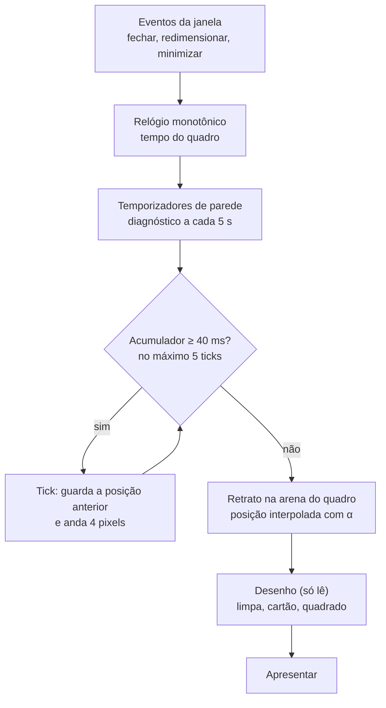

# Plano da fatia 0: Fundação

## Resumo para o dono

Primeiro, uma tarefa curta prova que as máquinas da CI conseguem usar a placa de vídeo nos 3 sistemas, porque é o maior risco da fatia. Depois vêm as peças sem tela (laço de ticks, handles, arena, log), testadas sem janela, e por fim a placa de vídeo, a janela, a tela da fundação e a prova visual. Cada peça é uma tarefa com teste e commit próprios.

## Abordagem

1. **Sondagem da CI (primeira tarefa).** Um teste mínimo cria o dispositivo do SDL GPU sem janela, limpa uma textura, lê os pixels de volta e registra o backend e a placa. Ele roda na CI dos 3 sistemas: no Linux pelo Vulkan por software (lavapipe, que a CI já instala), no Windows pelo Direct3D 12 por software (WARP) e no macOS pelo Metal. A mesma tarefa testa uma janela no Linux num servidor de vídeo virtual (Xvfb). **Se um sistema não tiver placa de vídeo na CI, a fatia para** e o bloqueio vai para o dono decidir (ver "Riscos").
2. **Tempo** (`Engine/Time`): o relógio de ticks é uma função pura do tempo que passou, sem relógio do sistema dentro dele. Quem chama informa o tempo de cada quadro, o que permite simular 10 minutos em milissegundos nos testes. Os exemplos da seção "Suficiência das descrições" viram os testes.
3. **Peças de base** (`Engine/Core`): o `NEXUM_ASSERT`, o `Handle` geracional e o pool, a arena e a imagem RGBA.
4. **Log e profiler** (`Engine/Debug`): o log recebe a saída no construtor (sem estado global). O Tracy só é ligado com a opção `NEXUM_PROFILER`.
5. **Plataforma** (`Engine/Platform`): o `main` do `MuClient` chama a plataforma, que entra nos *main callbacks* do SDL pelo `SDL_EnterAppMainCallbacks`. Assim o SDL continua escondido atrás do módulo (INV-10). Também ficam aqui a janela, os eventos dela, o relógio monotônico e o PNG (o próprio SDL 3.4 lê e grava PNG, sem biblioteca nova).
6. **Placa de vídeo** (`Engine/Render`): o dispositivo, o alvo da janela, o alvo sem janela com a leitura dos pixels, as texturas por handle e a cópia de textura para a tela (o *blit* do SDL GPU, que não precisa de shader próprio).
7. **Tela da fundação** (`Games/MuOnline`): o estado do quadrado (anterior e atual) avança no tick; o desenho recebe um retrato com o α e só lê. O retrato é montado na arena do quadro.
8. **Prova visual:** o `MuClient` de desenvolvimento grava a cena de prova com `--capture`; o `Tools/visualproof` compara com a imagem aprovada. Um teste do CTest faz os dois passos em sequência.
9. **Teste de alocação do quadro:** um programa de teste próprio troca o `operator new` global por um contador e roda 1.000 quadros da tela da fundação sem janela.
10. **CI e documentação:** os ajustes das travas listados em "Decisões e dependências", e a documentação viva.

## Alvos e módulos afetados

| Alvo do build | O que muda |
|---|---|
| `nexum_core` | `NEXUM_ASSERT`, `Handle` e `HandlePool`, `FrameArena`, `Image` |
| `nexum_time` (novo) | `TickClock`, temporizadores de parede e de tick, diagnóstico do laço |
| `nexum_debug` (novo) | `Logger` com categorias e níveis; macros do profiler e o Tracy opcional |
| `nexum_platform` | entrada pelos *main callbacks*, `Window`, relógio monotônico, `LoadPng` e `SavePng` |
| `nexum_render` (novo) | `GpuDevice`, escolha do backend, alvo da janela, alvo sem janela com leitura, texturas por handle, cópia para a tela, cartão de teste |
| `MuOnline` | a cena da fundação (estado por tick e retrato) |
| `MuClient` | a tela da fundação; `--frames`, `--gpu-driver` e, no build de desenvolvimento, `--capture` |
| `visualproof` (novo, em `Tools/`) | compara duas imagens; só existe no build de desenvolvimento |
| `other_game` | passa a abrir o relógio de ticks, para provar que a Engine serve a outro jogo sem o módulo MU |

## Visão de destino

- **Tempo:** o `TickClock` já é o relógio final do [ADR 0005](../../docs/adr/0005-tick-fixo-de-25-hz.md). Quando houver rede (M2), o tick aplica os eventos pendentes antes dos comandos; a ordem do quadro já fica escrita no laço do `MuClient` com os pontos vazios marcados.
- **Handles e arena:** são os tipos definitivos do [III.6 da spec](../../docs/referencia/especificacao-engine-propria-caminho-b.md#iii6-memória-e-ciclo-de-vida). Entidades (M1/M2), recursos e vozes de áudio usam o mesmo `Handle`. A arena por tick é outra instância do mesmo tipo, criada quando houver eventos e comandos.
- **Render:** a interface pública fala em dispositivo, alvo, textura e quadro, sem nada do SDL, e já separa o desenho com janela do desenho sem janela. A lista fixa de passes (IV.9.1) entra no M1/M3 por cima disso, sem mudar a criação do dispositivo nem a escolha do backend.
- **Captura sem janela:** é a mesma que o M3 usa para as cenas de paridade, e o `visualproof` é a semente do `Tools/parity` (SSIM no M3).
- **Plataforma:** a janela já repassa redimensionar e minimizar. Teclado, mouse e IME entram pelo mesmo caminho de eventos.
- **Nenhuma porta fechada:** nada desta fatia depende do cartão de teste. Ele é só a primeira cena, e some quando o visualizador do M1 chegar.

## Simplificações provisórias

| Item provisório | Por que é provisório | Destino |
|---|---|---|
| O log só escreve no terminal | a pasta do usuário, a configuração e o relatório de falhas entram juntos | M7 |
| Não há contagem de samplers por quadro ([ADR 0029](../../docs/adr/0029-sdl3-e-sdl-gpu.md)) | a fatia ainda não usa nenhum sampler próprio | M1 |
| A tela do `MuClient` é o cartão de teste | ainda não existe nenhum modelo para mostrar | M1 |
| A prova visual compara só pixel a pixel | a comparação perceptual (SSIM) chega com a primeira cena de paridade ([ADR 0028](../../docs/adr/0028-prova-visual-e-paridade.md)) | M3 |
| A CI usa placas de vídeo por software, e o piso de hardware não foi medido em máquinas reais | as metas de fluidez só valem a partir do M3, e a medição completa dos orçamentos é do M7 | M7 |
| O defeito do D3D12 com mais de 2048 samplers por quadro continua aberto no SDL 3.4.20 | a correção está prevista para o SDL 3.6.0; até lá, o Vulkan segue como padrão no Windows | M14 |

## Decisões e dependências

**Biblioteca nova (precisa da sua aprovação):**

- **Tracy 0.15.0**, o profiler. Licença BSD-3-Clause, BSD-2-Clause e MIT. Sem as ferramentas gráficas e sem o tratador de falhas; no modo "sob demanda", que só coleta quando o programa do Tracy se conecta. Fica atrás do `Engine/Debug`, só no build de desenvolvimento e só quando ligado com `NEXUM_PROFILER=ON`. Desligado por padrão porque, ligado, cada programa abre uma porta de rede, e o Windows pediria a liberação do firewall a cada teste.

**Mudanças nas travas (precisam da sua aprovação):**

| Trava | Mudança | Por quê |
|---|---|---|
| `vcpkg.json` | o Tracy; no Linux, o SDL com X11 e Wayland | o profiler do M0; a janela de verdade no Linux ([TD-0003](../../docs/TECH_DEBT.md)) |
| `.github/actions/setup-build/action.yml` | os pacotes do Linux para compilar o SDL com X11 e Wayland, e o Xvfb | sem eles o SDL não compila com janela, e a CI do Linux não tem tela |
| `.github/workflows/ci.yml` | os testes do Linux rodam dentro do Xvfb; um passo compila com o profiler ligado | o CA-10 e o CA-05 |
| `tests/visual/approved/` | a primeira imagem aprovada, `0000-test-card.png` | o CA-07. Só entra depois do seu "sim" |
| `cmake/NexumSanitizers.cmake`, se for preciso | uma lista de supressões para vazamentos dentro dos drivers de vídeo do sistema (Mesa, X11), nunca no código do Nexum | os sanitizers do Linux acusam vazamentos nas bibliotecas do sistema; cada supressão é listada no report |

**Mudança na VISÃO (precisa da sua aprovação):** a tabela "Piso de hardware" ganha a lista exata do SDL GPU 3.4.20:

- Windows 10 ou mais novo, com uma placa de Direct3D 12 de nível 11_0 e *Resource Binding Tier 2*, ou com Vulkan;
- Linux com Vulkan 1.0 e os recursos que o SDL exige (`VK_KHR_swapchain`, `VK_KHR_maintenance1`, *independent blend*, *image cube array*, *depth clamp*, *shader clip distance*, *draw indirect first instance* e *sample rate shading*);
- macOS 10.14 ou mais novo, com Apple Silicon ou uma placa Intel da família *Mac2*.

**Sem ADR novo.** As decisões desta fatia aplicam ADRs que já existem:

- o Vulkan primeiro no Windows segue o [ADR 0029](../../docs/adr/0029-sdl3-e-sdl-gpu.md);
- o profiler só no desenvolvimento segue o [D-18 da spec](../../docs/referencia/especificacao-engine-propria-caminho-b.md#d-18--configuração-logs-e-diagnóstico);
- o tempo pausado é descartado, para que sair da pausa não dispare 5 ticks de uma vez. É uma decisão da engine, não do original;
- o `NEXUM_ASSERT` fica ligado no build de desenvolvimento e desligado no build de jogador.

**Formatos da engine e contrato de rede:** nenhuma mudança.

**Documentos vivos atualizados:** [ARCHITECTURE](../../docs/ARCHITECTURE.md) (módulos novos; os workers passam do M0 para o M1), [CONVENTIONS](../../docs/CONVENTIONS.md) (código de referência), [TECH_DEBT](../../docs/TECH_DEBT.md), [THIRD_PARTY](../../docs/THIRD_PARTY.md), [VISUAL](../../docs/VISUAL.md) (a ferramenta de comparação passa a existir; precisa da sua aprovação junto com a VISÃO) e [docs/setup/DEV.md](../../docs/setup/DEV.md) (os pacotes do Linux).

## Fontes da central usadas

| Comportamento | Fonte na central | Base |
|---|---|---|
| A lógica anda a 25 passos por segundo, 40 ms cada | spec de referência, [I.2](../../docs/referencia/especificacao-engine-propria-caminho-b.md#i2-tempo-os-25-fps-de-referência) (Fato: o original rodava travado a 25 FPS) e [D-05](../../docs/referencia/especificacao-engine-propria-caminho-b.md#d-05--modelo-de-tempo-tick-fixo-de-25-hz-com-interpolação) | Client `c405ae907`, Server `b53c704c6` |
| As regras do laço: até 5 ticks por quadro, o descarte do excesso, o α, a pausa e os relógios de parede | spec de referência, D-05, [III.4](../../docs/referencia/especificacao-engine-propria-caminho-b.md#iii4-anatomia-de-um-frame) e [IV.2](../../docs/referencia/especificacao-engine-propria-caminho-b.md#iv2-tempo-e-laço-enginetime). São decisões da spec, não comportamento do original | a mesma |

A central não tem achados sobre o SDL GPU além da spec: a busca em `knowledge/` e `docs/specs/` só encontrou a própria spec e a auditoria dela. O que o marco manda investigar antes é documentação externa:

| Assunto | Fonte externa | O que diz |
|---|---|---|
| Requisitos do SDL GPU | `SDL_gpu.h` do SDL 3.4.20 (a versão fixada no vcpkg), seção "System Requirements" e as propriedades de `SDL_CreateGPUDeviceWithProperties` | a lista da VISÃO acima; o Vulkan aceita drivers por software, como o lavapipe; só existem os backends Vulkan, Direct3D 12 e Metal |
| Defeito do D3D12 | [SDL #16369](https://github.com/libsdl-org/SDL/issues/16369), aberto, com a correção prevista para o 3.6.0; [SDL #16653](https://github.com/libsdl-org/SDL/issues/16653), fechado sem correção | o lote de descritores pode passar do fim do heap de 2048 samplers; o Vulkan não é afetado |
| Navegador | o mesmo `SDL_gpu.h` | não há backend para o navegador; o WebAssembly continua fora do escopo |

## Suficiência das descrições

### Comportamento: ritmo do laço de ticks

| O que a descrição precisa dizer | O que ela diz | Fonte |
|---|---|---|
| Entradas e saídas | entra o tempo do relógio monotônico a cada quadro; sai quantos ticks rodar neste quadro, o número do tick e o α para o desenho | D-05, III.4 |
| Ordem dos passos | soma ao acumulador o menor valor entre o tempo do quadro e 5 ticks; enquanto o acumulador tiver 40 ms ou mais, roda um tick (guarda o estado anterior, aplica eventos, executa comandos, roda os sistemas), tira 40 ms e soma 1 ao número do tick; no fim, α = acumulador ÷ 40 ms | III.4 |
| Tempos | 40 ms por tick (25 por segundo); no máximo 5 ticks por quadro (200 ms); os relógios de parede são independentes de quadros e ticks e continuam durante carregamentos | I.2, D-05 |
| Limites e casos de erro | um atraso acima de 200 ms é descartado, e o tempo da simulação "escorrega"; comandos nunca se repetem para recuperar ticks; pausada, a simulação não roda ticks e o desenho continua com o α fixo | D-05 |
| Números | 40 ms, 25 ticks por segundo, 5 ticks por quadro; o teste de 10 minutos com quadros de 5 a 200 ms | D-05, IV.2 |

A descrição não diz o que fazer com o tempo que passa durante a pausa. Isso é uma decisão da engine, não um comportamento do original, e por isso não vai para a central: o tempo pausado é descartado (ver "Decisões e dependências").

Exemplos esperados, escritos só a partir da descrição (viram testes no `/implementar`):

| Entrada | Resultado esperado | De onde veio |
|---|---|---|
| três quadros de 16 ms, a partir do zero | 1º: 0 ticks, α 0,4; 2º: 0 ticks, α 0,8; 3º: 1 tick, α 0,2 | calculado pela descrição |
| um quadro de 1.000 ms (o jogo travou) | 5 ticks; 800 ms descartados; α 0 | calculado pela descrição |
| um quadro de 39 ms e depois um de 250 ms | 1º: 0 ticks, α 0,975; 2º: 5 ticks, 50 ms descartados, α 0,975 | calculado pela descrição |
| 10 minutos (600.000 ms) em quadros de 5 a 200 ms; um objeto anda 3 unidades por tick | 15.000 ticks, nenhum descartado; o objeto termina em 45.000; α 0 | calculado pela descrição (o teste da IV.2) |

Perguntas abertas para a central: nenhuma

## Riscos

- **As máquinas da CI podem não ter placa de vídeo.** No Linux, o lavapipe é conhecido e já está instalado. No Windows, não está provado que o SDL GPU aceita o WARP. No macOS, os relatos sobre o Metal nas máquinas virtuais do GitHub se contradizem. Por isso a sondagem é a primeira tarefa. Se um sistema falhar, a fatia para e as opções vão para você. Um exemplo de opção: rodar a captura nesse sistema só na máquina de desenvolvimento, com essa limitação escrita no report. Nenhum teste é desligado em silêncio.
- **A mesma imagem em quatro placas diferentes** (lavapipe, WARP, Metal e a sua placa). A cena usa só limpeza de tela e cópia de textura em tamanho real, sem filtro, num formato de cor fixo e com cores exatas. Se um backend der diferente, a causa é investigada, e a tolerância nunca é aumentada sem a sua aprovação.
- **Os sanitizers do Linux com o driver de vídeo por software** costumam acusar vazamentos dentro do Mesa e do X11. A supressão vale só para bibliotecas do sistema, é listada no report e muda uma trava (ver acima).
- **O SDL com X11 e Wayland** exige pacotes do sistema no Linux, na CI e na máquina de quem desenvolve. A lista fica no `setup-build` e no [DEV.md](../../docs/setup/DEV.md).
- **A fatia é grande para um marco M.** São 13 critérios. Se, depois da sondagem, o resto parecer grande demais, a proposta é dividir em duas fatias (as peças sem tela e a parte gráfica), com a sua aprovação.

## Testes

| Critério | Como é provado |
|---|---|
| CA-01 | teste automático em `Engine/Time/Tests/TickClockTest.cpp` |
| CA-02 | testes automáticos em `Engine/Time/Tests/TickClockTest.cpp`, com os exemplos deste plano |
| CA-03 | testes automáticos em `Engine/Time/Tests/TimersTest.cpp` e `Engine/Time/Tests/TickDiagnosticsTest.cpp` |
| CA-04 | testes automáticos em `Engine/Core/Tests/HandlePoolTest.cpp` e `Engine/Core/Tests/FrameArenaTest.cpp`; o assert, por um teste do CTest que espera a falha e a mensagem |
| CA-05 | testes automáticos em `Engine/Debug/Tests/LoggerTest.cpp`; o profiler ligado, pelo passo da CI; o build de jogador, por um teste de configuração do CMake |
| CA-06 | teste automático da ordem de escolha em `Engine/Render/Tests/GpuDriverOrderTest.cpp`, sem placa de vídeo; o log do backend, pelo CA-10 na CI |
| CA-07 | teste do CTest que roda `MuClient --capture` e depois `visualproof`, nos 3 sistemas da CI |
| CA-08 | testes automáticos em `Tools/visualproof/Tests/ImageComparisonTest.cpp` |
| CA-09 | teste automático em `Games/MuOnline/Tests/FrameAllocationTest.cpp`, num programa de teste próprio |
| CA-10 | teste do CTest que roda `MuClient --frames 300`, nos 3 sistemas da CI |
| CA-11 | verificação manual do dono, registrada no report |
| CA-12 | o report mostra a CI verde, o CA-01 e o teste da checagem `architecture` que reprova um `#include` proibido |
| CA-13 | revisão dos documentos e a checagem `docs` |

## Diagramas

O quadro da tela da fundação, na ordem do [III.4 da spec](../../docs/referencia/especificacao-engine-propria-caminho-b.md#iii4-anatomia-de-um-frame). Os passos que ainda não existem (rede, cargas) ficam marcados no código, vazios:

