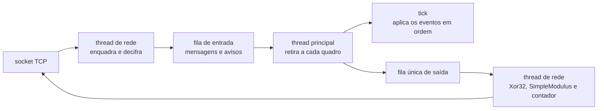
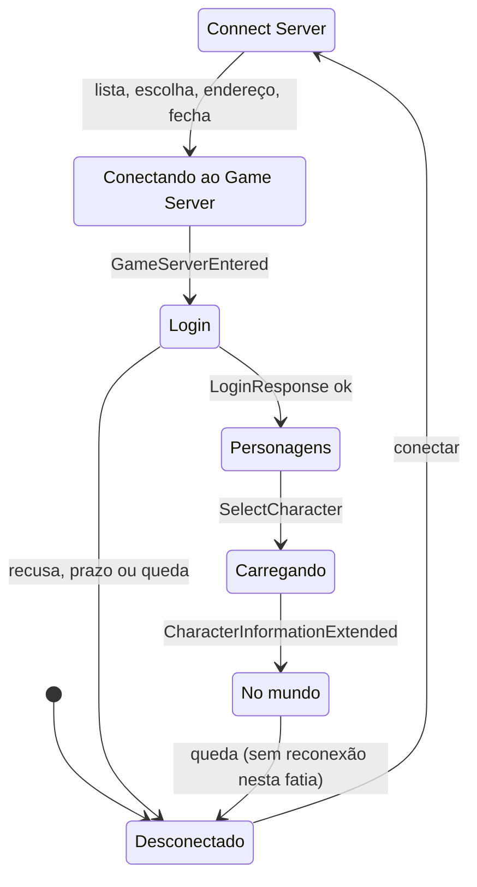

# Plano da fatia 1: A rede até o mundo

## Resumo para o dono

A fatia é feita de baixo para cima, sempre com os vetores da central como prova. Primeiro vem o que vira bytes: o gerador do codec, o enquadramento, a cifra, o item e a aparência. Depois vem o que conversa: a conexão de rede, a sessão, o ping e os eventos. Por último, o `MuClient` se liga a um OpenMU de verdade, no seu computador. As travas que mudam (o Asio no vcpkg, o fuzzing na CI e nas checagens) entram no começo, cada uma com o seu "sim".

## Abordagem

1. **Travas e dependências.** O Asio entra no `vcpkg.json`, e a checagem `architecture` passa a conhecer o dono dele (`Engine/Net`). O `cmake/` ganha a opção `NEXUM_FUZZING` e as funções que declaram um alvo de fuzzing e o código gerado. O `CMakePresets.json` ganha um preset de fuzzing no Linux com Clang, e a CI, um passo que roda cada alvo por 60 s. A checagem `structure` passa a aceitar `third_party/openmu`. Cada mudança é explicada e pede o "sim" do dono na hora.
2. **Os XML do OpenMU** vão para `third_party/openmu`, com o aviso da licença MIT e a base `b53c704c6`. O terminal do Nexum não alcança a central, então o dono copia os arquivos com um comando pronto.
3. **O `packetgen`** (`Tools/PacketGen`), em Python 3, só com a biblioteca padrão. Ele lê o esquema e os XML e gera, para cada pacote:
   - as constantes (tipo do cabeçalho, código, subcódigo e tamanho);
   - uma leitura que confere o tamanho mínimo antes de dar acesso aos campos;
   - uma escrita que monta o pacote num espaço dado;
   - um teste dos bytes fixos e do tamanho.

   Cada campo é lido com a ordem dos bytes e o deslocamento de bits que o XML declara. O CMake roda o gerador no build, e o código gerado fica na pasta de build ([ADR 0034](#decisões-e-dependências), novo).
4. **O dialeto 106.3** (`Games/MuOnline`, `Mu/Protocol`): a tabela escrita à mão "código e direção → variante", os códigos ingleses e uma configuração única com a versão `20404` e o número de série `NEXUM-CLIENT-001`.
5. **O enquadramento:** um leitor incremental que recebe pedaços de bytes e entrega mensagens inteiras.
6. **A cifra, no papel do cliente:** o SimpleModulus (cifrar o que sai e decifrar o que chega, cada direção com o seu contador), o Xor32 em tudo o que sai e o Xor3 nos campos do login.
7. **O item e a aparência estendidos**, escritos à mão, cada um convertido num componente neutro.
8. **A estrutura de fuzzing** e um alvo para cada leitor: o enquadramento, a cifra, o item, a aparência, a leitura dos pacotes do dialeto, o `ParseVersion` e o `LoadPng`. Sem a opção `NEXUM_FUZZING`, cada alvo vira um teste comum que roda as sementes dele nos 3 sistemas. O `LoadPng` passa a ler o tamanho no cabeçalho antes dos pixels ([TD-0020](../../docs/TECH_DEBT.md)).
9. **O transporte** (`Engine/Net`, módulo novo):
   - uma conexão TCP com o Asio, numa thread própria;
   - uma interface de transformação de bytes, que a engine define e o módulo MU implementa;
   - uma fila de entrada com as mensagens já decifradas e os avisos da conexão;
   - uma única fila de saída, cifrada só na thread de rede.

   As filas reservam a memória ao abrir a conexão e são protegidas por mutex, como aceita o [ADR 0006](../../docs/adr/0006-modelo-de-threads.md). O Asio é usado com os códigos de erro, sem exceções.
10. **A sessão** (`Mu/Session`): uma máquina de estados com os prazos, a época e a fila dos eventos guardados durante o carregamento.
11. **O ping:** um temporizador de parede de 20 s, a partir da entrada no Game Server.
12. **A tradução e a visão do mundo** (`Mu/Translate` e `Mu/World`): os pacotes viram eventos neutros, e os eventos são aplicados um a um no tick, numa tabela simples dos objetos na visão. O log conta cada mudança.
13. **O `MuClient`:** as opções novas e a leitura da senha no terminal sem eco. A leitura sem eco é uma função nova do `Engine/Platform`, que só depende do sistema operacional.
14. **A janela minimizada** ([TD-0015](../../docs/TECH_DEBT.md)): a plataforma informa se alguma janela está visível. Se nenhuma estiver, o laço espera até a hora do próximo tick, nunca mais que 40 ms. O teste usa um relógio de teste.
15. **O quadro sem alocação:** o teste de alocação do quadro passa a ter mensagens de rede chegando por um transporte de teste.
16. **O ambiente de teste e a integração:** o arquivo do Docker em `tests/integration/openmu` (a imagem fixada pela impressão digital, `-demo`, as portas só em `127.0.0.1`, o resolvedor de IP e os processadores 0 a 5) e um teste de integração que só roda quando o endereço do servidor está configurado. Depois, o teste do dono.
17. **A documentação:** a ARCHITECTURE, as páginas dos módulos, o THIRD_PARTY, o ADR 0034 e o TECH_DEBT.

## Alvos e módulos afetados

| Alvo do build | O que muda |
|---|---|
| `nexum_net` (`Nexum::Net`, novo, `Engine/Net`) | a conexão TCP com o Asio, a thread de rede, as filas de entrada e de saída e a interface da transformação de bytes |
| `nexum_net_tests` (novo) | a conexão contra um servidor de teste local, a ordem das filas e os avisos de erro |
| `nexum_platform` | a leitura de uma linha do terminal sem eco; a informação de janela visível; o `LoadPng` conferindo o cabeçalho |
| `nexum_core` | nada no código; ganha o alvo de fuzzing do `ParseVersion` |
| `MuOnline` | `Mu/Protocol` (enquadramento, cifra, dialeto, código gerado, item e aparência), `Mu/Session`, `Mu/Translate` e `Mu/World` |
| `muonline_tests`, `muonline_frame_allocation_tests` | os vetores, a sessão sem rede, a visão do mundo com eventos e o quadro com mensagens de rede |
| `MuClient` | as opções novas, a sessão dentro do laço, o log e o ritmo com a janela minimizada |
| `packetgen` (novo, `Tools/PacketGen`, em Python) | o gerador do codec e os testes dele |
| alvos `*_fuzz` (novos) | um por leitor; só existem com `NEXUM_FUZZING=ON`, no Clang |
| `third_party/openmu` (pasta nova) | os XML de pacotes e o esquema do OpenMU, com o aviso MIT |
| `tests/integration/openmu` (pasta nova) | o arquivo do Docker do servidor de teste e o teste de integração |

## Visão de destino

- **Transporte.** No destino, o mesmo `Engine/Net` serve à terceira conexão (o chat), às métricas do painel do modo de autoria (IV.18) e à reconexão. A interface de transformação de bytes deixa a engine servir a outro jogo sem saber nada do MU. As filas com mutex só viram filas sem trava se uma medição mostrar disputa ([ADR 0006](../../docs/adr/0006-modelo-de-threads.md)).
- **Codec.** O gerador produz todas as variantes do XML, e a tabela do dialeto é o único lugar que sabe o que é o 106.3. Quando o OpenMU mudar, basta trocar os XML, gerar de novo e refazer a tabela (o risco 5 da spec de referência).
- **Sessão.** A máquina de estados já nomeia os estados de IV.14.1 que ainda não existem ("Trocando de mapa" e "Reconectando"). A troca de mapa (M4) e a reconexão (M7) entram sem mudar a interface.
- **Eventos.** Os eventos neutros são o contrato estável entre o protocolo e os sistemas do jogo. O replay da fatia 2 alimenta os mesmos eventos, e os sistemas do M4 e do M5 os consomem do mesmo jeito.
- **Visão do mundo.** No destino, os objetos viram entidades do `Engine/World`, com a coordenada dupla do kit (M4). Agora, uma tabela por id no módulo MU basta, porque ainda não há desenho nem movimento.
- **Credenciais.** A sessão recebe a conta e a senha como valores, sem saber de onde elas vieram. No M6, a tela de login entrega os mesmos valores, e o terminal sai.
- **Fuzzing.** Os mesmos alvos rodam 1 hora cada antes de fechar o M2, e depois toda noite (V.1 da spec de referência).
- **Ritmo.** A mesma espera serve ao limite de FPS da configuração de vídeo (IV.17), no M7.

## Simplificações provisórias

| Item provisório | Por que é provisório | Destino |
|---|---|---|
| A conta, a senha, o servidor e o personagem vêm da linha de comando e do terminal | ainda não existe a tela de login | M6 |
| Uma queda encerra a sessão com erro, sem reconexão e sem nova tentativa depois de "conta já conectada" | a reconexão é do M7 no roteiro | M7 |
| Os prazos das respostas são fixos, de 10 s | a configuração em JSON é do M7 | M7 |
| Os vetores vêm dos documentos da central, sem o programa em C# que gera vetores com a biblioteca do OpenMU (V.2.1 da spec de referência) | esse programa exigiria o .NET no build e na CI. A central já tirou vetores independentes dos testes do OpenMU e das capturas reais | M2, parte 2: rever no planejamento dela |
| O teste de integração contra o OpenMU roda só no computador do dono | a CI teria de baixar a imagem de 425 MB e subir o servidor a cada execução | M7 |
| A CI roda cada alvo de fuzzing por 60 s; a 1 hora por alvo fica para depois | a V.3 pede a 1 hora antes de fechar o marco, e o M2 fecha na parte 2 | M2, parte 2 |
| A visão do mundo é uma tabela por id no módulo MU, sem entidades | ainda não há desenho nem movimento | M4 |

Cada item entra no [TECH_DEBT](../../docs/TECH_DEBT.md) na tarefa que o cria, com o número seguinte (a partir do TD-0026).

## Decisões e dependências

- **ADR novo, o 0034: o gerador do codec em Python, rodando no build.** É uma decisão própria, porque a spec de referência só diz que o gerador é nosso.
  - Em Python 3, só com a biblioteca padrão, que já é exigida pelo `scripts/dev.py` e pelas checagens.
  - O código gerado fica na pasta de build, não no repositório, e é conferido pelos testes gerados e pelos vetores.
  - Alternativas: o gerador em C++, que precisaria de uma biblioteca de XML nova; e o código gerado guardado no repositório, que poria milhares de linhas no diff a cada mudança do XML.
- **Biblioteca nova (precisa da aprovação do dono):** o Asio standalone, pela porta `asio` do vcpkg, com a Boost Software License 1.0. O dono é o `Engine/Net`, como o [ADR 0033](../../docs/adr/0033-dono-de-cada-biblioteca-externa.md) já previa.
- **Conteúdo de terceiros:** os XML de pacotes, o `CommonEnums.xml`, o `PacketHeaders.xml` e o esquema `PacketDefinitions.xsd` do OpenMU (MIT), em `third_party/openmu`, com o aviso da licença e a base `b53c704c6`.
- **Contrato de rede (precisa da aprovação do dono):**
  - o Nexum se apresenta ao OpenMU como o cliente 106.3 em inglês, com a versão `20404` e o número de série `NEXUM-CLIENT-001`;
  - usa os códigos ingleses (`D4`, `15`, `11` e `DB`);
  - segue sempre o endereço que o Connect Server devolve;
  - o Connect Server padrão fica na porta 44406.
- **Formatos da engine:** nenhum. O `.mucap` é da fatia 2.
- **Travas que mudam,** cada uma com o motivo:
  - `vcpkg.json`: o Asio, para o transporte TCP;
  - `scripts/checks/`: a checagem `architecture` aceita o Asio só no `Engine/Net`; a checagem `structure` aceita a pasta `third_party/openmu` e o registro, no THIRD_PARTY, de conteúdo de terceiros que não vem do vcpkg;
  - `cmake/`: a opção `NEXUM_FUZZING` e as funções que declaram os alvos de fuzzing e o código gerado pelo `packetgen`;
  - `CMakePresets.json`: o preset de fuzzing no Linux com Clang;
  - `.github/`: o passo que compila esse preset e roda cada alvo por 60 s;
  - `scripts/dev.py` e `.clang-tidy`, só se for preciso para rodar o fuzzing ou deixar o código gerado fora da análise. Nesse caso, o motivo vai antes do pedido.

## Fontes da central usadas

A base de todas as fontes abaixo é a mesma: o OpenMU `b53c704c6` e o MuMain `c405ae907`, conferidos pela central. A spec de protocolo foi atualizada em 2026-11-22. Os caminhos são da central; os achados ficam em `knowledge/protocolo/`, e a spec de protocolo, em `docs/specs/protocolo/protocolo-106-3-m2.md`.

| Comportamento | Fonte na central | Base |
|---|---|---|
| Conexões, portas e o Connect Server sem cifra | spec de protocolo, §2; achado `2026-11-21-portas-numa-instalacao-nova.md` | b53c704c6 |
| Enquadramento `C1` a `C4` | spec de protocolo, §3 | b53c704c6 |
| SimpleModulus, contador, Xor32 e Xor3 | spec de protocolo, §4.1 a §4.5; achado `2026-11-21-cifra-simplemodulus-xor32-xor3.md` (chaves e vetores V1 a V9) | b53c704c6 |
| Versão, idioma e variantes do dialeto 106.3 | spec de protocolo, §5.1 e §5.2; achados `2026-11-21-variantes-por-versao-m2.md` e `2026-11-21-codigos-por-idioma.md` | b53c704c6 |
| A sessão até "No mundo", campo a campo | spec de protocolo, §6.1 a §6.12; achado `2026-11-21-sessao-106-3-campo-a-campo.md` | b53c704c6 |
| A ordem real do primeiro ingresso, o ping desde a entrada no Game Server e o `C1 B2 1A` | achado `2026-11-21-capturas-reais-sessao-106-3.md`, §3 e §4 | imagem 0.10.1 (`766da9a12`) e MuMain c405ae907 |
| Item estendido | spec de protocolo, §7.1; achado `2026-11-21-item-estendido.md` | b53c704c6 |
| Aparência estendida e o layout do `C2 12` | spec de protocolo, §7.2; achado `2026-11-21-aparencia-estendida.md`, §1, §2 e §4 | b53c704c6 |
| Pacotes do mundo: ping, eco do andar, `C2 13`, `C1 14`, `C1 15` e `C1 46` | spec de protocolo, §8; achado `2026-11-21-variantes-por-versao-m2.md`, §4 | b53c704c6 |
| As direções do andar e os vetores V1 a V6 (só a leitura do eco nesta fatia) | spec de protocolo, §8.1; achado `2026-11-22-direcoes-do-walkrequest.md` | b53c704c6 |
| Estados e erros | spec de protocolo, §9 | b53c704c6 |
| Servidor de teste: a imagem, a impressão digital, o `-demo`, o resolvedor de IP e as contas | spec de protocolo, §10; achados `2026-11-21-versao-docker-para-testes.md` e `2026-11-21-capturas-reais-sessao-106-3.md`, §1 | imagem 0.10.1 |
| Vetores de teste | spec de protocolo, §11; os achados da cifra, do item, da aparência, das direções e das capturas reais | b53c704c6 |
| O layout de cada campo dos pacotes gerados | os XML do OpenMU em `Server/src/Network/Packets/` (`ConnectServer`, `ClientToServer`, `ServerToClient`, `ChatServer`, `CommonEnums.xml`, `PacketHeaders.xml`) e o esquema `PacketDefinitions.xsd` (MIT) | b53c704c6 |
| Os parâmetros do servidor (`-demo` e `RESOLVE_IP`) e as contas de teste | documentos do OpenMU: `Server/docs-website/docs/deployment/startup-parameters.md` e `Server/docs-website/docs/getting-started/test-accounts.md` | b53c704c6 |

Na cópia da spec de referência: [I.13](../../docs/referencia/especificacao-engine-propria-caminho-b.md#i13-rede-o-contrato-com-o-openmu), [IV.14](../../docs/referencia/especificacao-engine-propria-caminho-b.md#iv14-rede-enginenet--gamesmuonlineprotocol-session-translate), [D-10](../../docs/referencia/especificacao-engine-propria-caminho-b.md#d-10--rede-adaptador-em-camadas-codec-gerado-dialeto-1063), [V.2](../../docs/referencia/especificacao-engine-propria-caminho-b.md#v2-o-banco-de-paridade) e [V.3](../../docs/referencia/especificacao-engine-propria-caminho-b.md#v3-fuzzing).

Nenhum achado usado está com status `revisar` ou `obsoleto`. O laboratório de captura (`C:\dev\nexum-lab`) não é aberto, porque guarda também uma cópia do código do MuMain.

## Suficiência das descrições

### Comportamento: enquadramento

| O que a descrição precisa dizer | O que ela diz | Fonte |
|---|---|---|
| Entradas e saídas | bytes do TCP, em pedaços de qualquer tamanho → mensagens inteiras | spec de protocolo, §3 |
| Ordem dos passos | o 1º byte dá o tipo; o tamanho vem em 1 byte (`C1`, `C3`) ou em 2 bytes big-endian (`C2`, `C4`) e inclui o cabeçalho; o código fica no byte h e o subcódigo no h+1; o leitor junta mensagens partidas e separa as coladas | §3 |
| Tempos | nenhum: tudo acontece na thread de rede, a cada leitura | §1 e D-10 |
| Limites e casos de erro | um 1º byte desconhecido ou um tamanho 0 fecham a conexão. Um tamanho menor que o cabeçalho também fecha: é uma regra própria do Nexum para dados de fora (INV-12), não um comportamento do original | §3 |
| Números | cabeçalho de 2 bytes em `C1` e `C3` e de 3 bytes em `C2` e `C4`; tamanho máximo de 255 e de 65.535 | §3 |

| Entrada | Resultado esperado | De onde veio |
|---|---|---|
| `C1 04 00 01 C1 04 F4 06`, num pedaço só | duas mensagens, `C1 04 00 01` e `C1 04 F4 06` | calculado pela descrição |
| `C2 00`, e depois os outros 17 bytes de `C2 00 13 F4 06 00 03 …` | uma mensagem de 19 bytes (`00 13` = 19), entregue só quando o 19º byte chega | calculado pela descrição, com os bytes da captura real (achado das capturas, §3) |
| `C5 04 00 01`, ou `C1 00 F4` | erro de cabeçalho, e a conexão fecha | calculado pela descrição |

### Comportamento: SimpleModulus e o contador

| O que a descrição precisa dizer | O que ela diz | Fonte |
|---|---|---|
| Entradas e saídas | um pacote `C3` ou `C4` em claro (no cliente, já com o Xor32) e o contador da direção → o pacote cifrado; e o caminho contrário | §4.1 e §4.2 |
| Ordem dos passos | o contador é acrescentado antes do código; o fluxo é cortado em blocos de 8 bytes, o último completado com zeros; cada bloco vira 11 bytes; o tamanho do pacote é reescrito; o contador avança. Ao decifrar: confere o múltiplo de 11, decifra cada bloco, confere o contador e o tira. O pseudo-código de um bloco está completo, com as duas passadas e o empacotamento em 4 valores de 18 bits | §4.2 |
| Tempos | por pacote, na thread de rede, na ordem do fio; o contador avança depois de cada `C3` ou `C4` inteiro | §4.2 e "Para uma engine moderna" |
| Limites e casos de erro | contador errado, checksum errado, n maior que 8 e tamanho fora do múltiplo de 11 derrubam a conexão, sem ressincronização; o checksum soma os 8 bytes, com o enchimento; `C1` e `C2` não gastam contador; o maior `C3` em claro tem 185 bytes; o contador do login não é necessariamente 0 | §4.2, §6.6 e §9 |
| Números | as chaves M, X, E e D das duas direções; as constantes `F8` e `3D`; o contador de 1 byte, de 255 de volta a 0 | §4.2 |

| Entrada | Resultado esperado | De onde veio |
|---|---|---|
| o bloco `00 0E 00 01 33 FE 27 00`, com n = 8 e as chaves C→S | os valores de 18 bits `0x031C8`, `0x0668A`, `0x048E9` e `0x04D46`, e a saída `C8 31 22 99 8E 94 81 19 34 28 1D` | vetor V1 do achado da cifra. Refeito à mão nesta conferência, só pela descrição: as duas passadas, o empacotamento, o checksum `1D` (`F8` ⊕ os 8 bytes) e o byte 9, `28` (8 ⊕ `3D` ⊕ `1D`), batem |
| o mesmo ping do cliente com os contadores 0, 1 e 255 | `C3 18 BC 9D …`, `C3 18 24 98 …` e `C3 18 62 62 …`: só o 1º bloco muda | vetor V4 do achado da cifra |
| `C3 0D 68 CE 2F C3 CB D2 E0 8C 81 36 08`, recebido com o contador esperado 0; e o mesmo pacote com o contador esperado 1 | `C3 04 F1 01`; no segundo caso, erro de contador e a conexão fecha | vetores V5 e V9 do achado da cifra |

### Comportamento: Xor32

| O que a descrição precisa dizer | O que ela diz | Fonte |
|---|---|---|
| Entradas e saídas | um pacote do cliente em claro → o mesmo pacote com o Xor32, antes do SimpleModulus | §4.1 e §4.3 |
| Ordem dos passos | do byte h+1 até o fim, em ordem crescente, cada byte com o byte anterior já transformado e a chave na posição absoluta mod 32 | §4.3 |
| Tempos | cada pacote que sai, sem estado entre pacotes | §4.3 |
| Limites e casos de erro | o tipo, o tamanho e o código ficam em claro; vale para `C1` a `C4`; só do cliente para o servidor; o Connect Server não usa cifra | §2 e §4.3 |
| Números | a chave de 32 bytes | §4.3 |

| Entrada | Resultado esperado | De onde veio |
|---|---|---|
| `C1 04 F3 00` | `C1 04 F3 0D` (`00` ⊕ `F3` ⊕ `FE` = `0D`) | calculado pela descrição; igual ao V3 do achado da cifra |
| `C1 06 11 01 02 03` | `C1 06 11 EE F4 D4` (`01`⊕`11`⊕`FE` = `EE`; `02`⊕`EE`⊕`18` = `F4`; `03`⊕`F4`⊕`23` = `D4`) | calculado pela descrição; igual ao V3 |
| o ping `C3 0C 0E 00 01 33 FE 27 00 00 00 00` | `C3 0C 0E F0 E9 F9 C2 46 8C BF 7E B2` | vetor V2 do achado da cifra; os dois primeiros bytes recalculados pela descrição |

### Comportamento: Xor3

| O que a descrição precisa dizer | O que ela diz | Fonte |
|---|---|---|
| Entradas e saídas | os campos do usuário (10 bytes, no índice 4) e da senha (20 bytes, no índice 14) do login → os mesmos campos com o Xor3 | §4.4 e §6.6 |
| Ordem dos passos | na montagem do pacote, antes do Xor32; o índice conta do início de cada campo; os campos inteiros, com os zeros | §4.1 e §4.4 |
| Tempos | só no login | §4.4 |
| Limites e casos de erro | o usuário tem até 10 bytes em UTF-8 e a senha até 20, completados com zeros. Um texto maior é recusado antes de montar o pacote: regra própria do Nexum | §6.6 |
| Números | a chave `FC CF AB` | §4.4 |

| Entrada | Resultado esperado | De onde veio |
|---|---|---|
| o usuário "test0" | `88 AA D8 88 FF AB FC CF AB FC` | calculado pela descrição; igual ao vetor V8 do achado da cifra |
| a senha "test0" | `88 AA D8 88 FF AB FC CF AB FC CF AB FC CF AB FC CF AB FC CF` | calculado pela descrição; igual aos bytes 14 a 33 do login capturado (achado das capturas, §3) |

### Comportamento: o dialeto 106.3

| O que a descrição precisa dizer | O que ela diz | Fonte |
|---|---|---|
| Entradas e saídas | código, subcódigo e direção → a variante do pacote; a versão e o número de série no login | §5.1 e §5.2 |
| Ordem dos passos | o servidor escolhe a variante por mensagem, pela versão do login; antes do login, ele responde no dialeto do endpoint (a porta do 106.3 já é desse dialeto) | §5.1, §5.2 e Lacunas respondidas |
| Tempos | nenhum | — |
| Limites e casos de erro | uma versão desconhecida cai em silêncio no padrão, então o Nexum sempre manda `20404`; o número de série não é conferido; o cliente só tem os códigos ingleses; o id é little-endian no `C2 12` e big-endian no `GameServerEntered`, no `C2 13`, no `C1 14` e no `D4` | §5.1 e §5.2 |
| Números | a versão `32 30 34 30 34`; a tabela de variantes; os códigos `D4`, `15`, `11` e `DB` | §5.1 e §5.2 |

| Entrada | Resultado esperado | De onde veio |
|---|---|---|
| um `C2 12` recebido | variante `AddCharacterToScopeExtended`, com o id em little-endian | §5.2 |
| um `C2 13` recebido | variante 5.0 (`AddNpcsToScope`), com 10 bytes por NPC e o id em big-endian | §5.2 e achado das variantes, §4 |
| um `C1 D4` recebido | variante `ObjectWalkedExtended`, com o id em big-endian | §5.2 e §8 |

### Comportamento: a sessão até "No mundo"

| O que a descrição precisa dizer | O que ela diz | Fonte |
|---|---|---|
| Entradas e saídas | o endereço do Connect Server, a conta, a senha, o servidor e o personagem, mais as mensagens recebidas → as mensagens enviadas, o estado e os eventos | §6.1 |
| Ordem dos passos | Hello → pedido da lista → lista → pedido do endereço → endereço (e um 2º Hello, que se perde) → fecha o Connect Server → abre o Game Server → `GameServerEntered` → login → `LoginResponse` → pedido da lista de personagens → lista (e o `C1 DE 00`, se houver) → seleção → dados do personagem → o resto do ingresso, sem pausa | §6.1 a §6.12 |
| Tempos | o servidor manda o ingresso sem esperar o cliente; o Connect Server desconecta quem fica 60 s sem enviar nada. Os prazos de 10 s por resposta são do Nexum: o original não tem prazo e trava (a recomendação 5 da spec) | §2, §6.12 e "Para uma engine moderna" |
| Limites e casos de erro | a tabela de erros; os códigos do `LoginResponse`, com a conexão aberta depois de uma recusa; mais de 20 pedidos de lista ou mais de 5 pedidos de endereço desconectam; um 2º pedido da lista de personagens fica sem resposta; a seleção com nome errado derruba a conexão; dados do personagem com menos de 92 bytes; o byte 92 só se o pacote tiver 93 bytes; até 5 personagens, slot até 4 | §6.3 a §6.11 e §9 |
| Números | os tamanhos (12, 60 em claro e 90 no fio, 5, 5, 14 e 93 bytes); o id próprio `0x0200`; o endereço com 16 bytes de texto e a porta em little-endian; a porta 44406 | §2 e §6 |

| Entrada | Resultado esperado | De onde veio |
|---|---|---|
| `C2 00 13 F4 06 00 03 00 00 00 00 01 00 00 00 02 00 00 00` | 3 servidores, com os ids 0, 1 e 2; o Nexum escolhe o 0 e manda `C1 06 F4 03 00 00` | a lista vem da captura real (achado das capturas, §3); o pedido foi calculado pela §6.4 |
| `C1 16 F4 03`, seguido de "127.0.0.1" completado com zeros até 16 bytes e de `4E B3` | conectar a 127.0.0.1, na porta 45902 (`0xB34E`) | calculado pela §6.4 |
| `C1 0C F1 00 01 02 00 32 30 34 30 34` | sucesso; o id do jogador é `0x0200`; a versão do endpoint é "20404"; o Nexum manda o login | a captura real; os campos calculados pela §6.5 |
| `C1 05 F1 01 00` | login recusado com "senha inválida"; a sessão encerra com essa mensagem | calculado pela §6.7 |

### Comportamento: o ping

| O que a descrição precisa dizer | O que ela diz | Fonte |
|---|---|---|
| Entradas e saídas | o tempo em ms e as velocidades de ataque e de magia conhecidas → um `C3 0E 00` de 12 bytes | §8 |
| Ordem dos passos | monta o pacote → Xor32 → SimpleModulus com o contador; pela fila única | §4.1 e D-10 |
| Tempos | a cada 20 s, pelo relógio de parede; o servidor não responde; sem ping por 2 min, depois do primeiro, ele desconecta. O cliente real manda o ping desde a entrada no Game Server, e o Nexum faz o mesmo | §8 e achado das capturas, §4.1 |
| Limites e casos de erro | um ping com menos de 12 bytes é ignorado; o tempo só vai para o log do servidor, então qualquer valor serve; no ping, o tempo é little-endian, e no login, big-endian | §6.6 e §8 |
| Números | 12 bytes; o tempo nos bytes 4 a 7 e as velocidades nos bytes 8 e 9 e 10 e 11; 20 s; 2 min | §8 |

| Entrada | Resultado esperado | De onde veio |
|---|---|---|
| o tempo `0x08B7A69C` e as velocidades 29 e 29, com o contador 10 | em claro, `C3 0C 0E 00 9C A6 B7 08 1D 00 1D 00`; no fio, `C3 18 3A A1 0D 92 27 0E 93 60 70 E8 DD B8 07 32 AE 4B 02 B2 E1 60 C6 F8` | captura real (achado das capturas, §3, contador 10) |
| com o relógio de teste, a entrada no Game Server em t = 0 | pings em t = 20, 40 e 60 s, e nenhum antes de 20 s | calculado pela regra dos 20 s |

### Comportamento: o item estendido

| O que a descrição precisa dizer | O que ela diz | Fonte |
|---|---|---|
| Entradas e saídas | os bytes do item, de 5 a 15 → o componente neutro (grupo, número, nível, durabilidade, option, luck, skill, excelentes, ancient, harmony, opção 380 e sockets) e o tamanho lido | §7.1 |
| Ordem dos passos | 5 bytes fixos; os opcionais na ordem das opções `01`, `08`, `10`, `20` e `80` | §7.1 |
| Tempos | nenhum | — |
| Limites e casos de erro | um byte além do fim vale 0; o tamanho é o menor entre o calculado e o disponível; o tamanho dos sockets usa o nibble inteiro; luck, skill e opção 380 não têm byte próprio; `FE` é um socket vazio | §7.1 |
| Números | as opções `01` a `80`; o byte de cada socket | §7.1 |

| Entrada | Resultado esperado | De onde veio |
|---|---|---|
| `00 16 09 28 00` | grupo 0, número 22, nível 9, durabilidade 40, nenhum opcional; 5 bytes | achado do item |
| `00 16 09 28 09 13 3F` | o mesmo item, com a option de tipo 1 e nível 3 e as excelentes `3F`; 7 bytes (5 + 1 + 1) | achado do item; o tamanho calculado pela regra |
| `A0 05 00 1E 08 04` | grupo 10, número 5, nível 0, durabilidade 30, a excelente `04`; 6 bytes | captura real (as luvas do `C4 F3 10`, achado das capturas, §3) |

### Comportamento: a aparência estendida

| O que a descrição precisa dizer | O que ela diz | Fonte |
|---|---|---|
| Entradas e saídas | 27 bytes → a classe, a pose, o conjunto completo, a marca de GM, 7 itens com brilho, as asas e o pet | §7.2 |
| Ordem dos passos | a classe; o byte das marcas; 7 itens de 3 bytes; as asas e o pet com 2 bytes cada | §7.2 |
| Tempos | nenhum | — |
| Limites e casos de erro | o slot vazio é `FF FF 00` ou `FF FF`; o número das asas usa o deslocamento de 8 bits, e não o de 4 do MuMain; a marca de GM é o bit `20` | §7.2 e achado da aparência, §3 |
| Números | o brilho é (nível − 1) ÷ 2; as variantes do Fenrir | §7.2 |

| Entrada | Resultado esperado | De onde veio |
|---|---|---|
| `00 00` + 7 × `FF FF 00` + `FF FF FF FF` | DarkWizard (0), em pé, nenhum item | spec de protocolo, §11, e achado da aparência, §4 |
| o item com brilho `00 01 48` | grupo 0, número 1, brilho 4 (nível 9 ou 10), excelente | achado da aparência, §4; o brilho calculado: (9 − 1) ÷ 2 = 4 |
| as asas `C0 05` | grupo 12, número 5 | achado da aparência, §4 |

### Comportamento: os pacotes do mundo e os eventos

| O que a descrição precisa dizer | O que ela diz | Fonte |
|---|---|---|
| Entradas e saídas | `C2 12`, `C2 13`, `C1 14`, o eco `C1 D4`, `C1 15`, `C1 26 FF`, `C4 F3 10` e `C1 46` → eventos neutros → a visão do mundo | §6.12, §8 e IV.14.4 da spec de referência |
| Ordem dos passos | um a um, na ordem de chegada; o que chega durante o carregamento fica guardado e é aplicado depois | §6.12 e D-10 |
| Tempos | aplicados no tick que vem depois da retirada da fila | ARCHITECTURE, "O quadro" |
| Limites e casos de erro | um `C2 12` por jogador, com 54 bytes mais 1 por efeito; o `C2 13` com 5 + 10 bytes por NPC; o `C1 14` com 2 bytes por id e até 125 ids; o bit 15 do id marca "acabou de surgir"; o eco sem as direções tem 10 bytes; o herói se vê sempre com o id `0x0200`; um id desconhecido é ignorado e registrado (IV.14.6) | §8, achado das variantes, §4, e achado da aparência, §2 |
| Números | os offsets das tabelas da §8 e do achado da aparência; os campos do `C1 15` e do `C1 26 FF`, do XML | §8 e XML do OpenMU |

| Entrada | Resultado esperado | De onde veio |
|---|---|---|
| `C2 00 36 12 00 02 91 7B 91 7B 00 00 1D 00 1D 00 74 65 73 74 30 44 6B 00 00 00 …` (54 bytes) | entrou o jogador `0x0200` (o próprio herói), "test0Dk", em (145, 123), parado, com as velocidades 29 e 29 e 0 efeitos | captura real (achado das capturas, §3) |
| `C1 0A D4 02 00 91 7B 90 7E 30` | o objeto `0x0200` começou a andar de (145, 123) para (144, 126); rotação 3, de antes da caminhada; 0 passos | captura real (V2 do achado das direções) |
| `C2 00 0F 13 01 80 21 00 0E 87 7C 87 7C 30 00` | entrou o NPC ou monstro `0x0021`, que acabou de surgir, do tipo 14, em (135, 124), parado, com a rotação 3 | calculado pelo layout da variante 5.0 (achado das variantes, §4) |
| `C1 06 14 01 00 21` | saiu da visão o objeto `0x0021` | calculado pelo layout do `C1 14` (achado das variantes, §4) |

Perguntas abertas para a central: nenhuma

## Riscos

- **Erros sutis de protocolo** (o contador, a ordem dos bytes de cada campo, os nibbles): cada camada tem os seus vetores, com a fonte; a tabela do dialeto tem um teste por linha; o XML é a fonte dos campos; o codec nunca supõe o contador do login.
- **O endereço que o Connect Server devolve no Docker.** Com o resolvedor `loopback`, o servidor devolve 127.127.127.127, que não alcança as portas publicadas em 127.0.0.1: o laboratório da central usou um repetidor por isso. O plano é usar um IP fixo, 127.0.0.1, pelo `RESOLVE_IP`, como a documentação do OpenMU permite. Se a imagem 0.10.1 não aceitar, as portas passam a ser publicadas em 127.127.127.127. A tarefa do ambiente confere isso antes do teste de integração.
- **O tamanho do código gerado** (391 pacotes do servidor e 204 do cliente): o tempo de build é medido e registrado no report. Se pesar, cada direção vira um arquivo próprio, e só a tabela do dialeto liga as variantes usadas.
- **O fuzzing só existe no Linux com Clang:** as sementes de cada alvo rodam nos 3 sistemas, e a CI do Linux roda o fuzzing de verdade.
- **Erros entre threads:** as filas são pequenas e testadas, e os sanitizers da CI rodam os testes do `Engine/Net`.
- **O OpenMU mudar:** a imagem fica fixada pela impressão digital, e os XML ficam fixados numa base conhecida (o risco 5 da spec de referência).
- **A sala limpa:** o laboratório de captura não é aberto, e todos os vetores vêm dos documentos da central, com a fonte.
- **O Python no build:** ele já é exigido pelas checagens. O CMake procura o Python 3 e dá um erro claro se ele faltar.

## Testes

| Critério | Como é provado |
|---|---|
| CA-01 | testes do enquadramento em `Games/MuOnline/Tests`, com pedaços de 1 byte, mensagens coladas e cabeçalhos inválidos |
| CA-02 | testes da cifra com os vetores do achado da cifra e das capturas reais |
| CA-03 | os testes gerados pelo `packetgen`, os testes do próprio gerador e um teste por linha da tabela do dialeto |
| CA-04 | testes do item e da aparência com os vetores da central e com dados cortados |
| CA-05 | testes dos pacotes de exemplo, lidos e escritos de novo; o report soma os vetores por grupo |
| CA-06 | `nexum_net_tests`, com um servidor de teste local; as checagens `architecture` e `terms` |
| CA-07 | testes da sessão com mensagens em memória e um relógio de teste |
| CA-08 | teste do ping com um relógio de teste e quadros irregulares |
| CA-09 | testes da tradução e da visão do mundo, só com eventos |
| CA-10 | os alvos de fuzzing: as sementes nos testes dos 3 sistemas e o passo de 60 s por alvo na CI; teste do `LoadPng` com um cabeçalho que declara uma imagem enorme |
| CA-11 | o teste de alocação do quadro, com mensagens de rede |
| CA-12 | testes do log de pacotes (usuário e senha mascarados) e da configuração do dialeto; revisão de onde a senha passa |
| CA-13 | teste da espera com um relógio de teste; a medição de CPU, manual, no report |
| CA-14 | o teste de integração com a etiqueta `openmu`; a sessão de 30 minutos, manual, no report |
| CA-15 | as checagens `docs` e `structure`; revisão |

## Diagramas

As threads e as filas de uma conexão:

A sessão até "No mundo":

