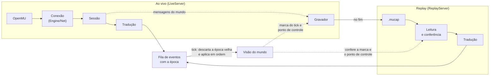
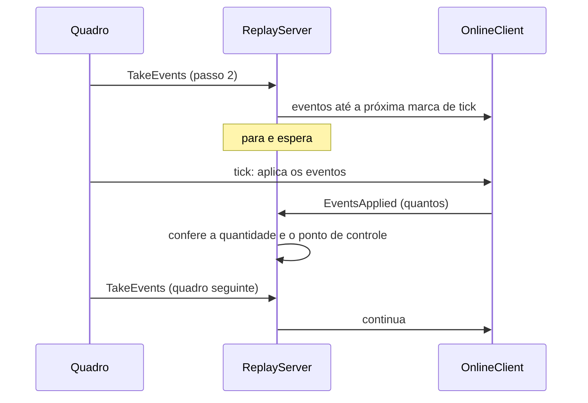

# Plano da fatia 2: A gravação e o replay

## Resumo para o dono

Primeiro vêm as decisões e as peças pequenas: o ADR do adaptador, a trava dos `NOLINT` e duas funções da engine (o arquivo inteiro e o FNV-1a). Depois, o cliente online passa a usar o adaptador, e a época entra nos eventos, sem mudar nada do que a fatia 1 faz. Em seguida vêm o formato `.mucap`, a gravação e o replay, cada um com os seus testes. No fim, eu gravo uma sessão de verdade no OpenMU local, ela vira a gravação de referência, e você faz o teste.

## Abordagem

1. **O ADR 0035**, com as decisões 1 e 3 da spec: o contrato do adaptador de servidor, as duas implementações, a época nos eventos, os comandos na parte 2 do M2, a gravação e o replay no módulo MU (e não em `Tools/CaptureReplay`) e só no build de desenvolvimento.
2. **Os `NOLINT`** ([P-0015](../../docs/PROPOSALS.md), trava `scripts/checks/`):
   - a checagem `cpp-rules` exige a regra entre parênteses e um comentário com o motivo na linha de cima de cada `NOLINT`, `NOLINTNEXTLINE` e `NOLINTBEGIN`;
   - o `pr_summary.py` lista cada linha nova com `NOLINT` em qualquer arquivo fora de `.md`, inclusive em `Tools/` (o modelo do `packetgen` é Python);
   - o segundo `NOLINTNEXTLINE` de `Engine/Debug/Private/Profiler.cpp` ganha uma linha de motivo própria, porque hoje a linha de cima dele é código.

   Os testes ficam em `scripts/checks/tests/`. A mudança na trava pede a confirmação na hora, além do "sim" da spec.
3. **As peças da engine**, sem nada do MU:
   - `Engine/Core`: o FNV-1a de 64 bits, com os valores de teste publicados do algoritmo;
   - `Engine/Platform`: `ReadFileBytes(caminho, limite)`, que confere o tamanho antes de ler, e `WriteFileBytes(caminho, bytes)`, as duas pelo SDL, que já lida com os caminhos em UTF-8 no Windows.
4. **O adaptador de servidor** (`Mu/Online/ServerAdapter.hpp`). O contrato:
   - `Start(now)`;
   - `TakeEvents(now, events)`, o passo 2 do quadro, que põe os eventos traduzidos na fila, cada um com a época;
   - `AdvanceClock(now)`, o passo 3;
   - `EventsApplied(view, count, now)`, chamado depois de cada tick que tirou eventos da fila;
   - `CurrentEpoch()`, `Status()` e `Summary(now)`.

   O `LiveServer` junta as peças de hoje: o `Transport`, a `Session` e o `Translator`. O `OnlineClient` fica só com a fila de eventos, a visão do mundo e o tempo pedido no mundo, e usa só o contrato. Os testes da fatia 1 passam a montar o `LiveServer`, com as mesmas conferências. Um adaptador de teste prova que o cliente não sabe de onde vêm os eventos.
5. **A época nos eventos** ([TD-0037](../../docs/TECH_DEBT.md)). A fila (`Mu/World/EventQueue`) guarda cada evento com a época. A tradução recebe a época da mensagem. No tick, o `OnlineClient` descarta e conta os eventos de uma época mais velha que a do adaptador. A visão do mundo continua sem saber de época.
6. **O formato `.mucap`** (`Mu/Recording/Recording.hpp`, área nova): a escrita num espaço reservado e a leitura que confere tudo antes de devolver a gravação, com as recusas do CA-03. Os testes fixam os bytes de uma gravação pequena, e cada recusa confere o motivo, com a sabotagem nas conferências de tamanho e de ordem ([CONVENTIONS](../../docs/CONVENTIONS.md#testes)).
7. **A impressão do estado** (`Mu/Recording/StateDigest.hpp`), com os campos da seção "O formato `.mucap`" abaixo. Cada objeto e cada item do inventário tem a impressão própria, e as impressões são somadas. Assim, a ordem da tabela não importa, e nenhuma memória é pedida para ordenar.
8. **O gravador** (`Mu/Recording/Recorder.hpp`). O `LiveServer` avisa o gravador da entrada no mundo, de cada mensagem do mundo antes da tradução e de cada mudança de época. O `EventsApplied` grava a marca do tick e, a cada 5 segundos, o ponto de controle. O fim é gravado quando o cliente termina, e o arquivo é escrito pelo `MuClient` depois do último quadro.
9. **O replay** (`Mu/Online/ReplayServer.hpp`), a segunda implementação do contrato. Ele entrega os registros cujo tempo já passou desde o começo do replay. Quando chega a uma marca de tick, para e espera o `EventsApplied` seguinte. Nesse momento, confere a quantidade de eventos e, se o registro seguinte for um ponto de controle, a impressão. Só depois continua. Assim, o agrupamento por tick é o mesmo da sessão gravada, e uma mudança de época descarta os mesmos eventos. Os testes usam gravações montadas no próprio teste, com um relógio de teste.
10. **O fuzzing:** o alvo `muonline_recording` lê a gravação e, quando ela é válida, faz o replay inteiro, com um relógio que salta para o fim. As sementes são a gravação de referência e algumas gravações pequenas e inválidas.
11. **O `MuClient`:** as opções `--record`, `--server-version` e `--replay`, com as regras do CA-08. O `--record` escreve o cabeçalho logo no começo, para recusar um caminho ruim antes da conexão, e reescreve o arquivo inteiro no fim. O `--replay` lê e confere a gravação antes de abrir a janela. O código que liga as opções ao `MuClient` só compila com `NEXUM_AUTHORING`, como o `--capture`. Os testes do `MuClient` cobrem as recusas e o build de jogador.
12. **O quadro sem alocação:** o teste de alocação do quadro ganha um caso gravando e outro reproduzindo, com pontos de controle dentro dos 1.000 quadros.
13. **A gravação de referência.** Com o OpenMU 0.10.1 local (`tests/integration/openmu/compose.yaml`), eu gravo cerca de 20 segundos com a `test0`, e a `test1` entra e sai da visão. A senha entra pela entrada padrão, como nos testes da fatia 1. Antes do commit, eu confiro que a conta e a senha não aparecem no arquivo, além do nome dos personagens de teste. A gravação vai para `Games/MuOnline/Tests/Recordings/openmu-two-players.mucap`, e o `.gitattributes` marca o `.mucap` como binário. Dois testes a reproduzem nos 3 sistemas: um da biblioteca, sem relógio de parede, e um do `MuClient --replay`, no ritmo gravado.
14. **A integração:** o teste `openmu_muclient_records_and_replays`, em `tests/integration/openmu`, grava 20 segundos e reproduz a gravação. Ele roda só com o endereço do servidor configurado ([TD-0034](../../docs/TECH_DEBT.md)). A medição manual de 60 segundos fica no report.
15. **A documentação:** a ARCHITECTURE, a página nova `mu-recording` (com o formato byte a byte), a `mu-online`, a `mu-world`, a `platform`, a `core`, o `docs/setup/DEV.md`, o ADR 0035 e o TECH_DEBT.

## Alvos e módulos afetados

| Alvo do build | O que muda |
|---|---|
| `nexum_core` | o FNV-1a de 64 bits (`Nexum/Core/Fnv1a.hpp`), com os testes |
| `nexum_platform` | `ReadFileBytes` e `WriteFileBytes` (`Nexum/Platform/FileBytes.hpp`), com os testes |
| `MuOnline` | `Mu/Online`: o `ServerAdapter`, o `LiveServer`, o `ReplayServer` e o `OnlineClient` só pelo contrato. `Mu/World`: a fila com a época. `Mu/Translate`: a época na tradução. `Mu/Recording` (nova): o formato, a impressão do estado e o gravador |
| `MuClient` | as opções `--record`, `--server-version` e `--replay`, só no build de desenvolvimento, com os testes de execução |
| `muonline_tests` | os testes do adaptador, da época, do formato, da impressão, do gravador e do replay, e o replay da gravação de referência |
| `muonline_frame_allocation_tests` | os casos gravando e reproduzindo |
| `muonline_recording` (novo) | o alvo de fuzzing da leitura e do replay |
| `tests/integration/openmu` | o teste que grava e reproduz |
| `scripts/checks` (trava) | `cpp_rules_check.py` e `pr_summary.py`, com os testes |
| `nexum_debug` | só a linha de motivo do segundo `NOLINT` do profiler |

## O formato `.mucap`

Tudo em little-endian. Um texto é um byte com o tamanho, de 0 a 64, seguido de tantos bytes em UTF-8.

**Cabeçalho**

| Campo | Tamanho | Valor |
|---|---|---|
| marca | 8 | `4E 58 4D 55 43 41 50 1A` (`NXMUCAP` e o byte `1A`) |
| versão do formato | 2 | `1` |
| versão da impressão do estado | 2 | `1` |
| versão do Nexum | texto | a mesma do `--version` |
| versão do dialeto | texto | `20404` (`Mu/Protocol/Dialect.hpp`) |
| servidor | texto | o `--server-version`, ou `unknown` |

**Registros**, um depois do outro, cada um com o tipo (1 byte), o tamanho do conteúdo (4 bytes) e o conteúdo. O tempo é contado em microssegundos desde o começo da gravação, pelo relógio monotônico do quadro, e nunca diminui.

| Tipo | Registro | Conteúdo |
|---|---|---|
| 1 | entrada no mundo | tempo (8), época (4), id do herói (2) |
| 2 | mensagem | tempo (8), época (4), a mensagem decifrada como a sessão a entrega, de 3 a 65.535 bytes |
| 3 | mudança de época | tempo (8), época nova (4) |
| 4 | tick | tempo (8), eventos que o tick tirou da fila, aplicados ou descartados (4) |
| 5 | ponto de controle | tempo (8), mensagens desde o começo (4), impressão (8), objetos na visão (4), itens no inventário (4) |
| 6 | fim | tempo (8), como acabou (1): `0` o cliente fechou ou o tempo no mundo acabou, `1` a sessão falhou, `2` o espaço da gravação encheu |

**A leitura confere**, nesta ordem:

- o tamanho do arquivo (até 64 MiB, antes de ler);
- a marca, as duas versões e os textos;
- cada registro inteiro dentro do arquivo, com o tipo conhecido e o tamanho exato do tipo (a mensagem, de 15 a 65.547 bytes de conteúdo);
- o tempo que nunca volta;
- no máximo uma entrada no mundo, antes de qualquer mensagem, mudança de época ou tick (uma sessão que falhou antes do mundo grava só o cabeçalho e o fim);
- o ponto de controle logo depois de um tick, com a contagem de mensagens certa;
- um único fim, como último registro.

**A impressão do estado, versão 1.** É o FNV-1a de 64 bits sobre os campos, nesta ordem, cada número com o seu tamanho em little-endian:

1. o herói: carregado (1), id (2), mapa (2), posição (x e y), os 6 valores do `HeroStats` e os 4 do `HeroMaxima`;
2. a soma, módulo 2⁶⁴, das impressões de cada objeto na visão. Cada objeto entra com id, tipo, posição, destino, rotação, nome (o tamanho e os bytes), aparência (todos os campos, na ordem da declaração), número de efeitos e número do tipo;
3. a soma das impressões de cada item do inventário: o slot e todos os campos do item, na ordem da declaração;
4. a quantidade de objetos e a de itens (4 cada);
5. a contagem das mudanças do terreno (8) e a dos eventos ignorados (8).

A página `mu-recording` traz a lista campo a campo. Quando a visão do mundo mudar de forma (as entidades do M4, [TD-0029](../../docs/TECH_DEBT.md)), a impressão ganha uma versão 2, e o replay de uma gravação com a versão 1 diz isso claramente, em vez de acusar uma diferença.

## Visão de destino

- **O adaptador de servidor** ganha os comandos neutros com o andar (parte 2 do M2) e o ataque (M5). A troca de mapa (M4) e a reconexão (M7) mudam a época dentro do `LiveServer`, e a gravação já guarda essas mudanças. Um servidor diferente do OpenMU continua fora ([VISÃO](../../docs/VISION.md)), mas, se um dia entrar, ele seria outra implementação do mesmo contrato.
- **O `.mucap`** cresce por tipos de registro novos, com a versão do formato. A versão 2 traz os comandos do jogador. O cabeçalho já diz a versão do Nexum, a do dialeto e a do servidor, para uma gravação velha ser reconhecida.
- **O replay** é o mesmo quando a janela passar a mostrar o mundo: a visão 2D da parte 2 do M2 e o 3D do M3 e do M4 vão reproduzir sessões sem servidor. A pausa, a velocidade e o avanço tick a tick entram com o console do ImGui (IV.18). O inspetor de pacotes lê as mesmas mensagens que o gravador recebe.
- **A gravação** passa a ser escrita durante a sessão, por uma thread de escrita ou pelos workers do `Engine/Jobs`, e o relatório de falhas do M7 poderá levar a gravação junto.
- Nada disto fecha uma porta: o contrato não sabe de bytes nem de arquivo, e o formato tem versão desde o primeiro byte.

## Simplificações provisórias

| Item provisório | Por que é provisório | Destino |
|---|---|---|
| Os comandos do jogador não existem: nem no adaptador de servidor, nem no `.mucap` (a V.2.2 da spec de referência pede os dois) | ainda não há nenhum comando; o primeiro é o andar | M2, parte 2 |
| A gravação fica na memória, com até 16 MiB, e é escrita só quando o cliente termina. Um travamento perde a gravação, e uma sessão longa e cheia de gente pode passar do limite | escrever durante o quadro pediria uma thread de escrita; as sessões de hoje são curtas e com poucos objetos | M4 |

## Decisões e dependências

- **ADR novo:** o 0035, o adaptador de servidor e o lugar da gravação e do replay (decisões 1 e 3 da spec).
- **Bibliotecas externas novas:** nenhuma. A leitura e a escrita de arquivos usam o SDL, que já é do `Engine/Platform`, e o FNV-1a é escrito à mão.
- **Formatos da engine:** o `.mucap` versão 1, novo (decisão 2 da spec), descrito acima.
- **Contrato de rede:** não muda. Os bytes trocados com o OpenMU são os mesmos da fatia 1.
- **Travas:** só a `scripts/checks/` (o `cpp_rules_check.py`, o `pr_summary.py` e os testes deles), pela [P-0015](../../docs/PROPOSALS.md). Nenhuma outra: o alvo novo de fuzzing entra na lista que a CI já lê da pasta de build, e o `.gitattributes`, a pasta `Games/MuOnline/Tests/Recordings` e o teste de `tests/integration/openmu` não são travas.
- **Docker:** a imagem do OpenMU 0.10.1, fixada pela impressão digital, já está no computador do dono. Se ela tiver sumido, eu peço antes de baixar.

## Fontes da central usadas

Nenhuma: a fatia não implementa comportamento do MU. O formato `.mucap`, a gravação, o replay e o adaptador são do próprio Nexum: a V.2.2, a IV.18, a III.8 e o item 5 da D-10 da [spec de referência](../../docs/referencia/especificacao-engine-propria-caminho-b.md). A tradução que o replay usa é a da fatia 1, e as fontes dela estão no [plano da fatia 1](../0001-rede-ate-o-mundo/plan.md#fontes-da-central-usadas). As mensagens da gravação de referência vêm do OpenMU 0.10.1 sem modificações, a mesma imagem do teste da fatia 1.

## Suficiência das descrições

Não se aplica: a fatia não reproduz nenhum comportamento do original.

Perguntas abertas para a central: nenhuma

## Riscos

- **O replay divergir da sessão gravada só pelo ritmo dos quadros.** Ao vivo, um quadro pode ter nenhum tick ou vários, e o replay roda em outro ritmo. A marca de cada tick e a parada do replay em cada marca fazem o replay aplicar os mesmos grupos de eventos. Os testes com gravações montadas cobrem um quadro sem tick, um quadro com vários ticks, um tick sem eventos e uma mudança de época entre a tradução e o tick.
- **A gravação de referência ficar velha.** Uma mudança legítima na tradução ou na visão do mundo muda a impressão, e o replay acusa a diferença, que é o trabalho dele. Nesse caso, a mensagem diz qual tick ou ponto de controle mudou, e a gravação é refeita contra o OpenMU local, em poucos minutos. Uma versão nova da impressão é dita como tal, e não como diferença.
- **Dados sensíveis na gravação de referência.** O gravador nunca vê o que o cliente envia e começa só na entrada no mundo. Um teste confere que a conta e a senha não aparecem no arquivo. Antes do commit, a gravação real passa pela mesma conferência.
- **Quebrar o que a fatia 1 faz ao mudar o cliente online para o contrato.** Os testes da fatia 1 continuam lá, sem perder nenhuma conferência, e o teste de integração contra o OpenMU roda de novo.
- **O teste do `MuClient --replay` tomar tempo da CI.** Ele roda no ritmo gravado, e a gravação de referência tem uns 20 segundos de propósito. O replay rápido fica no teste da biblioteca.
- **A trava nova recusar o código de hoje.** O segundo `NOLINT` do profiler ganha a linha de motivo na mesma tarefa, e os testes da checagem passam pelos três `NOLINT` que existem.
- **Um arquivo binário no repositório.** A gravação de referência é pequena (menos de 100 KB, a conferir), o `.gitattributes` a marca como binária, e o conteúdo é só do OpenMU.

## Testes

| Critério | Como é provado |
|---|---|
| CA-01 | testes `[0002-CA-01]` do `OnlineClient` com um adaptador de teste, e os testes da fatia 1 do cliente online, agora montando o `LiveServer`, em `Games/MuOnline/Tests` |
| CA-02 | testes `[0002-CA-02]` da fila com a época e do descarte no tick, com a sabotagem registrada no commit |
| CA-03 | testes `[0002-CA-03]` do formato: os bytes fixos de uma gravação pequena, a ida e a volta e cada recusa com o motivo exato |
| CA-04 | testes `[0002-CA-04]` do gravador com um transporte de teste: os registros, os pontos de controle a cada 5 s, a conta e a senha ausentes do arquivo, o espaço cheio e o caminho ruim recusado |
| CA-05 | testes `[0002-CA-05]` do replay com gravações montadas e um relógio de teste: o ritmo, o agrupamento por tick, as diferenças de eventos e de impressão com a mensagem certa, o fim e a repetição |
| CA-06 | testes `[0002-CA-06]` do FNV-1a com os valores publicados e da impressão: a ordem que não importa e cada campo que importa |
| CA-07 | o teste `[0002-CA-07]` da biblioteca com a gravação de referência e o teste `muclient_replays_the_reference_recording` do CTest, nos 3 sistemas |
| CA-08 | testes `[0002-CA-08]` do `ClientOptions` e os testes de execução do `MuClient`: as combinações recusadas, o build de jogador e a gravação inválida |
| CA-09 | o teste das sementes `muonline_recording_seeds` nos 3 sistemas e o passo "Fuzzing" da CI |
| CA-10 | os casos `[0002-CA-10]` de `Games/MuOnline/Tests/FrameAllocationTest.cpp` |
| CA-11 | os testes de `scripts/checks/tests/test_cpp_rules_check.py` e `test_pr_summary.py`, e a checagem `cpp-rules` em todo `verify` |
| CA-12 | o teste `openmu_muclient_records_and_replays` (etiqueta `openmu`) e a verificação manual de 60 s, registrados no report |
| CA-13 | verificação manual no fechamento e as checagens `docs` e `structure` em todo `verify` |

## Diagramas

O replay para em cada marca de tick até o tick seguinte aplicar os eventos:

